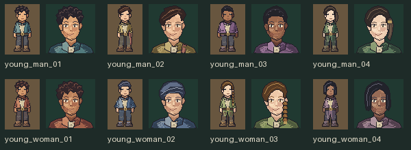
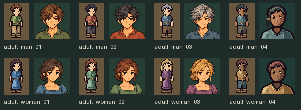
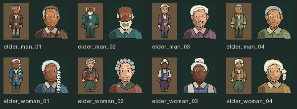
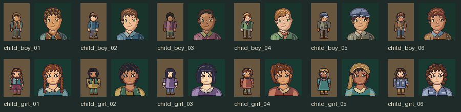
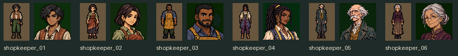

# Standard NPC idle roster

48 reusable designs: 24 everyday adults, 12 children, 6 innkeepers and 6 shopkeepers. Each design has four native 48×72 directional idles with transparent backgrounds and one matching 72×72 dialogue portrait.

Adult designs share a 34-world-pixel standing height across age groups. The children share a 26-world-pixel standing height at the same foot registration. Canvas dimensions remain 24×36 logical; each folder records the draw and foot anchors separately.

This is a reusable idle asset bank. No active map placements, scripts, services, movement banks or named characters were replaced. The six legacy civilian designs retain their portrait art and identity.

The images below use native front idles and portraits, without rescaling. Each linked design folder contains all four directions and its metadata.

## Young adults

[young_man_01](young_man_01/) · [young_man_02](young_man_02/) · [young_man_03](young_man_03/) · [young_man_04](young_man_04/)

[young_woman_01](young_woman_01/) · [young_woman_02](young_woman_02/) · [young_woman_03](young_woman_03/) · [young_woman_04](young_woman_04/)

## Adults

[adult_man_01](adult_man_01/) · [adult_man_02](adult_man_02/) · [adult_man_03](adult_man_03/) · [adult_man_04](adult_man_04/)

[adult_woman_01](adult_woman_01/) · [adult_woman_02](adult_woman_02/) · [adult_woman_03](adult_woman_03/) · [adult_woman_04](adult_woman_04/)

## Older adults

[elder_man_01](elder_man_01/) · [elder_man_02](elder_man_02/) · [elder_man_03](elder_man_03/) · [elder_man_04](elder_man_04/)

[elder_woman_01](elder_woman_01/) · [elder_woman_02](elder_woman_02/) · [elder_woman_03](elder_woman_03/) · [elder_woman_04](elder_woman_04/)

## Children

[child_boy_01](child_boy_01/) · [child_boy_02](child_boy_02/) · [child_boy_03](child_boy_03/) · [child_boy_04](child_boy_04/) · [child_boy_05](child_boy_05/) · [child_boy_06](child_boy_06/)

[child_girl_01](child_girl_01/) · [child_girl_02](child_girl_02/) · [child_girl_03](child_girl_03/) · [child_girl_04](child_girl_04/) · [child_girl_05](child_girl_05/) · [child_girl_06](child_girl_06/)

## Innkeepers

[innkeeper_01](innkeeper_01/) · [innkeeper_02](innkeeper_02/) · [innkeeper_03](innkeeper_03/) · [innkeeper_04](innkeeper_04/) · [innkeeper_05](innkeeper_05/) · [innkeeper_06](innkeeper_06/)

## Shopkeepers

[shopkeeper_01](shopkeeper_01/) · [shopkeeper_02](shopkeeper_02/) · [shopkeeper_03](shopkeeper_03/) · [shopkeeper_04](shopkeeper_04/) · [shopkeeper_05](shopkeeper_05/) · [shopkeeper_06](shopkeeper_06/)

