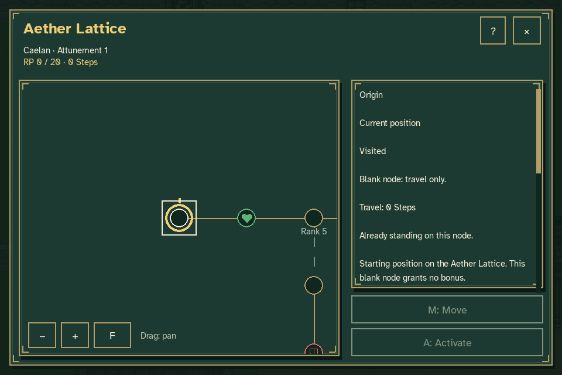
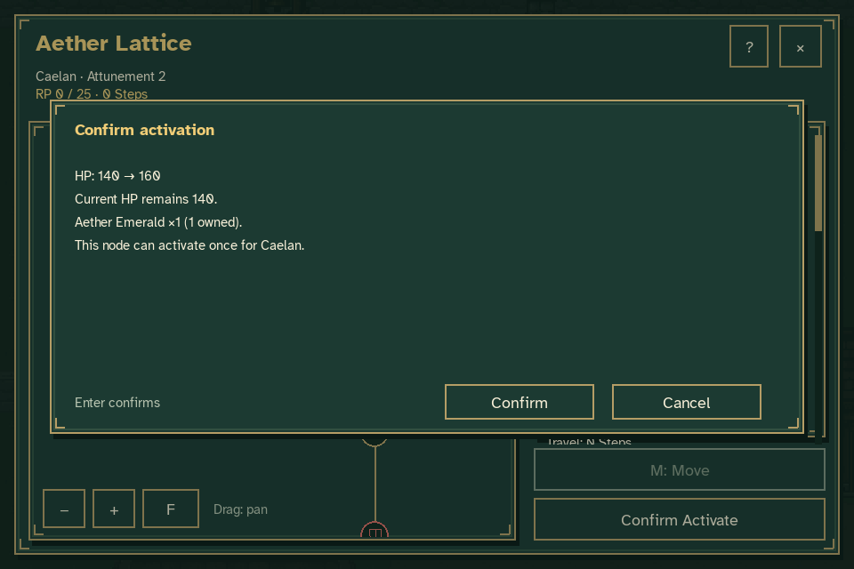
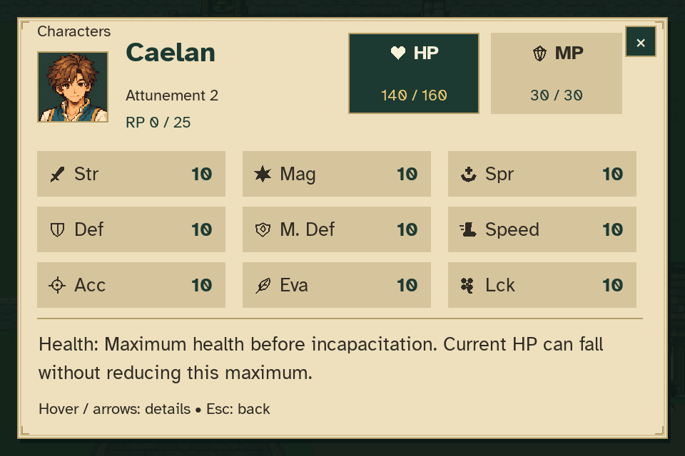
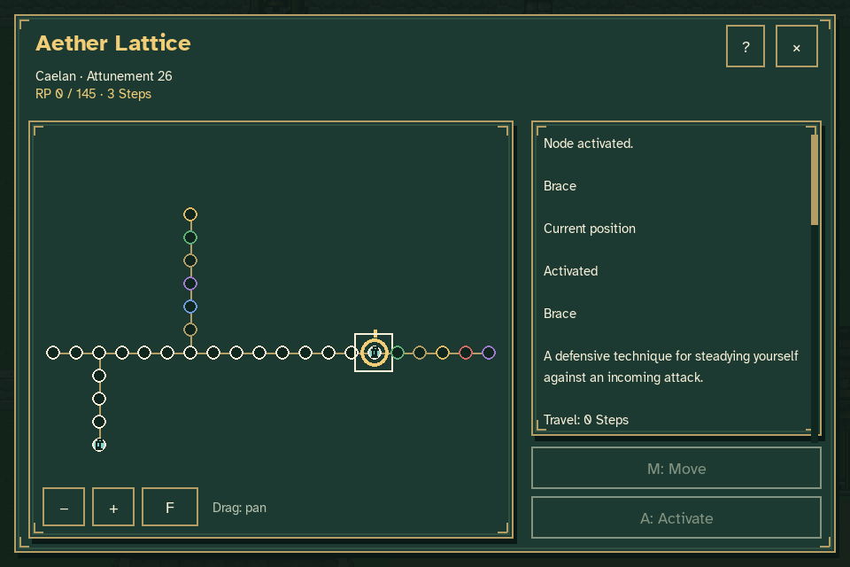
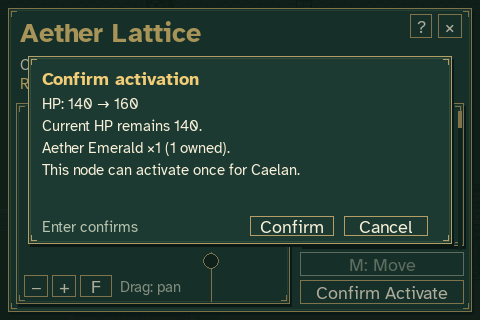

# Aether Lattice review

The production menu is **Pause → Aether Lattice**. Normal New Game starts
Caelan at Attunement 1, zero RP, zero Steps and no crystals. These captures use
separate temporary journeys and the real reward interface to demonstrate the
complete progression flow while the battle controller remains future work.

To review the first rank gain and HP node interactively:

```sh
python tools/preview_aether_lattice.py
```

For a larger temporary allowance:

```sh
python tools/preview_aether_lattice.py --rp 500 --crystals 10
```

Neither command reads or overwrites the player's normal journey or settings.
Reproduce all screenshots and their verification records with:

```sh
python tools/capture_aether_lattice.py
```

## Starting view and board



[Fit the entire 30-node board](lattice_initial.png). The main route and two
side branches include blank nodes, all eleven stat types, Brace and Mend,
and connections requiring Attunement 5 and 8.

## First activation

| Operation | Result |
| --- | --- |
| Award 20 RP and one Emerald | Attunement 2, one available Step. |
| Confirm travel to HP +20 | One Step spent; Attunement remains 2. |
| Confirm activation | One Emerald consumed; maximum HP rises from 140 to 160. |
| Inspect resources | Current HP remains 140; base HP remains 140. |
| Continue twice | Rank, spent movement, crystal consumption and the bonus remain unchanged. |





See [travel confirmation](lattice_move_confirmation.png),
[activated HP node](lattice_hp_activated.png) and
[after Continue](lattice_after_continue.png).

## Branches, blank nodes and abilities

The richer review fixture awards 2000 RP and three of each crystal through
the same reward API. It demonstrates travel through unactivated and blank
nodes, the gated branch, learning Mend, returning to the main route and
learning Brace. Only the two ability nodes are activated in that fixture.



- [Locked Attunement connection](lattice_rank_gate.png)
- [Blank-node travel](lattice_blank_travel.png)
- [Mend learned](lattice_mend_learned.png)
- [Crystal stock and known abilities](lattice_known_abilities_and_crystals.png)

Caelan's basic magicks remain a starting capability. This implementation
records learned techniques; their combat execution belongs to the battle
system. Existing opening-quest spell outcomes remain intact.

## Minimum window and enlarged text



The confirmation shows the stat change, unchanged current HP, crystal cost
and owned quantity before committing. Additional captures cover
[large text](lattice_large_text.png),
[minimum-window details](lattice_small_large_text.png) and
[scrollable controls help](lattice_controls_small_large.png).

## Verification

The [capture metadata](verification.json) records 17 screenshots, seven
confirmed operations and two Continue round trips. Captures use production
keyboard/menu input and real Move/Activate confirmations. Cursor inspection
does not spend movement or crystals.

Focused tests cover rank overflow, backtracking costs, permanent rank gates,
wrong and missing crystals, duplicate battle callbacks, independent character
ownership, failed checkpoint retries, base-versus-derived attributes,
older-save migration, malformed traversal records and modal input. The
reference is [docs/AETHER_LATTICE.md](../../AETHER_LATTICE.md).
