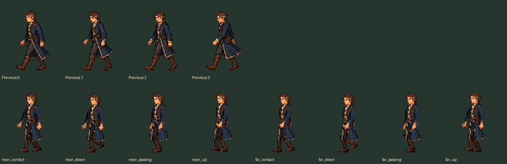
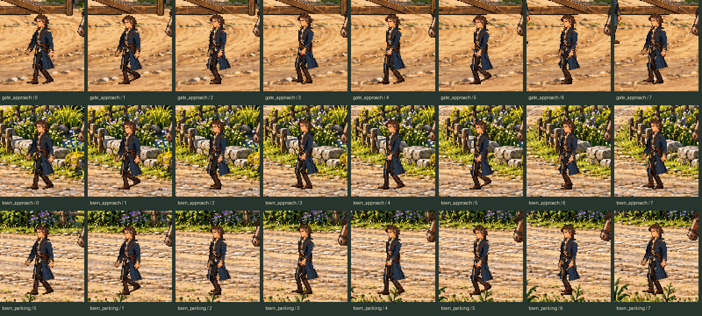

# Aldric: side-walk correction

[Production scene clip](in_scene.mp4) · [Pose loop](walk.gif)





## Changes

- Replaced the similar extended-stride drawings with contact, weight-settle,
  passing and rise poses for each leg.
- Opposing arm swing, softly bent elbows and consistent limb lengths.
- Exact retained head pixels, stable torso registration, one-pixel body motion
  and restrained coat follow-through.
- Fixed pelvis/root registration, rather than recentering each frame on boot
  pixels; 32-pixel full stride driven by ground distance at each scene's speed.
- The aerial reference translates both movement endpoints so the same cadence
  continues into the gate shot. Rear loops and all other actors are unchanged.

The new source is offline part-authored from retained appearance art, not a new
imagegen export. Original generations, other actor images, portraits, rear views,
quest staging and music are unchanged.

## Production capture

The silent 30 fps video contains the three side-walking shots, joined in order;
it is **not** presented as an uninterrupted full cinematic. The game progresses
from an acknowledged MQ02 report through normal input/update/draw, without
assigning cinematic phases, clocks or actor positions. Earlier quest completion
is the documented test fixture. It reaches the ordinary ending with MQ03
available, not accepted; exploration remains frozen during playback.

[Capture report](capture_report.json) records 422 video frames, all eight side
poses in every walking shot, render-input hashes and actual actor traces.

## Reproduce

Use the existing asset-tool environment:

```sh
python tools/build_aldric_side_walk.py
python tools/build_regent_arrival_actors.py
python tools/build_aldric_side_walk.py --check
python tools/build_regent_arrival_actors.py --check
PYTHONPATH=tests python -m unittest test_aldric_side_walk test_regent_arrival test_regent_arrival_staging
python tools/capture_aldric_side_walk.py
```

The side-walk tests check decoded pixels, head stability, fixed limb lengths,
alternating support and swing, modest foot clearance, authored-keyframe support
placement, protected original hashes and the actual aerial reference path.
Keyframe support placement does not imply zero sub-frame raster sliding.
The existing arrival, aerial, quest and Gallery tests cover lifecycle behavior.

## Verification

- **220 tests passed** in 94.405 seconds: side walk, arrival, staging, MQ03,
  aerial visuals/audio, Gallery catalogue/UI/session, music integration and saves.
- All 21 dedicated side-walk tests pass, including the real negative-time
  aerial reference regression (reproduced before the endpoint-translation fix).
- Both authoring and arrival-export check modes pass (eight poses and 74 exports).
- All 73 protected original/non-side asset hashes match; edited Python files
  have no editor diagnostics and the whitespace check passes.
- Independent static art and code reviews found no remaining blocker. Dynamic
  acceptance evidence is the production capture and frame/position trace, not
  a claim of continuous physical foot locking.