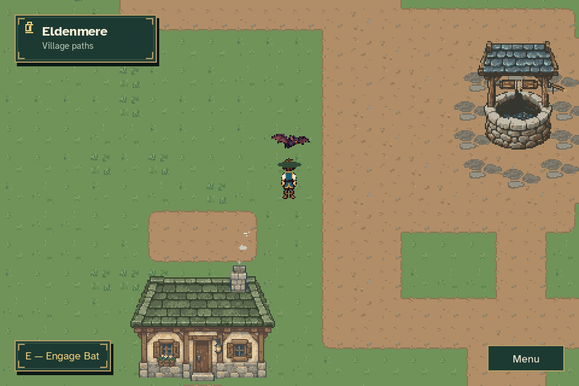
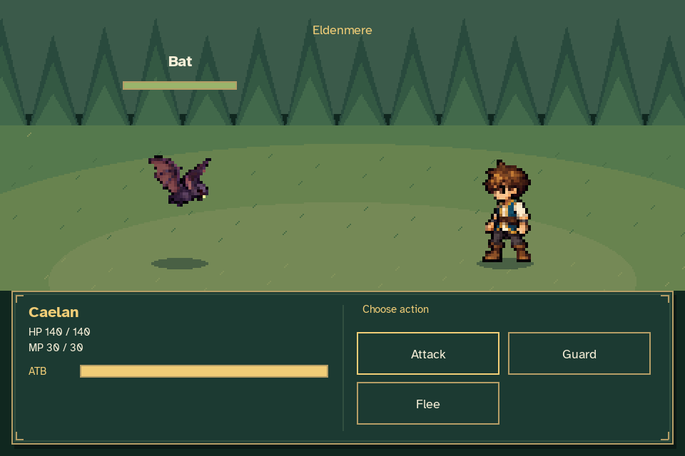
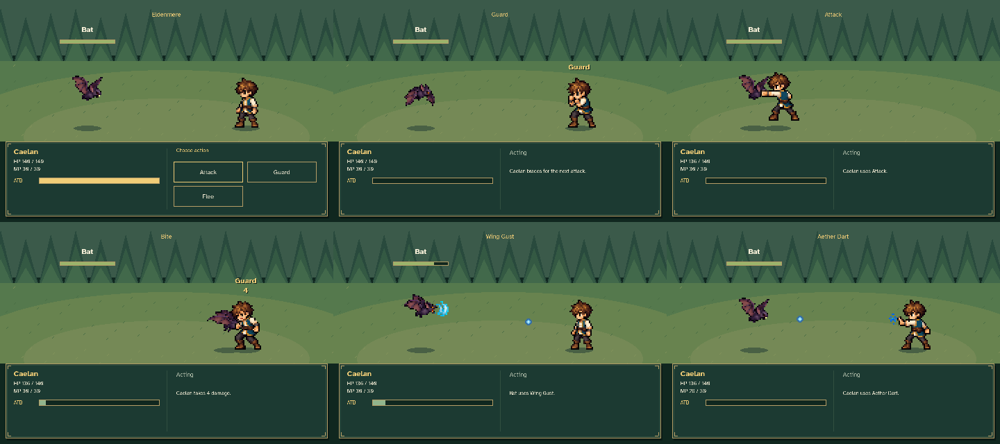
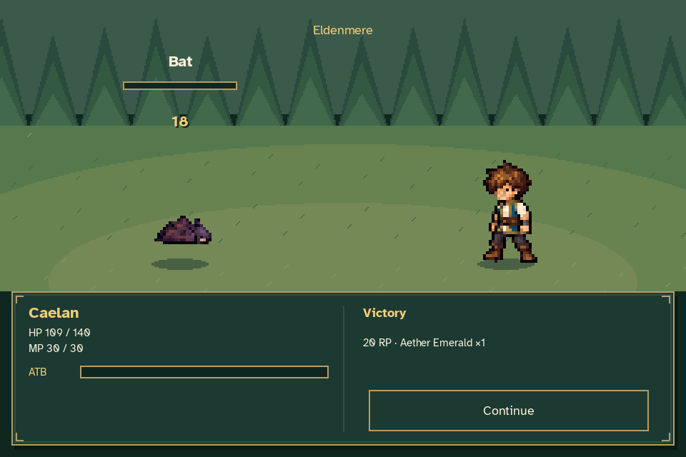
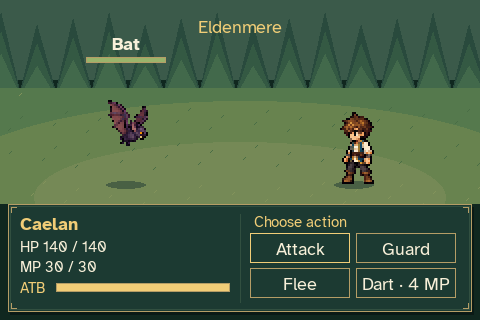
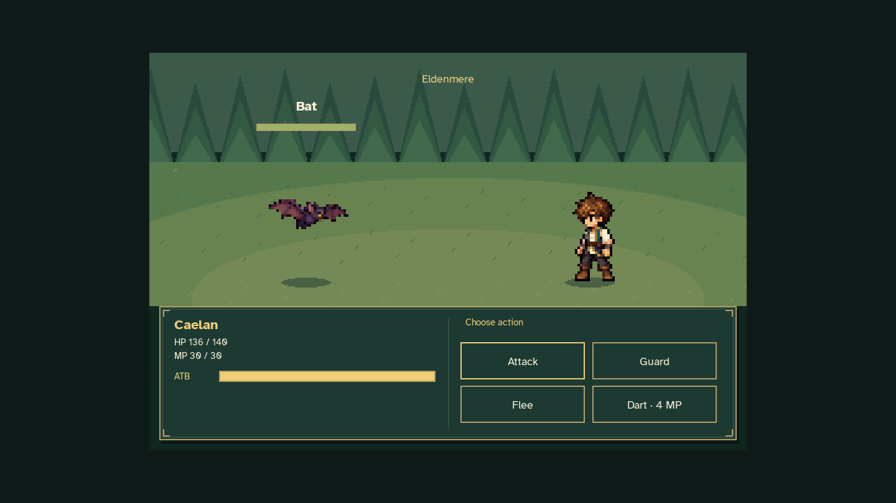

# Eldenmere Bat combat preview

This capture uses the actual game, battle model, combat sprites and interface.
The Bat hovers on the grass west of the well at world position **336, 900**.
Approach it and press **E** when **Engage Bat** appears to enter the separate
battle scene. Walking nearby does not start the encounter automatically.




Caelan's name, HP, MP and ATB appear in the compact bottom panel. The enemy has
its own gauge, but that gauge is never displayed. When Caelan is ready, **all
gauges pause** while the player chooses. The capture holds that ready state for
three seconds and verifies that both ATB values remain exactly unchanged.

The GIF samples decision and action stages, omitting several charging intervals.
The underlying simulation and the pause check run at sixty updates per second.



The first battle uses Caelan's normal starting attributes and resources. It
shows Attack, Guard, Bat Bite, Wing Gust, hit reactions and victory. Guard
reduces the next incoming action. An affordable learned **Aether Dart** appears
as a fourth command and costs four MP; it does not become available just by
entering combat. A separate temporary review journey learns it through the
real lattice before capturing its casting animation.



Victory grants **20 RP and one Aether Emerald** when Continue returns to the
world. The capture verifies the resulting rank 2, one available Lattice Step,
one Emerald, saved HP/MP and durable checkpoint, without awarding twice.
World time, the player's position and NPC positions remain frozen throughout
the battle. Flee commits the battle's current HP/MP and grants no rewards.
Defeat returns with pre-battle resources in this first encounter prototype.
The Bat returns after a short cooldown for repeated testing.



The compact UI also fits the minimum **480×320** window with **150% text**.
The capture executes Guard there and executes Dart with a real mouse click in
a **1440×810** letterboxed window.





The review owns temporary journey and settings files; it never opens or writes
the player's ordinary files. Camera/player placement and a seeded battle RNG
are capture fixtures. Battle entry, command selection, animations, timing,
damage, resource costs and result acknowledgement use normal production input
and update paths. Pillow only assembles the rendered frames into the GIF and
contact sheet; it does not alter the game artwork.

Reproduce with:

```sh
python tools/capture_combat.py
```

Rendered frames and [verification data](verification.json) are written to
`work/atb-combat`. The metadata records the two disposable fixtures, actions,
ready-time gauge checks, resource/reward results and animation timeline.
