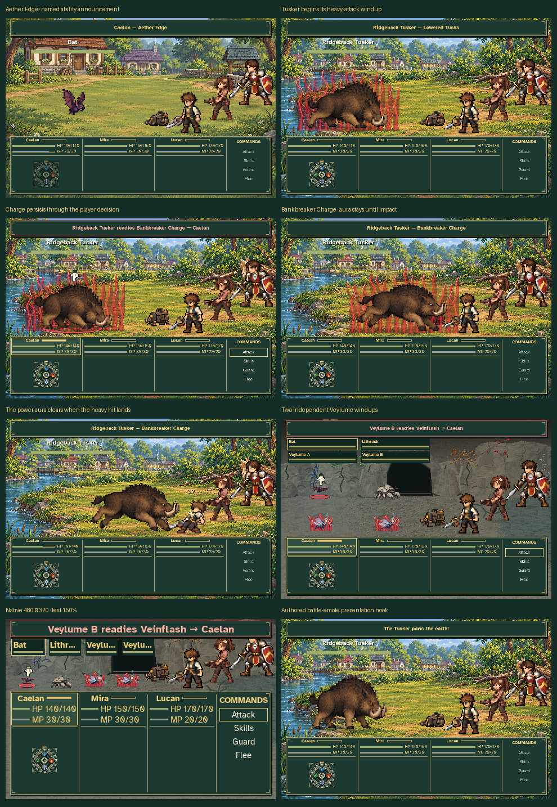
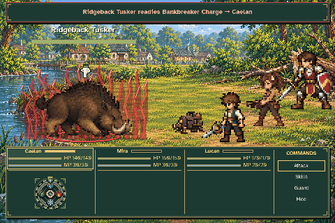
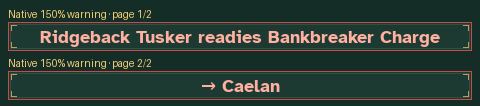

# Battle announcements and charged-attack feedback

These captures use the production `Game`, `BattleModel` and `BattleScene`.
NPC action scheduling and ATB are explicit disposable review fixtures; no player
journey or settings are read or changed. The two-Veylume formation is a visual
stress fixture, not an addition to the cave's random-encounter roster. The
illustrative Tusker emote exercises the presentation hook without adding story
dialogue or a new combat mechanic.







The eight screenshots cover a named Aether Edge, the start of Lowered Tusks,
the held Bankbreaker Charge warning during a player decision, release before
impact, aura removal after impact, two simultaneous Veylume charges, minimum
480 × 320 rendering with 150% text, and an authored battle-emote announcement.
Basic Attack omission is checked separately by the capture tool.
The supplementary strip shows every page of a long Tusker warning at native
150% text size, keeping the full message available without shrinking the font.
Its actual rendered page text is recorded and checked so the target arrow
stays with the target's name and every word remains available.

The GIF contains sixteen successive production-rendered frames at 90 ms scene
intervals. Its red lightning/flame effect is drawn behind the enemy with sparse
foreground arcs; the actual sprite and target finger remain visible. The
presentation clock advances while the model waits for player input. There is
no inserted artwork, synthetic overlay or audio in this review.

`verification.json` records the current announcements, live warnings, charged
enemy identities, body/aura/announcement bounds and display settings. The tool
checks that announcements avoid enemy status cards, aura bounds remain above
the combat HUD, and charge identities match each staged model state.

Reproduce from the repository root:

```sh
SDL_VIDEODRIVER=dummy SDL_AUDIODRIVER=dummy \
  python tools/capture_battle_feedback.py
```

Use `--output /tmp/battle-feedback-review` for a disposable alternative output
directory. The usual Pillow-based asset-tool environment is sufficient.
