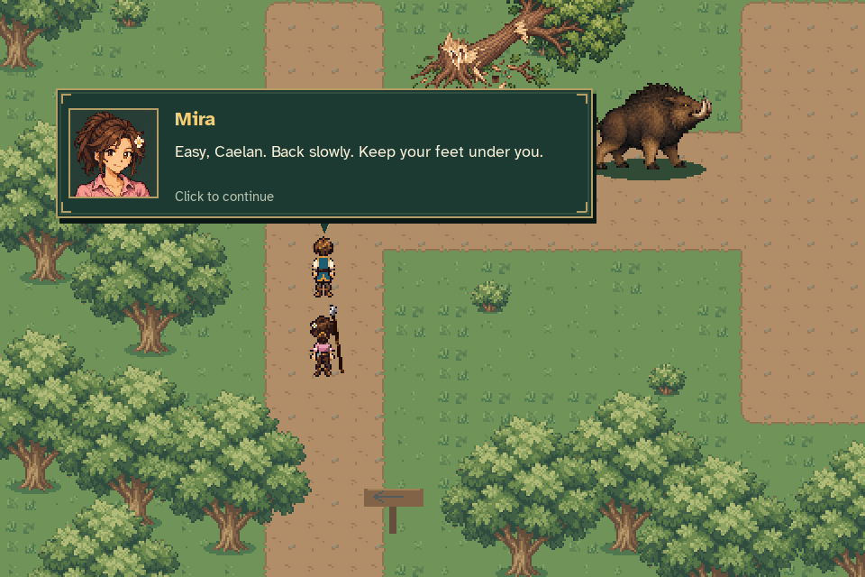
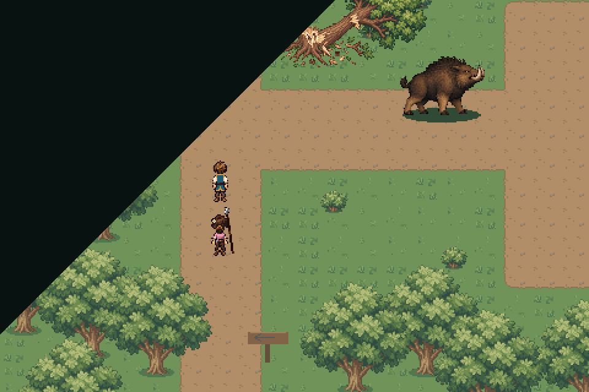
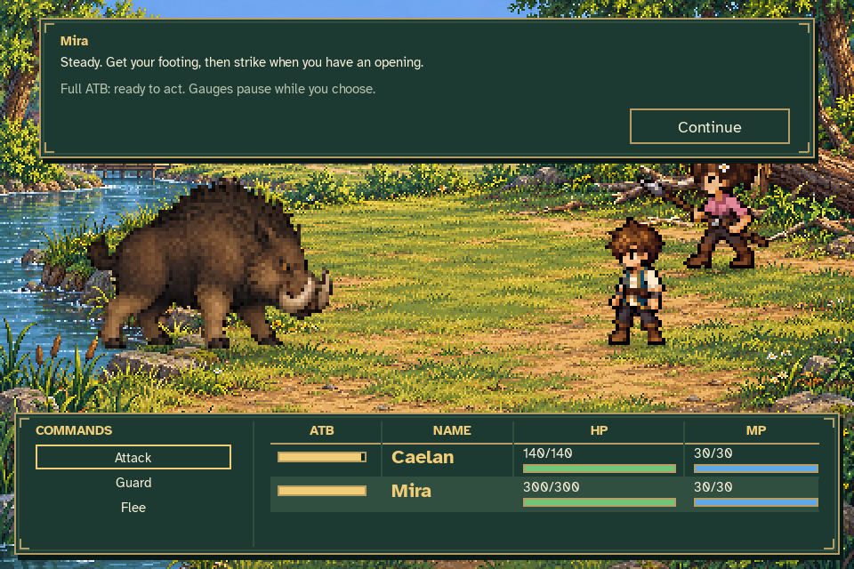

# User music and battle-entry review

[Watch the recorded scene with music](battle_music_transition.mp4).

The production game shows Mira's warning, starts the supplied **Kindled Courage**
track on “Easy, Caelan. Back slowly. Keep your feet under you,” then closes a
brief curtain over the actual world before revealing the riverbank battle.
The same music stream continues through entry, ATB decisions and guidance.
Mira demonstrates a spear thrust; Caelan withdraws through the real Flee command,
returning to the safe approach and the supplied **Eldenmere Theme**.





Video frames are captured directly from the game at 960×640 and 30 FPS. Because
SDL's headless audio device cannot provide loopback recording, the MP4 soundtrack
is reconstructed offline from the exact runtime OGGs and observed production
mixer load/play/volume/pause commands. It includes the real controller's fade and
duck levels; effects are muted so the music can be reviewed clearly.

The disposable journey seeds completed MQ01 through public quest APIs. Existing
test helpers place actors at the prelude interaction stations, play MQ02's
reunion, diagnosis and departure, and then walk the actual upstream approach.
Captured dialogue, commands, transition, battle clocks and return are production
behavior. No ordinary journey or settings file is used.

The [verification record](verification.json) includes the cue time, music and
mixer events, per-frame frozen-clock checks, source hashes and safe withdrawal.
It verifies that the battle track starts once on Mira's page and does not
restart when the battle opens.

Reproduce with:

```sh
python tools/capture_battle_music_transition.py --output work/battle-music-transition
```
