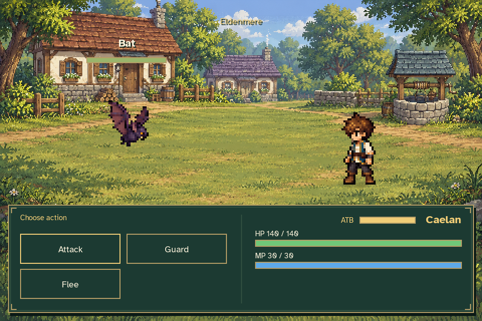
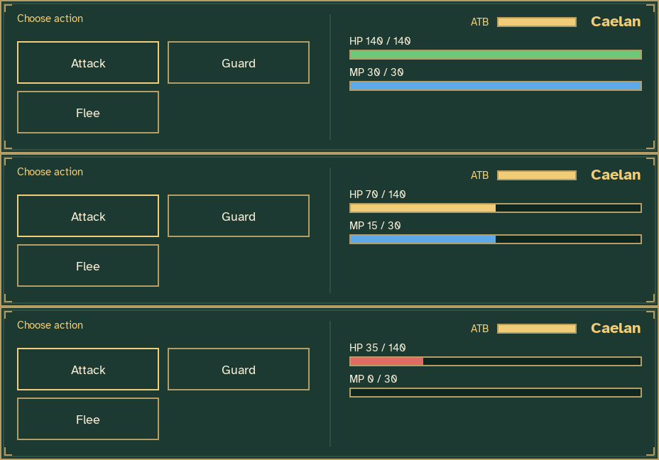
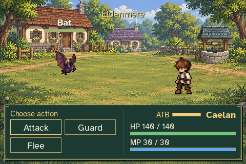
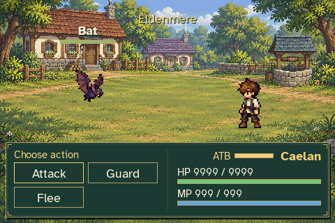

# Right-side party status

The bottom battle panel now matches the party's position on the battlefield:
party status appears on the right, with commands and results on the left.



A compact 56×7 yellow ATB gauge sits immediately left of Caelan's name. HP and
MP bars sit beneath his name, with resource labels and current/max numbers.
The HP bar is green above 50%, yellow above 25% through 50%, and red at 25%
or below. MP is blue. ATB remains yellow while charging and when full.



These three panels are cropped directly from rendered game frames. Their HP
and MP values are explicit display fixtures, rather than recorded battle
damage or changes to the player's saved attributes.





Validation: all 30 focused status, scene and gameplay tests passed. They cover
HP threshold boundaries, proportional and empty bars, zero MP capacity,
yellow ATB, HP9999/MP999 labels, left-side commands/results and supported
window/text sizes. Independent visual review covered these images plus the
four-command minimum window, letterboxed battle and victory result.

The full production capture also verified ready-state ATB pause, actions,
resource costs, reward settlement and return to Eldenmere with the relocated
command buttons. Both capture tools use disposable journeys and settings.

Reproduce with:

```sh
python tools/capture_battle_status.py --output work/battle-status
python tools/capture_combat.py --output work/battle-status-gameplay
```

[Status fixture metadata](status_verification.json) describes the selected
images. [Gameplay verification](gameplay_verification.json) records the full
combat capture; its other screenshots and GIF are generated in the second
output directory above.
