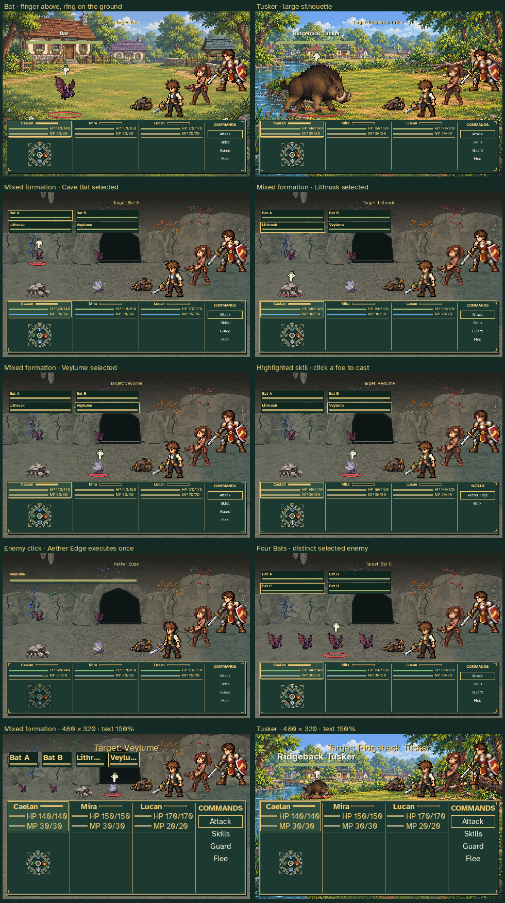

# Battle target pointer and direct enemy clicks

The production battle view now marks the selected enemy with an original
downward-pointing pixel glove and a static red ground circle. The circle is
drawn behind the sprite; the hand sits above its occupied bounds. Flying
enemies keep their circle on the same ground plane as their shadow. Enemy
status cards retain their selected-row border; the old sprite-outline selector
is removed.

While a party member is ready, clicking a living enemy's sprite or status card
executes the highlighted attack or offensive skill against that enemy. A skill
can be highlighted in Skills and cast directly by clicking the foe. Existing
keyboard confirmation and the group target menu remain available. Hovering
changes the target without spending resources. Support skills, disabled skills,
fallen enemies, paused scenes and unavailable turns do not become attacks.

These are **disposable review fixtures**, with an explicitly readied party and
authored enemy formations. They do not claim gameplay-earned levels or rewards
and do not read or write a player's journey. Rendering and the demonstrated
enemy-click skill cast use the actual Game and BattleScene implementations.



The captures cover:

- A single Bat and the larger Ridgeback Tusker.
- Each species in a four-enemy mixed cave formation, and four distinct Bats.
- A highlighted Aether Edge followed by a click that casts it on Veylume,
  spends 4 MP once, and hides the selector during execution.
- The minimum 480 × 320 window with 150% text for mixed enemies and Tusker.

The capture tool checks that the hand clears the target body and enemy headers,
both markers remain above the combat HUD, and the click executes the selected
skill against the selected enemy. Geometry and explicit fixture details are
recorded in [verification.json](verification.json).

Reproduce from the repository root:

```sh
SDL_VIDEODRIVER=dummy SDL_AUDIODRIVER=dummy \
  python tools/capture_battle_targeting.py
```
