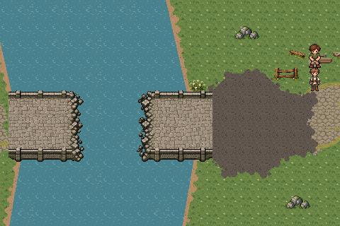
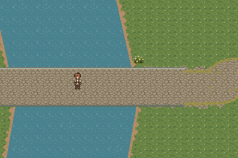

# Bridge condition foundation — PR 1 of 2

This PR adds the bridge's shared physical condition and save contract. It keeps
the production crossing ruined while PR 2 supplies layered art, safe traversal
and an authored far-bank boundary. Narrative chronology remains owned by
[Chapter 1](../../narrative/game_01/CHAPTER_01.md); this is verification evidence.

## Implemented scope

- Immutable intact/destroyed/restored conditions with strict versioned snapshots.
- A separate saved `overworld.bridge_condition` staged before world creation.
- Explicit conditions take precedence over the old repair flag. Missing records
  preserve the ruined `legacy_layout`, or a legacy repaired crossing; neither
  proves the revised attack occurred. No story receipts or rewards are granted.
- Shared world, atlas/minimap and fallback route/description decisions. Condition
  changes invalidate geometry/render caches, including intact-to-restored changes.
- Bridge scorch hidden for intact condition; damaged/restored ground retains
  scars. Other burned terrain is independent.
- Destroyed-only crew props, visible actors, blockers, interaction and audio.
  Saved cup/sorting/tea receipts stay dormant. Only owned dialogue and sounds
  stop. The unrelated river bed continues.
- Gallery bridge tea explicitly stages its own destroyed preview.

## Actual renderer captures

The [capture script](capture.py) uses production Game/OverworldWorld rendering
and temporary save/settings files. Its [record](captures.json) verifies
passability, crew presence and unchanged quest/dialogue facts.



The current start remains ruined with the crew present. Its pixels match the
[explicit destroyed fixture](destroyed_fixture.png) exactly.



Intact and [restored](restored_fixture.png) fixtures are passable and suppress
the damage crew. They still use the old procedural deck. These images are
diagnostics, not approval of completed intact/restored bridge artwork. PR 2
must replace that presentation and review actors against layered parapets.

Reproduce from the repository root:

```sh
PYTHONPATH=.:tests SDL_VIDEODRIVER=dummy SDL_AUDIODRIVER=dummy python docs/reviews/bridge_condition_foundation/capture.py
```

## Validation

[The validation record](validation.json) lists 286 focused test methods across
condition, gameplay save/load, world/cache, maps, crew, audio, participation,
save-library/title and Gallery suites. All pass. The full unrelated suite was
not rerun. Actual Game cases include manual/scene-autosave round trips, old
missing records, explicit-condition precedence, malformed-record rejection,
cached-world New Game reset, pending cup preservation, owned-dialogue cleanup
and bridge-contact audio isolation from the river.

To reproduce a listed group, run its module names with:

```sh
PYTHONPATH=.:tests SDL_VIDEODRIVER=dummy SDL_AUDIODRIVER=dummy python -m unittest MODULES -v
```

Regional and cartography builder checks pass. The approach remains 46.05 seconds
with 43,616 opening tiles reachable. All 43 atlas tile images remain unchanged;
only the cartography manifest's runtime-code hash was refreshed. No terrain
artwork, source geography, world boundary or quest was changed.

## PR 2 handoff

Deliver registered deck/parapet layers, matching bank joins and collision,
far-bank routing limits, final condition-specific scenery/crew presentation and
safe staging for later condition changes. Only then enable the intact default
and deliberately migrate `legacy_layout` placeholders. Preserve explicitly
authored conditions and legacy repair facts. Do not infer invasion completion
from any old MQ03 record or the previous ruined scenery.

The future bombardment and repair quests retain their separate story owners;
this foundation introduces neither sequence nor a repair-method decision.
