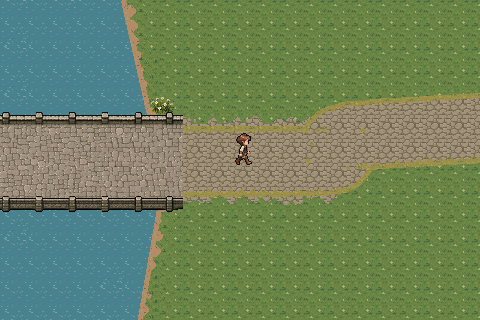
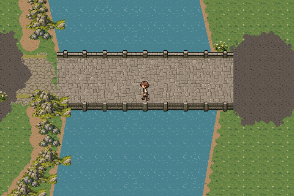
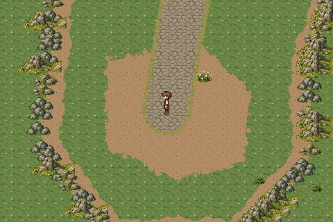

# Western bridge — playable crossing, PR 2 of 2

The production Game now begins with an intact western stone crossing. Missing
old components and `legacy_layout` scenery placeholders roll forward to intact;
explicit damage and legacy repair conditions are preserved. This completes
the bridge foundation after PR 1, without implementing the Fire Veinhold
prologue, bombardment, invasion, repair quest or onward town.

Chronology remains owned by [Chapter 1](../../narrative/game_01/CHAPTER_01.md)
and the [regional attack guide](../../narrative/game_01/REGIONAL_SURGES.md).
The [overworld guide](../../OVERWORLD.md) owns runtime contracts. This document
is verification evidence, not another story authority.

## Actual gameplay captures

The [capture record](capture.json) and [movement samples](movement_samples.csv)
come from a disposable production Game with retained MQ01/MQ02 completed as
fixture prerequisites. Each phase and starting station is seeded, then movement
uses normal Game.update calls and rendering uses Game.draw. This is not a
played version of the new opening or an enacted attack.

The record covers all 24 intact/restored lane × direction × walk/run combinations,
six blocked destroyed approaches, the far-bank layby and reduced motion. Native
and window captures show bank joins and character/parapet depth. The complete
sample CSV records each checked 24×12-footprint position; hashes pin the runtime
inputs and exported video.

Watch [the actual crossing video](crossing.mp4).







The captured atlas is [available separately](far_bank_atlas.png).

Reproduce from the repository root:

```sh
PYTHONPATH=.:tests SDL_VIDEODRIVER=dummy SDL_AUDIODRIVER=dummy python tools/capture_bridge_crossing.py
```

## Art and geometry

An image-generated stone span was exported to the approved native palette and
288×144 registration. The [source recipe](../../../assets/source/terrain/overworld/elden_vale/bridge/recipe.json)
and [generation prompt](../../../assets/source/terrain/overworld/elden_vale/bridge/prompt.txt)
retain its origin. The 72-pixel clear road is a ground layer; registered far and
near parapets sort around actors. Restored uses the same finished stone
structure, without choosing a repair method or timetable.

Destroyed presentation retains the original bank abutments and central gap.
Safe end rectangles are intersected with the actual deck alpha; transparent
fracture tips remain unsafe. Water highlights do not paint over supported deck.
Original bridge source artwork and historical reviews remain untouched.

The western landing leads down a bounded rocky shelf to the layby at tile
[-148,78]. Rock/gravel dressing follows the solid boundary. The old unused road
tail was removed. Its future exit is not destination-ready; no town, quest,
travel authorization or military route is silently supplied. Existing northern
and southern checkpoint permissions remain independent.

Source flood validation covers all three phases: 43,637 tiles for destroyed,
44,540 for intact/restored, with 22 shared required approaches and no corridor
or wall-latitude escape. A separate production full-footprint flood found 42,905
reachable intact tiles, including the west approach and layby, while former
escape points (-140,±110) and (-160,0) are blocked. These counts use different
sampling/probe rules and are not claims of identical traversable tile counts.

## Saves and condition changes

Save validation does not rewrite source files. Normal Continue stages the
condition before constructing the regional world, preserves valid feet and
finds a nearby safe same-bank landing when updated terrain invalidates an old
position. A failed search rejects the load readably rather than moving across
the river. A final check follows regional story restoration.

An explicit destroyed checkpoint west of the crossing is also rejected while
the onward destination is unavailable: walkable feet alone would leave the
party stranded. Intact/restored west-bank saves remain valid. The condition
hook refuses the same stranded outcome before mutation, so the future attack
scene must stage the party safely before committing destruction.

`OverworldTravel.change_bridge_condition(phase)` is a settled-checkpoint hook
for later scenes. It rejects unsafe UI/combat/cinematic/action states, prepares
affected physical actors against prospective geometry and saves only after safe
landings exist. Failure restores component, world geometry, positions and motion
flags. Owned dialogue/audio cleanup happens only after success; unrelated scenes
and river audio remain independent. The hook adds no attack or repair receipt.

## Validation

[The validation record](validation.json) lists 344 passing focused test methods, builders,
capture summary and remaining scope. Tests cover real New Game, both-direction
crossing, bounded road traversal/return, manual and scene autosaves, legacy
rollout, explicit-condition retention, same-bank landings, checkpoint failure
rollback, busy-state guards, crew ownership, layers/caches, maps and shared
save/Gallery systems. The unrelated full suite was not rerun.

```sh
python tools/build_western_bridge_assets.py --check
python tools/build_elden_vale_overworld.py --check
python tools/build_elden_vale_cartography.py --check
PYTHONPATH=.:tests SDL_VIDEODRIVER=dummy SDL_AUDIODRIVER=dummy python -m unittest test_bridge_playable_gameplay test_bridge_layers_world test_western_bridge_assets -v
```

Independent safety review found no blocking migration, same-bank landing or
checkpoint issues. Native visual review prompted a rock-shelf dressing polish;
the final recording was regenerated after that renderer change. All 43 painted
atlas tile images are unchanged; the survey and metadata reflect the local
road/boundary revision.
