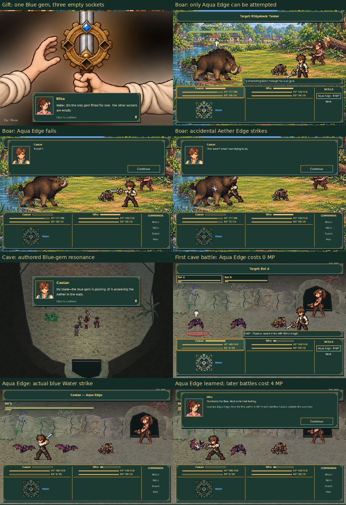

# Caelan’s Blue-gem progression review

These eight screenshots come from the production `Game` renderer and input
handlers. They show the Blue-only gift, Aqua’s failed Boar attempt and automatic
Aether Edge discovery, the authored cave resonance pose, the two-bat lesson at
**0 current MP**, the actual Water strike and the saved Aqua Edge unlock.



The review uses two explicitly prepared journeys. The gift/Boar journey skips
completed MQ01 through the supported test fixture, then plays MQ02’s gift,
departure and tutorial with real inputs. The cave journey skips completed
MQ01/MQ02, then follows production MQ03 dialogue and travel; public weapon
acquisition represents its already-earned blade. For the cave capture only,
Caelan’s current MP is set to zero, his approach is positioned and the walking
countdown is shortened to one pixel. Production code selects and saves the
two level-two bats and battle seed. No attack poses or rendered artwork are
invented for the review.

The cave capture stops after the real strike learns and checkpoints Aqua Edge;
it does not claim victory or the introductory encounter’s cleared milestone.
Aqua remains free throughout this introductory battle and costs 4 MP in later
battles. The gift close-up is photographed before its final acknowledgment, so
its item and gem ownership have not yet been committed in that frame.

All save/settings files are temporary. `verification.json` records fixtures,
observed commands, MP, learned skills, the saved encounter ticket and source /
screenshot hashes. Regenerate with:

```sh
/workspace/.venvs/project-jrpg/bin/python tools/capture_caelan_aqua_progression.py
```

Validation includes 504 targeted tests and 943 subtests across the combat,
quest, cave, ownership, reward, music and save flows, plus inspection of these
rendered frames. The broader-suite attempt also reproduced four unrelated
failures on unchanged `c4d2504`: a doctrine dialogue assertion, an Aldric/Lucan
asset manifest, and two town-Bat Spoils subtests. Those existing failures remain
outside this progression change.
