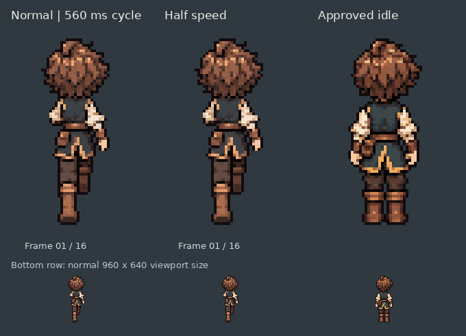

# Caelan rear walk — revision 2, approved

Sixteen 48×72 frames at 2× artwork density; unchanged 24×36 logical canvas,
[24,60] draw anchor, [24,68] foot anchor and 16×35ms=560ms cadence.
**User-approved front and rear artwork. Runtime integration remains pending.**



[Numbered drawings](frames_v2.png) · [Hall-scale playback](hall_preview.gif) ·
[Superseded first review](history_v1/preview.gif)

## Motion correction

The first review's upper and lower drawing selections lost their shared phase:
trailing arms persisted after the same-side leg moved back, some passing poses
changed limb depth prematurely, and the return to contact was uneven. Its boot
continuity checks passed but could not establish correct arm/leg opposition.

Revision 2 starts with new **complete coupled rear drawings**. The approved
front walk supplies anatomical phase references; the approved rear idle supplies
appearance. In rear view, left is viewer left and right is viewer right. At the
right contact, the right leg reaches away while the right arm trails toward the
camera; the left pair counters it. The opposite contact exchanges those roles.
Both shoulders, elbows, hands, hips, knees and boots are considered together.
Hands reaching away may disappear naturally behind the torso.

Four small source batches preserve the character's costume and left-hip pouch.
Selected whole poses and scoped join redraws distribute the passing/landing
changes and approach to the loop seam. The source column order is not assumed
to be chronology: the explicit selection plan is in the exporter and final
registration. No detached limbs are rotated, shifted, stretched or interpolated.

Only the previous head region (rows0–23) is retained across the core redraws.
The previous arms/torso are **not** preserved. Small leg-join corrections retain
rows0–47 from their corresponding **new coupled pose**, keeping its arm phase
while smoothing that pose's knee/boot return. These are documented regional
edits to complete generated drawings under the
[global visual standard](../../VISUAL_ART_STANDARD.md#6-correct-one-defect-while-protecting-accepted-work),
not assembly of independently timed arm and leg cycles. Neck/shoulder and
row47/48 joins were inspected for stale pixels, disconnections and extra limbs.

Sampling is uniform within each source atlas. Different source canvas densities
use audited neck/head/belt registration, recorded with crop, origin and scale;
neither full occupied height nor the lowest boot establishes the body's scale.
Crown excursion remains one artwork pixel. Observed sole windows change by at
most three artwork pixels between neighboring frames, including16→1. A shared
palette and the existing fine black contour treatment remain in use.

## Provenance and checks

Current masters, front phase guides, join guides, original coupled-pose
snapshots and registration are under
`assets/source/characters/caelan/walk_back_hd_review/revision_2/`.
`A.png`–`D.png` are the coupled source batches; `joins_A.png`, `joins_B.png` and
`final_joins.png` contain complete transition redraws. `before/` preserves the
rejected first pack; `coupled_before_joins/` preserves the new core drawings.
`registration.json` identifies every source cell, original head, scoped repair,
body landmark, uniform scale, source hash and measured boot observation.

The front pack and its preview images are SHA-protected by
`revision_2/protected_front.json`. Recording its approval changes metadata only;
its PNGs, spritesheet and previews remain byte-identical. The approved idles
and side walks also remain unchanged.

Twenty-five focused checks pass. In addition to dimensions, alpha, margins,
unique frames, timing, sheet reconstruction and source preservation, checks
cover the visible trailing hand and away-reaching same-side boot at both
opposite contacts; provenance from the new coupled drawing; the exact head
region; measured crown/boot continuity through the loop; and approved-front
pixel preservation. These support visual review, not a guarantee of anatomy
or world-ground foot locking.

The normal and half-speed previews share a palette and alternate30/40ms GIF
delays, preserving the average35ms cadence. Exact RGBA PNGs remain authoritative.
The hall preview is stationary native-compositor playback with temporary saves,
not activated player travel. Movement speed, stance sliding during travel,
turning, stopping and moving occlusion remain runtime-integration checks.

```sh
python tools/export_caelan_front_back_walk_hd.py
python -c "from tools.capture_caelan_front_back_walk_hd import capture; capture('back')"
PYTHONPATH=.:tests python -m unittest test_caelan_front_back_walk_hd test_caelan_left_walk_hd test_caelan_right_walk_hd
```
