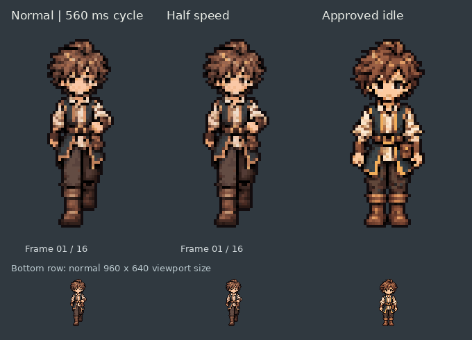

# Caelan front walk — approved

Sixteen complete 48×72 RGBA poses, 2× artwork density, 24×36 logical canvas,
[24,60] artwork draw anchor and [24,68] foot anchor. Each frame lasts35ms;
the two-step loop lasts560ms. **User-approved artwork; unmerged and not activated in gameplay.**



[Numbered frame sheet](frames.png) · [Stationary hall-scale preview](hall_preview.gif)

The main preview shows 4× enlargement and ordinary 960×640-viewport artwork
size below. The hall capture uses the actual native WorldCanvas compositor
and temporary saves/settings, with the candidate stationary. Actual traveling,
direction/idle transitions, depth occlusion during movement and foot locking
at gameplay speed remain runtime-integration work after art approval.

## Applying the animation standard

The [global visual standard](../../VISUAL_ART_STANDARD.md) is authoritative.
The approved directional idle supplies appearance. Contact/passing keys and
Iselin's accepted directional motion supplied planning references, followed by
small batches of whole-character drawings. Both arm/leg pairs progress in depth;
same-side arm counters leg, knees bend naturally and hands may be occluded.
Boot lanes stay narrow rather than reproducing the side view's reach as lateral
kicks. Anatomical-left hip pouch is viewer right.

Initial batches completed some steps too early. Full-cycle redraws and an
annotated sole-landmark guide corrected that progression. The actual exported
boot observations differ slightly from the intended source guide; the manifest
records both the retained plan and measured export, without claiming exact joint
positions or biomechanical ground locking. Two small join corrections distribute
landings across intermediate poses. Maximum adjacent measured boot-height
change is three artwork pixels, including frame16→1; both boot tracks have
at least six pixels of depth excursion. Those observations are asset regression
bounds, not universal animation rules.

The upper48 rows are retained from sampled complete-drawing snapshots after
the complete leg redraws, following the regional-preservation workflow used for
Iselin. This protects the established arms, face/hair, tabard, bracers and pouch.
No detached limbs are rotated, shifted or stretched; no idle is warped to build
poses. Row47/48 joins were inspected for knee continuity, old boots, disconnected
cloth and duplicate outlines. Crown positions stay within rows2–3, with at most
one pixel of adjacent change, and no extra runtime bob is added.

Sources with different canvas densities are sampled uniformly within each
atlas, using audited head/neck/belt landmarks. Source metadata records scales,
origins and selected cells. Occupied height and the lowest boot do not determine
body scale. The approved right-walk material palette and existing fine black
contour treatment are retained across both directions.

## Sources and reproducibility

Original generated masters, motion references, annotated guides, whole-pose
snapshots and selection/registration records are retained in
`assets/source/characters/caelan/walk_front_hd_review/`. The current export combines
selected upper artwork from the small batches with `leg_revision.png` and
`join_revision.png`. Guides and source pose indices are recorded in
`leg_plan.json`; `registration.json` records the actual final selections and
hashes. Unselected cells, initial keys and `cycle_candidate.png` remain source
history. They are not alternative production banks.

Front frame14 selects a complete original A pose for its contact approach.
Front frame12 and rear frames11/12 use audited chronological source selections;
source atlas column order is not assumed to be a valid cycle. Final frame order
is the manifest's explicit list. All reference idles and both approved profile
walk packs remain byte-identical.

Eight focused front/rear checks plus fifteen approved-profile regression checks
pass: dimensions/density/anchors, hard alpha and margins, distinct poses,
measured crown and boot continuity including the loop, upper-pixel preservation
and source provenance, exact sheet reconstruction, source/palette/reference
hashes, explicit review/integration state, and saved GIF cadence. These checks
support inspection; they cannot certify visual quality or anatomy by themselves.

The PNG timing is16×35ms. GIF delays alternate30/40ms: normal plays twice in
1120ms while half speed plays once. Each preview uses a shared palette to avoid
temporal recoloring; RGBA PNGs remain authoritative for exact pixels.

```sh
python tools/export_caelan_front_back_walk_hd.py
python tools/capture_caelan_front_back_walk_hd.py
PYTHONPATH=.:tests python -m unittest test_caelan_front_back_walk_hd test_caelan_left_walk_hd test_caelan_right_walk_hd
```
