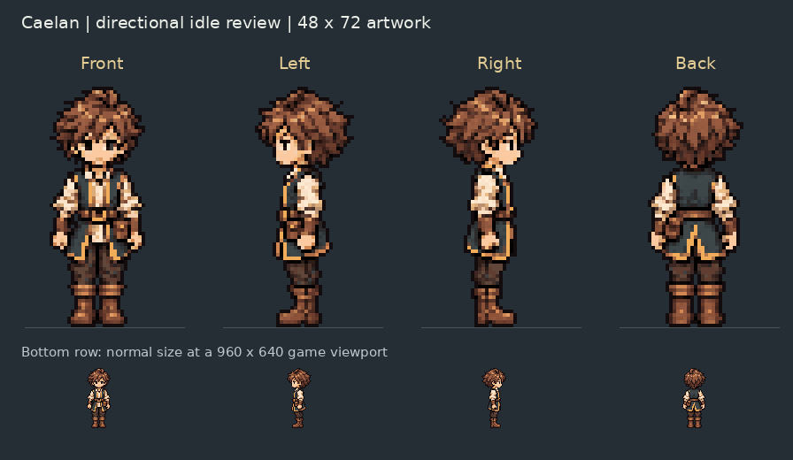

# Caelan higher-density directional idles — approved

**Current runtime status: integrated for normal idles and walking.** See the
[gameplay integration report](../caelan_walk_integration/README.md) for moving
footage, compatibility boundaries and remaining stride sliding.

## Original art-review record

The record below describes the standalone artwork review before integration.

**Status: user-approved design and artwork; merged asset pack, not runtime-integrated.**

[Four directional idles](directions.png) · [Hall and cast comparison](hall_comparison.png)



The top row is a constant 4× nearest-neighbor enlargement. The bottom row shows
the actual 48×72 artwork size at a 960×640 game viewport. Source resolution,
logical world size and display scale follow the existing
[visual art standard](../../VISUAL_ART_STANDARD.md); this is a scoped asset review,
not another construction guide.

## Design and registration

The four newly drawn idles preserve chestnut hair, ivory shirt/sleeves, dark
teal tabard with ochre edging, leather belt/bracers/boots, dark trousers and the
single anatomical-left hip pouch. Front shows that pouch on viewer right; rear
shows it on viewer left. Left-facing profile exposes it on the near side;
right-facing profile keeps it on the far side. Profiles are separate complete
drawings, with visible faces, hair, sleeve folds, trim and boots, not mirrors.

Each exported frame is **48×72 RGBA**, representing **24×36 logical units** at
2 artwork pixels per world pixel. Draw anchor is `[24,60]` artwork / `[12,30]`
logical; foot anchor is `[24,68]` / `[12,34]`. All four have 68-pixel visible height,
the same boot baseline and unclipped transparent margins. One uniform source
scale and one shared 64-color material palette serve the entire set. The existing
Caelan contour helper applies a thin warm-black exterior contour consistent
with his current outline convention. Bodies/limbs are not independently warped.

The retained source is
`assets/source/characters/caelan/idles_hd_review/idles_authored.png`. It was
newly drawn using the established authored Caelan bank as the design reference
and Iselin as the pixel-detail/style reference. The source hash, exact cells,
scale, positions, anchors and approval status are recorded in
`assets/characters/caelan/review_hd/idles/idles.json`. PNGs and the four-view
spritesheet live beside that manifest.

## Validation and boundaries

All four exports were inspected enlarged and at normal display size, then
composed through the actual World renderer in the rebuilt hall. The lower cast
comparison uses current Caelan, current Mira and approved Iselin artwork at their
existing world sizes/anchors. Isolated review actors and temporary saves do not
change the playable character selector or progress; this is not a played quest
or a claim of animation integration.

Hard alpha, unclipped bounds, exact 48×72 canvases, unchanged current runtime
idles, source identity and byte-identical repeated export were verified. Walking,
running, action poses, collision, game metadata and current runtime PNGs remain
unchanged. No gait or animation frames are included. User approval covers these
four exact idle drawings and their design; walking/running and runtime integration
remain subsequent work. Future exports preserve this approval status and artwork.

Reproduce these review assets only:

```sh
python tools/export_caelan_hd_idles.py
python tools/capture_caelan_hd_idles.py
```
