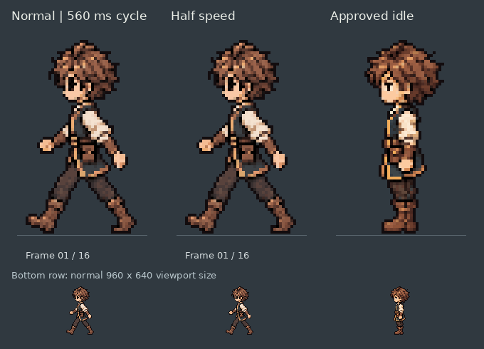

# Caelan left-facing walk — approved

Sixteen 48×72 complete frames at 2× artwork density, preserving Caelan's
24×36 logical canvas, [24,60] artwork draw anchor, [24,68] foot anchor and
560 ms cadence (16 × 35 ms). **User-approved asset pack; runtime integration remains pending.**



[Numbered frame sheet](frames.png) · [Stationary hall-scale preview](hall_preview.gif)

The enlarged preview shows normal speed, half speed and the exact approved
left idle. Its lower row shows ordinary artwork size in a 960×640 viewport.
The hall preview uses the real WorldCanvas compositor and temporary save/settings
paths. The candidate stays stationary; this is a scale/presentation review,
not gameplay travel or proof of ground locking at the player's movement speed.

## Construction and motion review

The [global visual standard](../../VISUAL_ART_STANDARD.md) remains authoritative.
This follows the successful [Iselin left walk](../iselin_left_walk_redrawn/README.md):
reflected approved opposite-direction motion guides, newly authored complete
left-specific poses and documented preservation of accepted lower-body pixels.

- Anatomical left is near, right is far. The near left arm counters the near
  left leg, while the far right pair counters through the other step. Occlusion
  around passing poses hides part of the far arm rather than adding a hand
  through the torso. First-half support is near-left; second-half support is
  far-right. Each swing boot lifts, passes, reaches and returns to contact.
- Four small batches of complete drawings use the approved left idle for face,
  chestnut hairstyle, teal/gold tabard, ivory sleeves, bracers and the single
  **near-side anatomical-left hip pouch**. This is not a finished flipped
  right-facing costume. Hair has restrained silhouette changes across poses.
- Native rows 50–71 retain exactly mirrored approved right-walk lower-body
  pixels. This protects the accepted stance/swing progression while the new
  upper drawings establish left-specific appearance. The row49/50 joins were
  inspected for pant continuity, stale coat pixels and duplicate outlines.
  No detached limb rotation, shifting, stretching or procedural rig is used.
- Whole drawings use one uniform .124 sampling scale and audited head/neck/belt
  registration. Scale is not calculated from the lowest boot or occupied height.
  Actual crown rows are `2,2,2,2,2,2,2,2,2,2,1,1,2,2,2,2`; observed support soles
  occupy rows68–70. No additional runtime bob is introduced.
- The approved right palette and existing fine black contour treatment preserve
  material consistency. A frame12 near-arm jump was corrected through a complete
  generated redraw; only its fourth cell is selected from `C2.png`. The original
  `C.png` remains source history. Other fifteen poses are selected from A/B/C/D.

The numbered sheet was inspected for both limb pairs, hand/hip-pouch occlusion,
body stability, boot progression, batch joins and frame16→1. Exact pixel tests
support these checks; they cannot certify animation quality on their own.
Actual traveling, idle/direction transitions and world-foot sliding remain
runtime-integration checks after all directional art is approved.

## Sources and validation

Masters, reflected guides, approved-left-idle reference and registration are in
`assets/source/characters/caelan/walk_left_hd_review/`. The manifest records
source hashes, selected cells, uniform sampling, origins, support windows,
contact spans and protected lower-region hashes. `protected_references.json`
records the exact approved idle and right-walk files; all remain unchanged.

Eight focused left-pack tests plus seven approved-right regression tests pass.
They cover dimensions, hard alpha, unclipped margins, sixteen unique poses,
shared scale/crown/sole stability, support progression in both halves, timing,
sheet reconstruction, source hashes, exact preserved leg pixels and unchanged
approved reference packs. Repeated export is byte-identical.

GIF delays alternate 30/40 ms: the normal pane completes two cycles in1120 ms,
and the half-speed pane completes one. One shared GIF palette prevents temporal
recoloring; native RGBA PNGs remain authoritative for exact colors and alpha.

```sh
python tools/export_caelan_left_walk_hd.py
python tools/capture_caelan_left_walk_hd.py
PYTHONPATH=.:tests python -m unittest test_caelan_left_walk_hd test_caelan_right_walk_hd
```
