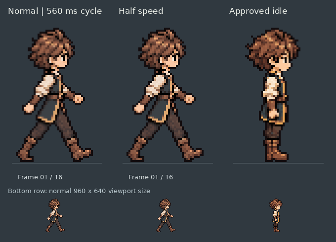

# Caelan right-facing walk — review candidate

**Not approved, merged or runtime-integrated.** This pack contains sixteen
complete authored 48×72 right-facing drawings, preserving the 24×36 logical
canvas and the existing 560 ms walking cadence (16 × 35 ms).



[Numbered frame sheet](frames.png) · [Stationary hall-scale playback](hall_preview.gif)

The main preview shows normal speed, half speed and the exact approved idle at
constant 4× enlargement, with ordinary 960×640-viewport artwork size below.
The hall preview uses the actual World compositor and temporary saves, with a
stationary isolated candidate sprite. This is an asset review, not activated
player travel or proof of world-ground foot locking at gameplay speed.

## Applying the Iselin lessons

The [global animation standard](../../VISUAL_ART_STANDARD.md#working-order) is
canonical. The accepted
[Iselin right-walk leg correction](../iselin_right_walk_redrawn/LEG_REVISION.md)
was inspected for support/swing progression and loop continuity.

- Four contact/passing keys were drawn first, followed by small batches of
  whole-character in-betweens. Each exported pose is flattened RGBA; no detached
  limb pieces, rotations, procedural anatomy, interpolated poses or idle warps
  manufacture the cycle.
- In right profile, anatomical right is near and left is far. Near arm counters
  near leg; far arm counters far leg. Both anatomical pairs progress through
  contact, support, passing, recovery and the opposite step. Passing can hide a
  far hand behind the torso. An absent occluded hand is not a third arm or a
  permanently parked far limb.
- Right/near leg supports the first half; left/far leg supports the second.
  Support-foot ground intervals move backward over each half-cycle; the other
  boot lifts, advances and returns toward contact. These visible contact spans
  are recorded observations, not ankle centers or a biomechanical simulation.
- One uniform source sampling scale applies to all sixteen drawings. Registration
  uses the audited head/neck/belt grid, with head center used for horizontal
  alignment. Neither occupied character height nor the lowest boot sets a pose's
  scale or vertical origin. Crown positions in the actual exports are
  `2,2,2,2,2,2,2,2,2,2,2,2,1,1,2,2`; adjacent changes never exceed one artwork pixel.
  Observed support-sole heights lie in artwork rows 68–70. No runtime bob is added.
- Hair/neck/torso scale, readable profiles, bracers, tabard edging and the far-side
  anatomical-left pouch follow the approved right idle. No weapons or accessories
  were introduced. A shared frozen palette and the existing thin black contour
  treatment keep materials consistent across poses.

The native sheet, contact/passing/recovery positions, near/far arms, boot
progression and the last→first join were inspected. Numerical export checks
protect specific defects; they do not replace reviewing the supplied motion.
Matching actual stance travel to player displacement remains runtime-integration
work; this review does not change speed, collision or gameplay animation selection.

## Source history and targeted correction

Retained masters live under
`assets/source/characters/caelan/walk_right_hd_review/`. Current registration
records exact sources/cells, bounds, scale, head/neck/belt references, origins,
phase/limb labels, visible ground-contact intervals and hashes.

The first large assembly rushed the passing transitions. A differently sized
batch also changed head/body proportions. Those sources (`first_assembly.png`
and `C.png`) remain as rejected history, not active frames. Current A/B/C2/D
batches were drawn on a common proportion grid. D's last pose reversed near-arm
identity; the separately authored contact key provides frame16's short approach
into frame01. The unused single-frame retry is also retained as history.

A final frame12 correction redraws the near arm closer to neutral before the
second passing pose. Only that complete corrected drawing is selected from C3.
The other fifteen exact PNGs are protected by SHA in `protected_frames.json`,
and `palette.json` retains their material palette during the correction. This
is whole-character redraw selection, not a limb rig or detached-arm patch.
The approved directional idles and all existing runtime art remain unchanged.

## Validation

Seven focused tests pass: sixteen unique complete frames; exact dimensions and
hard alpha; unclipped margins; shared scale and measured crown/support stability;
backward support progression in each half-cycle; saved GIF cadence; exact sheet
reconstruction/source hashes; preservation of the approved idle and the fifteen
protected candidate drawings. Repeated export is byte-identical. Changed Python
compiles and diff checks pass.

The authoritative PNG cycle is 560 ms. GIF centisecond timing alternates 30/40 ms:
the normal pane completes two cycles in 1120 ms and the half-speed pane one.
GIF previews share a palette; individual PNGs remain the exact color reference.

```sh
python tools/export_caelan_right_walk_hd.py
python tools/capture_caelan_right_walk_hd.py
PYTHONPATH=.:tests python -m unittest test_caelan_right_walk_hd
```

Exported candidate frames, sheet and manifest are in
`assets/characters/caelan/review_hd/walk_right/`. User review comes before any
merge or runtime activation. Other walk directions, running and action poses
are outside this pack.
