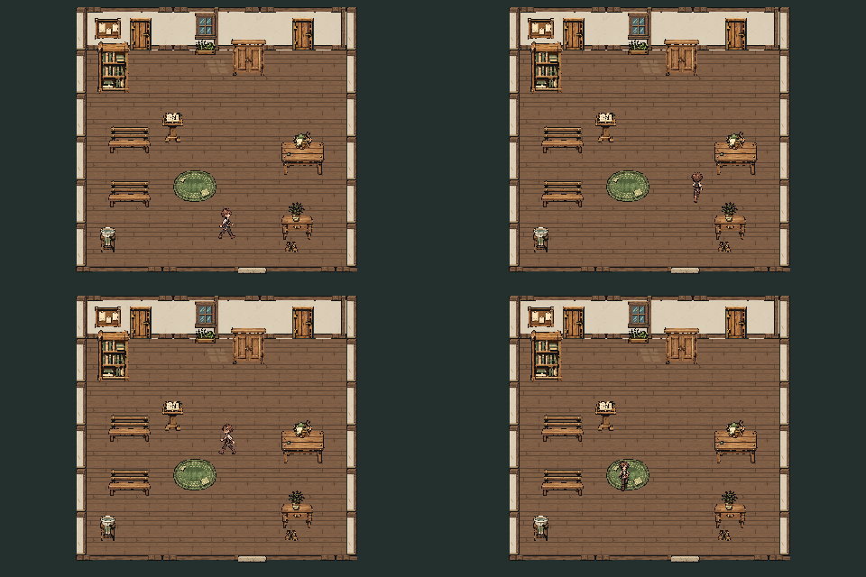

# Caelan HD travel — runtime integration

Normal player travel now uses all four approved HD idles and16-frame walks.
`assets/characters/caelan/animation.json` explicitly registers each bank's paths,
density and logical size; runs remain density1. All approved PNGs are unchanged.
The [character asset guide](../../../assets/characters/caelan/README.md) owns the
current bank inventory; the [global standard](../../VISUAL_ART_STANDARD.md) owns
construction and rendering rules.

[Outdoor movement](town_travel.gif) · [Hall movement](hall_travel.gif) ·
[Cave movement and lighting](cave_travel.gif) ·
[Walk/run/idle transitions](walk_run_transitions.gif) · [Cup delivery](cup_carry.gif)



The movement clips use actual Player.update, collision checks and production
World.draw/native WorldCanvas composition. Each direction travels two cycles,
then stops; the square includes turns. Scenery time is held fixed for comparison.
Scenes/controllers are isolated from random encounters and story advancement;
these captures are not a complete quest playthrough. Temporary save/settings
paths keep user progress separate. Native960×640 PNGs remain exact references;
contact sheets are deliberately reduced to fit four views, and GIFs quantize
colors. The captured ordinary movement changes neither quest state nor scenery.

## Compatibility checks

- Four idles and64 walking frames are normalized to24×36 logical surfaces with
  their48×72 native detail retained. Draw/foot anchors remain12,30 and12,34.
  Actual collisions, diagonal speed,72-unit walking and108-unit running remain
  unchanged. No additional bob or rescaling happens while selecting frames.
- Every35ms boundary and the560ms loop selects the same authored image in both
  logical and native presentation. Starting, stopping, blocked movement,
  turning, run/walk switching and pause behavior have focused coverage.
- CastActor copies durations and containers. The HD bank keeps35ms frames,
  avoiding the previous140ms fallback (which would stretch16 frames to2240ms).
  Explicit scene banks suppress inherited detailed imagery and retain their
  own anchors, action poses and timing. Actor changes do not mutate Player.
- Rescue regression tests exercise movement/drawing after the healing-pool
  handoff, saving/Continue, caretaker departure and scene reset. Arrival,
  carrying/prop ownership, opening, party travel and Iselin integration checks
  remain covered by the focused integration run.
- SanctuaryReturn's cup grips are authored for the retained four-phase legacy
  stride. It owns that carrying bank explicitly and restores HD travel on
  release; walking/running body selection and the cup's frame index use the
  same clock. Its review clip stages transient holding state without invoking
  pickup/completion callbacks; lifecycle tests exercise the real transfers.
- [Real tree foreground](tree_occlusion.png) and cave captures confirm normal
  painter-depth occlusion and lighting apply to the native player. Compositor
  tests cover partial-alpha foregrounds and the ordinary Surface fallback.
  Small480×320 windows necessarily reduce detail; source pixels cannot all
  remain visible at that presentation size.

## Remaining visual limits

Legacy running, action, carrying, support and bespoke cinematic banks retain
their existing artwork. Their transitions show a temporary change in detail;
this change does not reapprove or rebuild those older drawings.

The approved stride is **not fully world-ground locked** at the current speed.
For the sampled profile stance (frames1→8), Player travels35.28 render pixels
while the observed sole-span midpoint moves24 pixels back relative to the body.
That leaves an estimated11.28-pixel world drift in either profile. A rolling
sole midpoint is an approximate diagnostic rather than a fixed ankle/heel
landmark. The footage supports a separately reviewed stride revision; this PR
preserves approved drawings,560ms cadence and gameplay speed rather than
silently retiming movement or distorting anatomy.

## Evidence and performance

The consolidated targeted run passes174 checks across player movement, native
rendering, all approved Caelan banks, scene ownership, rescue and Continue,
arrival interactions, opening gameplay, party travel and Iselin integration.

[evidence.json](evidence.json) records scene routes, per-frame positions,
clocks, foreground placement, diagnostic limits and approved PNG hashes.
Re-exporting every approved HD bank reproduced its exact PNG bytes while
retaining integrated status. Historical protection manifests remain unchanged;
checks distinguish immutable artwork hashes from legitimately updated runtime
metadata.

[performance.json](performance.json) records12 warmed960×640 dummy-driver draws
per production path, excluding simulation updates. Median town/hall/cave draws
were approximately2.79/1.58/2.88ms on this environment. Normalized player banks
consume1,230,336 bytes (including logical/native buffers, excluding raw image
cache). Existing transformed-image and chunk budgets remain unchanged. The
profile also includes legacy overworld/combat/cinematic paths; those results
are hardware-specific observations, not a claim of universal frame rate or a
before/after performance comparison.

```sh
python tools/capture_caelan_travel_integration.py
python tools/profile_renderer.py --frames 12 --output docs/reviews/caelan_walk_integration/performance.json
PYTHONPATH=.:tests python -m unittest test_caelan_travel_integration test_cast_actor_animation_ownership test_player_running test_sanctuary_return
```
