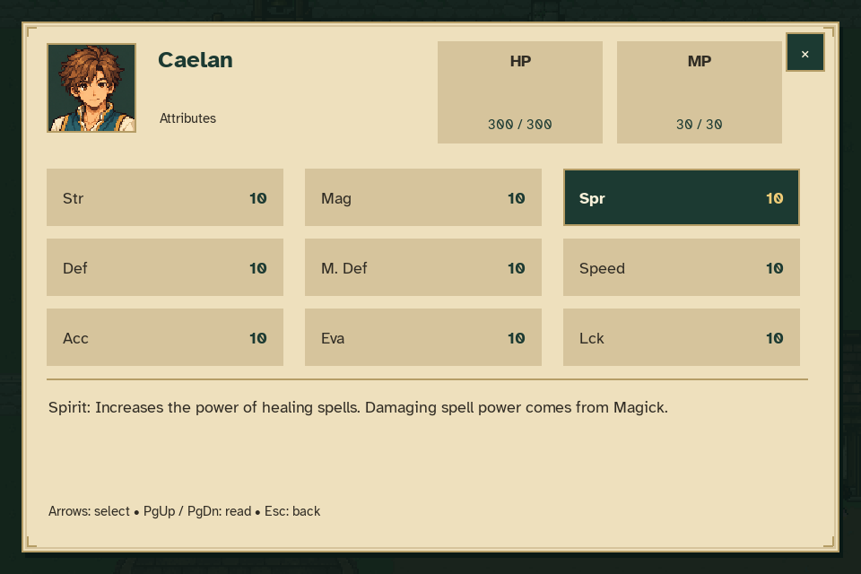
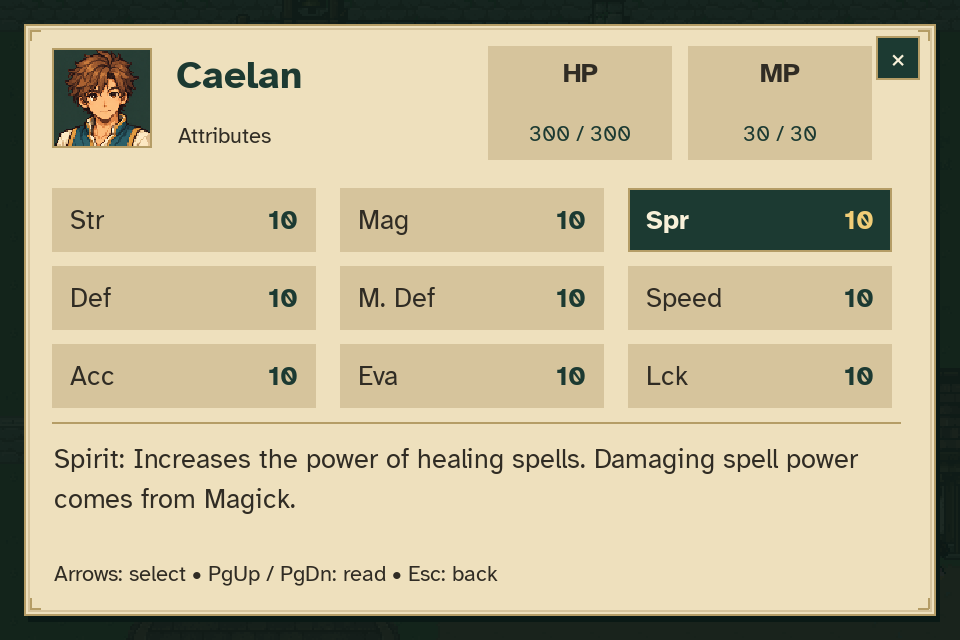
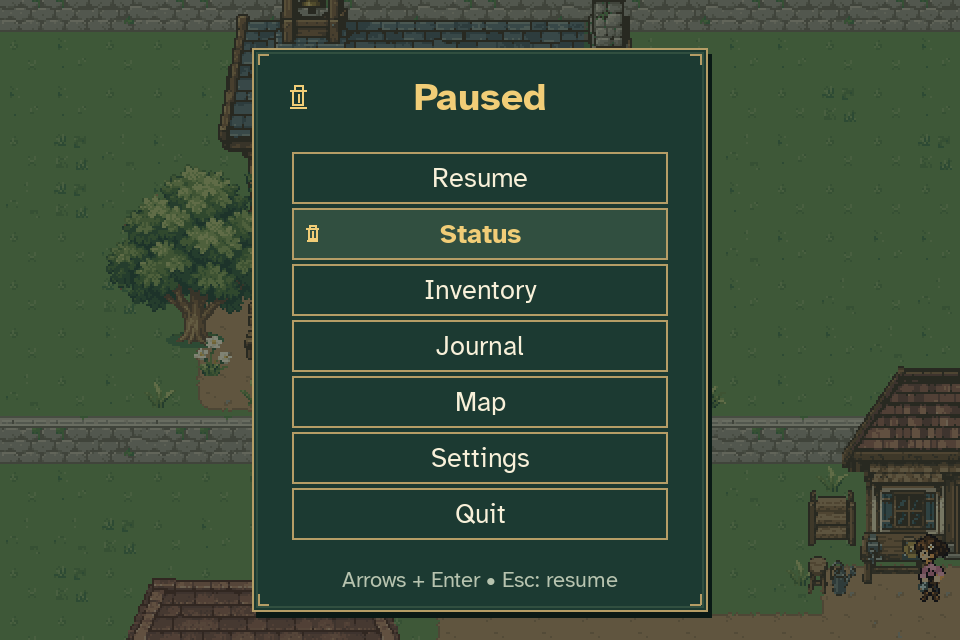

# Caelan's starting attributes

Caelan starts with **300 HP, 30 MP, and 10 in each of Str, Mag, Spr, Def,
M. Def, Speed, Acc, Eva and Lck**. Spirit determines healing spell power;
Magick determines damaging spell power. These are the initial balanced values,
with combat formulas and Sphere Grid development still to come.

Open **Pause → Status** to inspect the values and select an attribute for its
description. HP and MP display current and maximum values separately. Other
attributes are ratings, not percentages.

These screenshots come directly from the production `Game`, pause-menu
activation and `StatusUI` at 960×640. The selected attribute is Spirit. The
capture uses ordinary starting state, without invented items, combat or quest
completion. Reproduce them with:

```sh
python tools/capture_character_status.py
```

## Normal text



## Large text



## Pause menu



## Verification

The focused model and gameplay tests cover strict validation, independent
current resources, checkpoint restoration, older journeys, New Game reset and
automatic saving. UI tests cover all eleven attributes, keyboard and mouse
inspection, text sizes, description scrolling, letterboxed hit testing and
returning to Pause. The existing integration case also checks that closing
Status preserves the conversation underneath and does not pass queued clicks
through to Resume.

The full-suite run exposed an existing route-driver timing assumption when
Serene moved during an incidental conversation. The driver now replans against
her live location and retries a cancelled pending request. A deterministic
timing regression covers both cases; the complete opening routes still require
every main scene. This correction changes test navigation only.

See the [attribute reference](../../CHARACTER_ATTRIBUTES.md) for definitions,
starting values, persistence and the remaining combat-design decisions.
