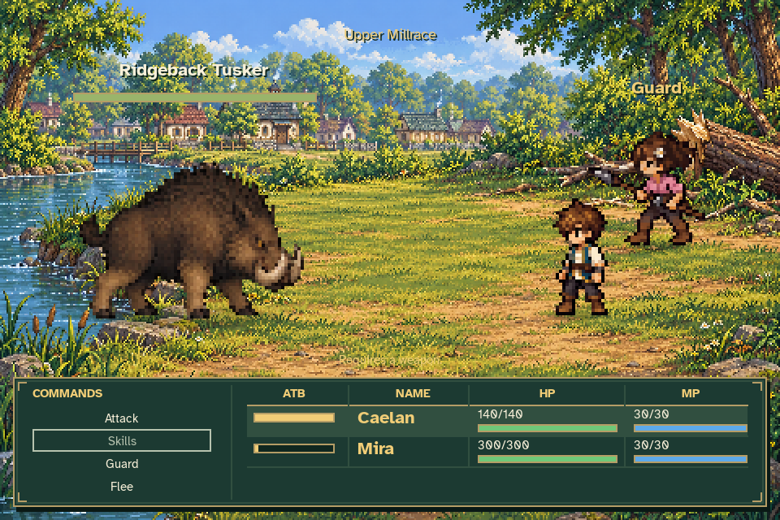
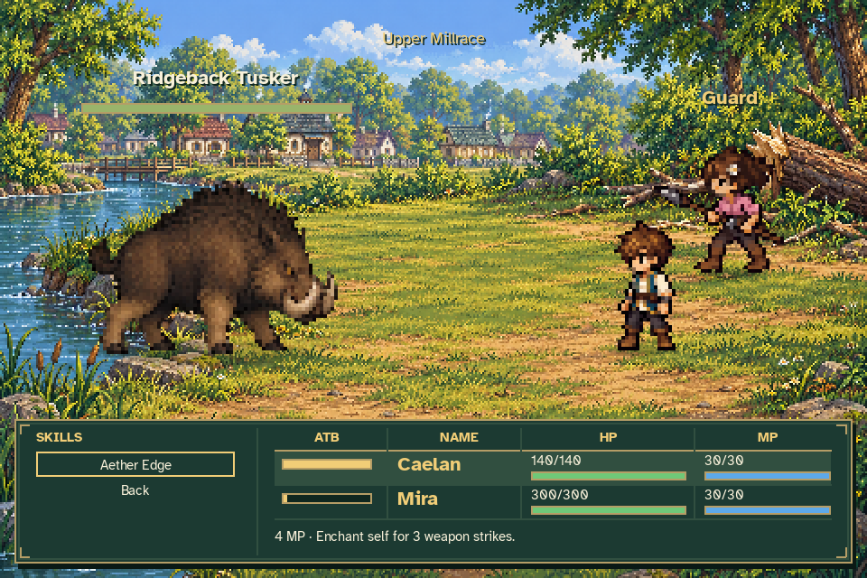

# Character skill menu review

These screenshots use the production Game renderer and ordinary MQ02 battle input.
Earlier quest work is seeded through the existing integration fixtures; battle
phases are not assigned.

## Opening fight

Caelan remains unarmed. Skills is greyed out and explains **Requires a weapon**.
Selecting it spends no MP or ATB.

## Weapon unlock fixture

This screenshot uses an **unawarded test sword**, injected only into the disposable
capture inventory catalog. The public acquisition hook equips it and unlocks
Aether Edge before the test begins. No weapon, acquisition quest or early reward
has been added to the game. Existing combat sprites are unchanged.

The submenu keeps the party rows visible, shows the MP cost and three-strike
duration, and includes Back. The [capture context](capture-context.json) identifies
the fixture. [Character ability documentation](../../CHARACTER_ABILITIES.md)
describes the dictionaries, battle effect and future weapon-grant hook.

## Verification

The 300-test runtime regression suite and the additional 47-test authoring/integration suite pass. The [validation record](validation.json) includes commands, source fingerprints and screenshot hashes; [test results](tests.txt) retain both run summaries.

Checks cover permanent unlocks, owned weapon quantities, legacy/malformed saves, ordinary MQ02 input, disabled Skills, cost-free submenu navigation, actual Aether Edge casting, MP/ATB settlement, three-hit expiry, damage caps, party isolation and 100/150% text. An independent review also passes.
