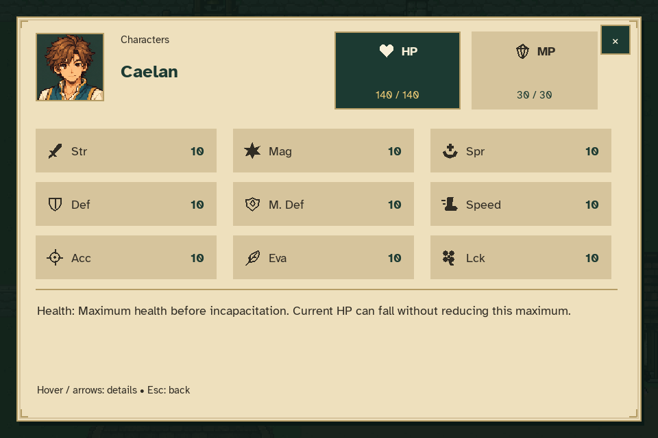
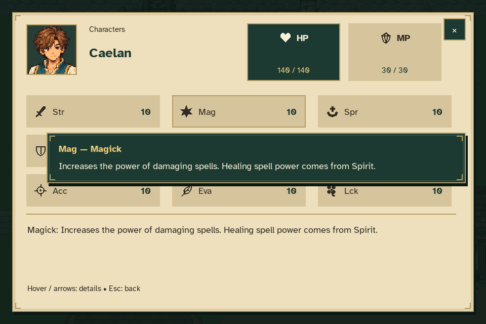
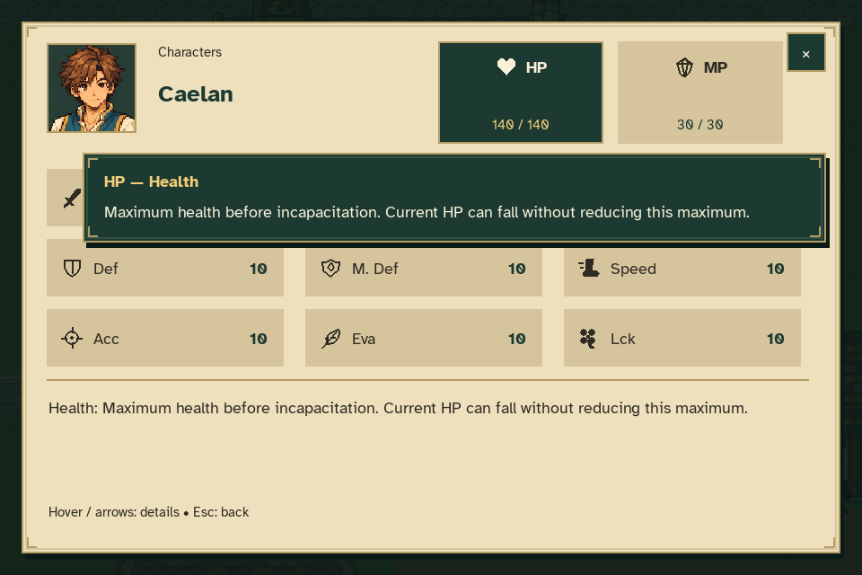
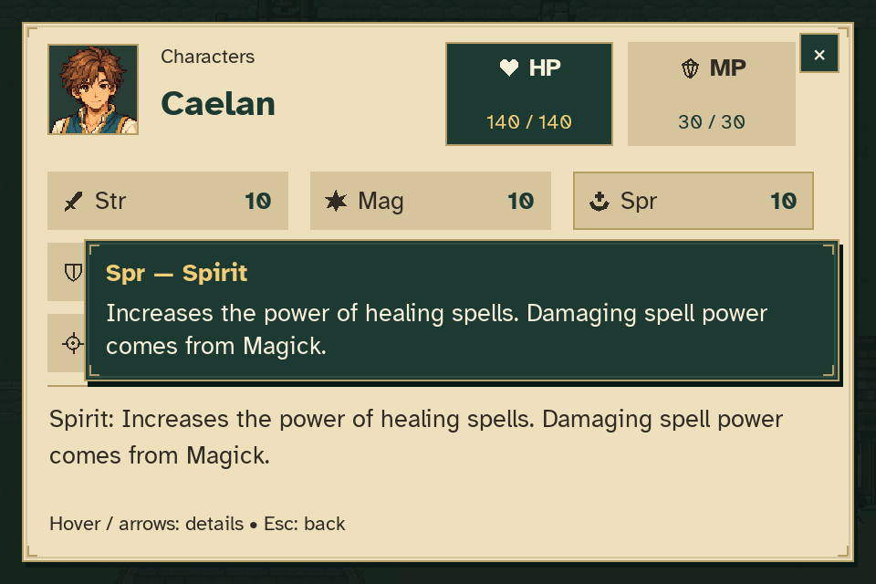
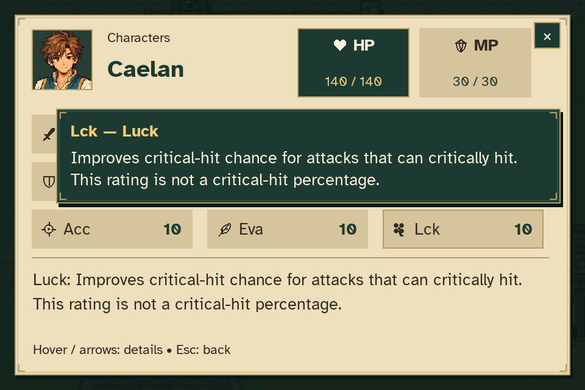
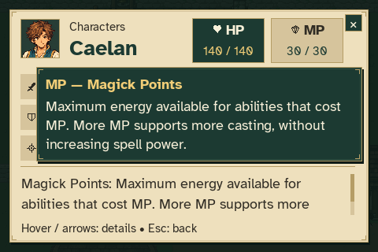
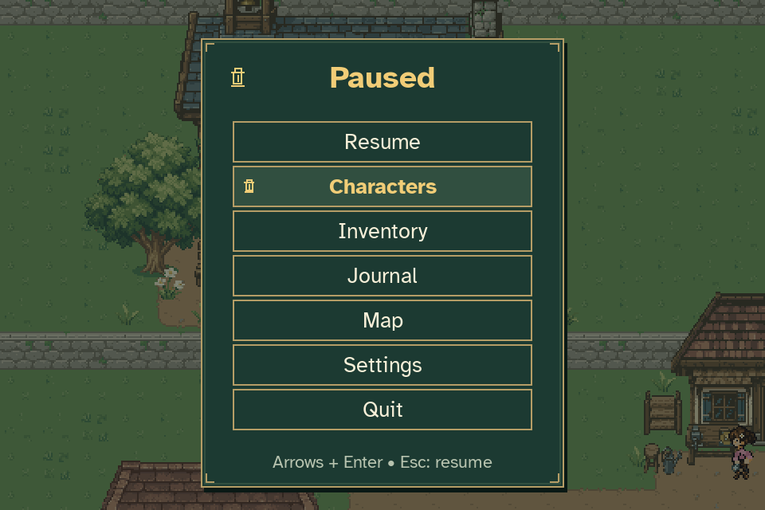
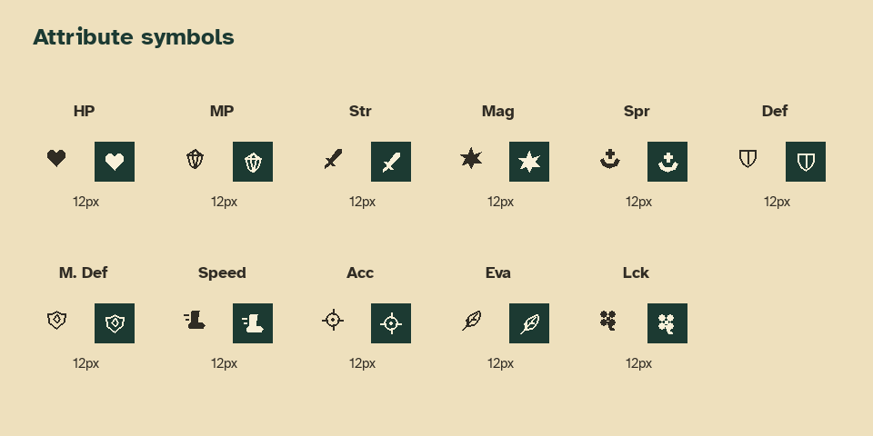

# Characters menu, attribute icons and tooltips

Open **Pause → Characters** to inspect Caelan's attributes. His starting health
is **140/140 HP**, with 30/30 MP and nine other ratings of 10. Every attribute
has its own icon. Hover an icon or its card for the full explanation; arrows
or Tab expose the same information with keyboard focus. Closing Characters
returns to Pause and preserves any conversation underneath.

The menu captures below come from the production game using actual keyboard/menu
input and mouse-motion events. No combat, additional party members or quest
completion was invented for the preview. Reproduce the menu captures with:

```sh
python tools/capture_character_status.py
```

## All attributes



## Hover explanations






## Enlarged text and screen edges









## Attribute symbols

This contact sheet draws the same eleven symbols directly through the shared
icon renderer, in ordinary and selected colors at a 12-unit size.



## Saves and verification

New Game and journeys without an attribute record start at 140 HP. Older
version-one records with the original 300-HP baseline migrate to 140 while
preserving the health proportion, other attributes and MP. Incapacitated
characters remain at zero HP; a positive resource remains at least one HP.
Other saved growth and version-two records restore exactly. Continue commits
the migration once; reading the save at the title does not alter it.

Focused tests cover migration, icon bounds and distinctness, all eleven hover
tooltips at every supported text setting, keyboard parity, pointer/window
leave, letterboxed hit testing and modal conversation preservation. Tooltip
text remains complete and stays clear of the close button and footer.

The opening-route verifier also waits for temporary resident obstructions and
chooses a fresh approach when its target moves. Timing regressions cover these
cases, and permanently blocked routes still fail. Every main dialogue scene
remains required; this adjustment changes test navigation only.

See [capture metadata](verification.json) and the
[attribute reference](../../CHARACTER_ATTRIBUTES.md) for values and behavior.
