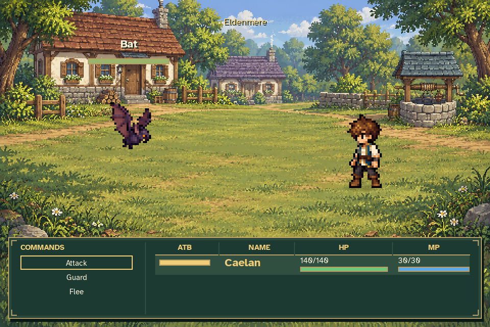
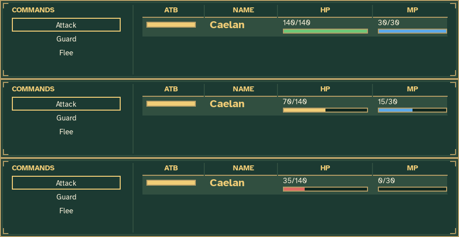
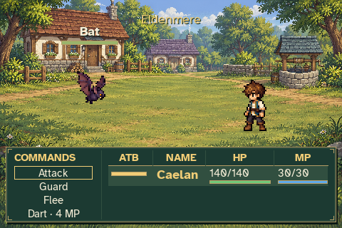
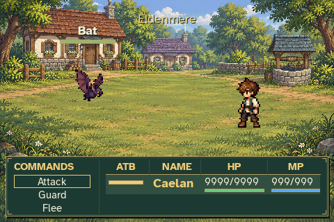
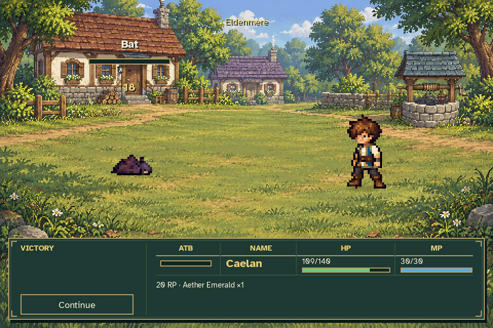

# Compact party table

This is the approved battle UI concept implemented in the actual game. The
standard panel is **80 logical pixels tall**, down from 108: a 28-pixel, 25.9%
reduction, matching the shorter concept's approximate 30% target.



Shared **ATB | NAME | HP | MP** headings appear once. Caelan occupies one
horizontal row, with a small yellow ATB gauge to the left of his name and
current/max HP and MP numbers above thin bars in their own columns. The
selected character's row has a subtle highlight. The current encounter shows
Caelan's occupied row; the sketch's future-party placeholders are omitted.

Commands form a narrow vertical list on the left. Supported learned spells
remain accessible through the same mouse and keyboard controls. Action,
reward and retry details wrap below the party row, keeping the full message
visible; result titles and Continue stay on the left.



Health remains green above 50%, yellow above 25% through 50%, and red at 25%
or below. MP is blue, and ATB stays yellow while charging and when ready.
These panels are crops of actual rendered frames with explicit HP/MP display
fixtures, rather than changes to the player's journey or combat balance.



Larger text settings expand the panel when necessary to keep all commands
and values legible. The minimum 480×320 window supports 150% text with all
four learned-command slots, and capped resource numbers stay inside their
columns.





Validation: **39 focused tests passed** across status, scene input/layout,
real encounter gameplay, battlefield and combat assets. The final six status
tests also passed after the visual separator adjustment. Actual-game capture
verified the ready-state ATB pause, attacks, spell costs, rewards and return
through the compact controls. Independent visual review found no overlaps
in ready, large-text, maximum-resource or victory views.

Reproduce with:

```sh
python tools/capture_battle_status.py --output work/compact-battle-status
python tools/capture_combat.py --output work/compact-battle-gameplay
```

Both tools use temporary journeys and settings. The first output contains
[resource fixture and panel measurements](status_verification.json), including
its own three-command minimum-window capture. The four-command screenshot
above and [full combat verification](gameplay_verification.json) come from the
second output. Its additional screenshots and GIF are generated alongside it.
