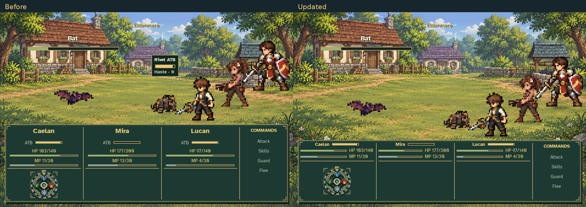

# Compact combat UI review

The character header now places the ATB gauge beside the name, then pairs each
HP/MP bar with its label and value on the right. Status takes the top third of
the panel; the interactive region takes the lower two thirds. Rivet's separate
ATB/haste panel is removed while the bot remains in the battle and acts normally.



Open [updated 1440×960](after_1440.png) or [the original renderer at the same
size](before_1440.png) for the closest comparison with the supplied screenshot.
The [silent 9-second action reel](compact_combat_ui_silent.mp4) shows keyboard
and mouse gear input, Mira selecting Overclock, and Rivet acting autonomously.
The [decoded video frames](decoded_reel_frames.png) provide a quick motion
contact sheet sampled from the encoded MP4.

| Three-member fixture | Before: panel / status / interaction | Updated: panel / status / interaction | Updated status : interaction | Gear, before → updated |
| --- | --- | --- | --- | --- |
| 960×640, 100% text | 128 / 72 / 56 | 102 / 34 / 68 | 1 : 2 | 48×48 → 48×48 |
| 1440×960, 100% text | 128 / 72 / 56 | 102 / 34 / 68 | 1 : 2 | 48×48 → 48×48 |
| 480×320, 150% text | 164 / 108 / 56 | 183 / 61 / 122 | 1 : 2 | 48×48 → 48×48 |

Geometry above uses the game's logical 480×320 canvas, before window scaling.
At normal text sizes the panel is 26 logical pixels shorter, revealing another
78 screen pixels at 1440×960. The extreme minimum-window/150%-text case needs
more height to preserve readable rows and the requested two-thirds interactive
region. Its panel grows by 19 logical pixels; staging remains above the panel.
The supported maximum HP9999/MP999 fits at that extreme size, with narrow bars
because the resource values need most of each column's width.

Additional production captures:

- [Minimum window, 150% text](minimum_480_text_150.png), with [baseline](before_minimum_480_text_150.png).
- [Maximum HP/MP, minimum window and 150% text](maximum_resources_480_text_150.png).
- [One member](1_member_960.png) and [two members](2_member_960.png).
- [Overclock active](overclock_active_960.png) and [Rivet after its first action](rivet_after_action_960.png).

The capture uses an isolated real `PartyState`, `BattleModel`, `BattleScene`,
`UIStyle` and production combat assets. Caelan has HP103/140 and MP11/30;
Mira HP177/300 and MP13/30; Lucan HP97/140 and MP4/30. Lucan is recruited only
into this review fixture; no story recruitment is added. Before and after use
the same frozen gauge state, Bat HP16/72 and RNG seed 7. The before renderer is
compiled directly from `f5c2203010fbfd7a4c17c475a654ef8004edd8ed:battle_scene.py`
with the real repository asset root. The comparison assembles captured pixels;
no mock UI is drawn over the images.

The reel sets Mira's initial ATB to 1 and gives Bat 9999 HP so it survives the
review. Subsequent ATB, action timing, damage, gear gestures and commands use
production code. Keyboard input seats water → nature; mouse drag seats
nature → ice. Overclock spends 5 MP (13 → 8), applies 8 turns, and the reel runs
continuously through the first completed autonomous bot action. The same battle
then continues to verify all 8 hasted actions: remaining turns 7, 6, 5, 4, 3, 2,
1, 0, followed by one haste-expired event. Across 1,134 rendered simulation
frames neither `Rivet ATB` nor a `Haste · N` counter is sent to the renderer.
The existing transient Haste application popup remains part of the action.

Reproduce and verify from the repository root:

```sh
SDL_VIDEODRIVER=dummy SDL_AUDIODRIVER=dummy \
  /workspace/.venvs/project-jrpg/bin/python tools/capture_compact_combat_ui.py
/workspace/.venvs/project-jrpg/bin/python tools/capture_compact_combat_ui.py --check
```

`verification.json` contains fixture declarations, all captured geometry, actual
inputs and model events. `fingerprints.json` records relevant renderer/model
source and asset hashes. `--check` verifies these, artifact hashes, the baseline
renderer, normal-size height reduction, the 1:2 split, unchanged 48-pixel gear,
eight autonomous bot actions, and the video's single silent 960×640/20fps stream.
It also compares model/state modules and action/bot/guest/enemy catalogs with
the baseline to ensure the UI change has not altered those rules.
The tool reads and writes no personal journey or settings files.

Final validation passed 349 tests and 556 subtests across 34 combat and UI
modules. See [the test output](tests.txt) and [validation record](validation.json).
Independent code and production capture review found no blocking issues.
