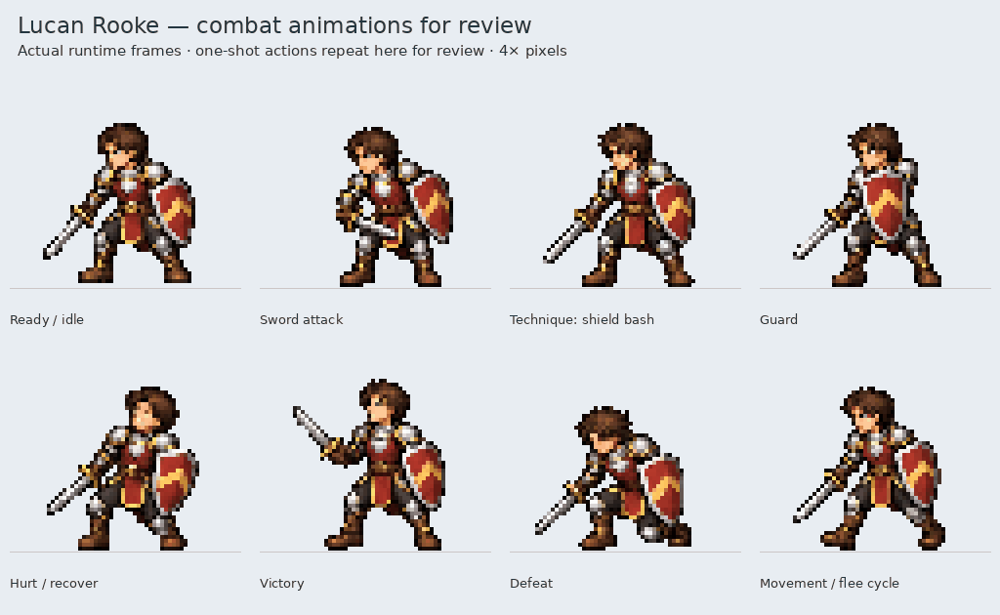
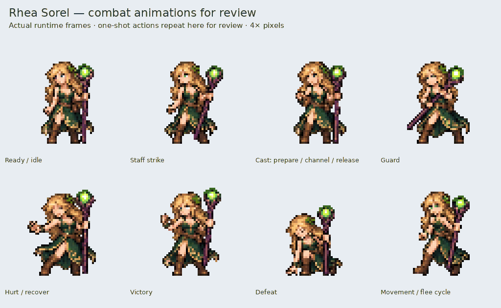

# Lucan and Rhea combat animations — approved

The user approved both animation sets for integration on November 4, 2026.
Each character has 24 authored poses, eight animation groups, and a movement
alias for fleeing. Runtime canvases remain 64×64 with ground anchor [32,54].

[Lucan animated review](lucan_animations.gif) · [All Lucan poses](lucan_poses.png)

[Rhea animated review](rhea_animations.gif) · [All Rhea poses](rhea_poses.png)

| Group | Lucan | Rhea | Timing |
| --- | --- | --- | --- |
| Ready / idle | Subtle breathing, sword and shield ready | Breathing and small hair/robe motion | Four frames, 720 ms loop |
| Attack | Sword attack | Physical staff strike | Four frames, 720 ms; contact at 360 ms |
| Special | Physical shield technique | Prepare, channel, release and recover | Four frames, 900 ms; contact/release at 500 ms |
| Guard | Shield forward | Staff brace | Two frames, 480 ms loop |
| Hurt | Recoil and recover | Recoil and recover | Two frames, 400 ms |
| Victory | Confident sword flourish | Lively staff gesture | Two frames, 680 ms loop |
| Defeat | Lower into a kneel and settle | Lower into a kneel and settle | Two frames, 680 ms, held at end |
| Movement | Four-phase equipped walk | Four-phase staff walk | Four frames, 560 ms loop |

The GIFs sample the production `CombatSprites.frame` loader, using a stable
per-character palette and nearest-neighbor enlargement. One-shot actions repeat
in this montage for inspection; their runtime metadata remains non-looping.
Contact sheets compare the original approved ready design with the new set.
These are sprite-playback previews, not newly implemented party encounters.

The work adds no recruitment, ability unlocks, damage rules, or spell effects.
Lucan's two-handed sword variant remains future work. Existing overworld and
cinematic sprites are unchanged.

Sources and exporter notes are in
[`assets/source/combat/companion_animations`](../../../assets/source/combat/companion_animations).
Rebuild with `python tools/build_companion_combat_animations.py`, then run
`python tools/preview_companion_combat_animations.py` with Pygame and Pillow installed.

All **95 asset/combat and battle-view checks pass**, including native-loader timing, one-shot holds, clipping, source provenance, deterministic rebuilding and protection against older exporters overwriting these packs. [Commands and hashes](validation.json) · [Test logs](tests.txt).
