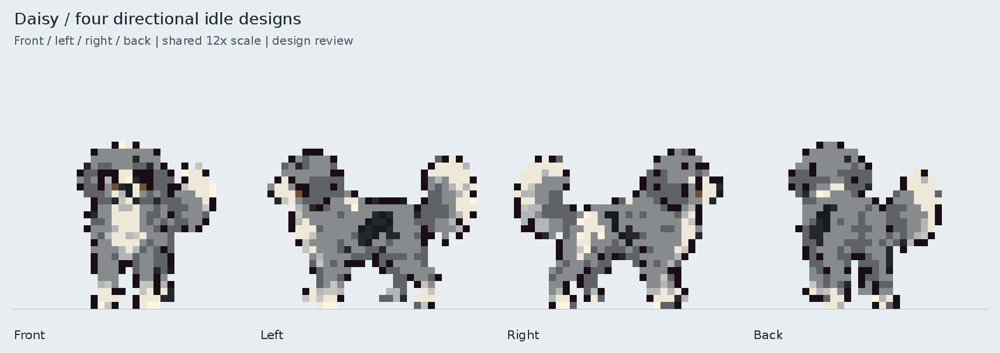

# Daisy — four directional idle designs

Initial sprite designs on `daisy-directional-idles`, awaiting user review.



- [Front — 24× enlargement](idle_front.png)
- [Left — 24× enlargement](idle_left.png)
- [Right — 24× enlargement](idle_right.png)
- [Back — 24× enlargement](idle_back.png)
- [Shared-scale comparison with Liam](liam_comparison.png)
- [Native transparent sheet](../../../assets/characters/daisy/idle_directions.png)

Daisy is Liam's family's gray female dog, with white and black patches, floppy
gray ears and a fluffy tail. Her white muzzle, chest, toes and tail tip remain
readable at game scale. The larger black left-flank patch differs from the
right flank's two smaller black spots and white hip patch. These are separately
authored directional views of one appearance, with no visible eyes in back.

| View | Visible bounds | Frame |
| --- | --- | --- |
| Front | 20×24 | 32×36 |
| Left | 30×23 | 32×36 |
| Right | 30×23 | 32×36 |
| Back | 22×24 | 32×36 |

The wider dog frame fits her body and tail without squeezing the profile.
Pixel density matches the human sprites. The comparison uses the approved
Liam sprite unchanged: Daisy is 23–24 pixels tall beside his 26. All paws and
feet share row 34; the dog draw anchor is `[16,34]`.

The four-view board uses 12× nearest-neighbor enlargement; individual cards use
24× and the Liam comparison uses 16×. Review PNGs have opaque light backgrounds
so they remain visible in image viewers. Game PNGs retain hard transparency.

Source plate, export registration and reconstructable layers are under
`assets/source/characters/daisy/`. Reproduce with:

```sh
python tools/build_daisy_idles.py
```

The builder checks bounds, baseline, colors, hard alpha, eye landmarks and
layer reconstruction. This pack contains idle artwork only; placement, walking
cycles and pet behavior have not been added to the game.
