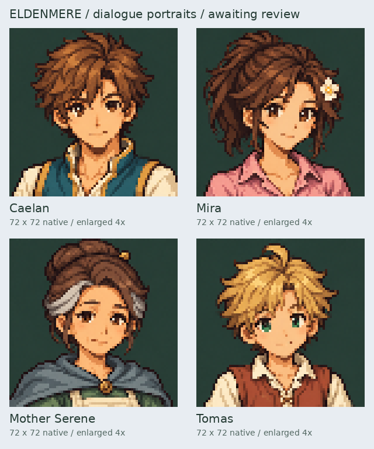
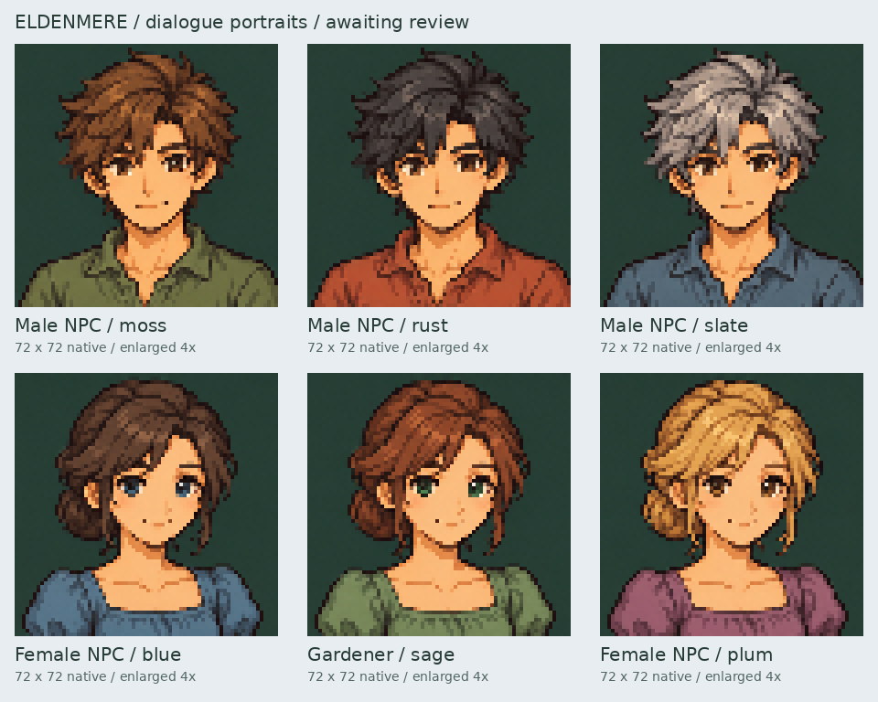

# Dialogue portrait review

Status: awaiting user review. Ten portraits are available as individual 72×72
PNGs, with a neutral expression and dark green background. Each labeled board
shows the exported game asset enlarged exactly 4× using nearest-neighbor
scaling. These are the actual exported portraits, not higher-resolution
substitutes.

## Main cast



## Villagers



The upper row shows male NPC palettes moss, rust and slate. The lower row
shows female NPC palettes blue, sage (gardener) and plum. Their eye colors
are blue, green and hazel respectively.

Individual enlarged previews are named `<speaker_id>_4x.png` in this folder.
The original detailed master sheets are preserved in
`assets/source/portraits/eldenmere/`; game assets and the speaker manifest are
in `assets/portraits/eldenmere/`.

This milestone supplies portrait art only. It does not implement dialogue UI
or change the existing character sprites. Reproduce exports with:

```sh
python tools/export_dialogue_portraits.py
```
