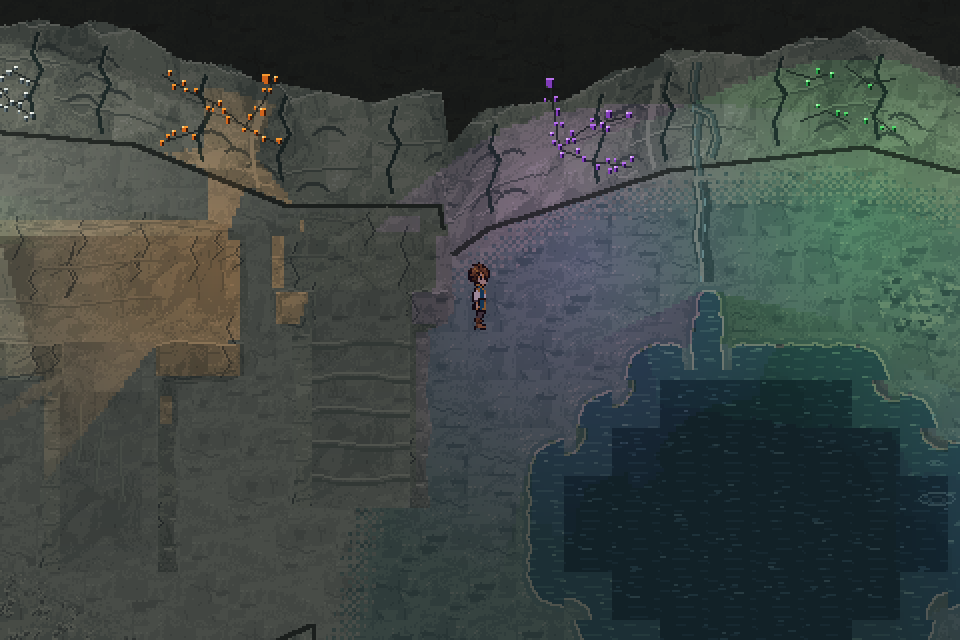

# Full dungeon pack review

The new additions are **unmerged and pending visual review**. This review brings
the previously merged limestone/microcrystal pack and the new terrain families
together in a complete catalogue and one playable sample scene.



## Every asset

- [Full catalogue index](../../../assets/terrain/limestone_cave/catalog/README.md)
- [Complete PDF](../../../assets/terrain/limestone_cave/catalog/full_catalog.pdf)
- [Native asset archive](../../../assets/terrain/limestone_cave/catalog/native_assets.zip)
- [Catalogue overview](../../../assets/terrain/limestone_cave/catalog/overview.png)

The catalogue includes **every module and floor variant**, not just the pieces
placed in the sample scene. Each labelled keyframe has the same enlargement;
animated pages retain all frames for water and microcrystal inspection. The
manifest records catalogue coverage and exact source files.

## Assembled scenery

The following views use the production renderer and unchanged character art:

- [Whole scene](whole_scene.png): stitched native world views at one light clock.
- [Underlying material colors](hero_materials.png) and [crystal lighting](hero_lit.png).
- [Pulse trough](pulse_trough.png) and [crest](pulse_peak.png).
- [Microcrystal pulse](microcrystal_pulse.gif): one full real-time cycle.
- [Animated water and seepage](water_animation.gif).
- [Water detail](water_detail.png) and [static reduced motion](reduced_motion.png).
- [Gameplay contact sheet](contact_sheet.png).
- [Walkthrough](dungeon_pack_walkthrough.mp4): ordinary movement sampled at
  three times speed, with held details and real-time animation segments.

The viewer reaches every authored station by collision-checked walking or
running. It traverses the shelf ramp, visits the tunnels/alcoves and inspects
the grotto, entrance transitions and loose geology. Room transfers, enemy
encounters and quest progression are not simulated by the asset review.

`verification.json` records reached positions, movement modes, water animation,
crystal pulse, reduced motion, microcrystal size and full catalogue counts.
Approved production files retain their merged baseline hashes.

```sh
python tools/preview_dungeon_pack.py
python tools/capture_dungeon_pack.py
python tools/capture_dungeon_pack.py --check
```

The viewer never opens a player journey or settings file. See the
[pack guide](../../DUNGEON_ASSET_PACK.md) for controls, asset families and builds.
