# Illustrated regional atlas and overworld minimap

The regional map now uses illustrated cartography with live roads, place names,
passage states and Caelan's directional marker. Normal overworld exploration
has a local minimap in the lower-right corner. The former Menu button and its
click areas have been removed throughout exploration; Escape still pauses.

The user authorized implementation and merge. These previews come from the
production game and use its ordinary map input, HUD and display-resolution text.

## Atlas

[](atlas_fit.png)

The default Fit view frames the inhabited vale, both rivers, the ruined crossing
and the two checkpoints. Zooming out can show the wider authored chart. Place
labels and operational states stay live over the illustrated terrain.

| Closer inspection | Selected crossing |
| --- | --- |
| 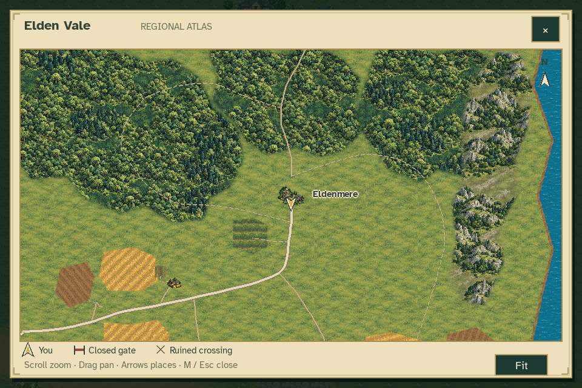 |  |

| Checkpoint status | Player and selected place overlap |
| --- | --- |
| 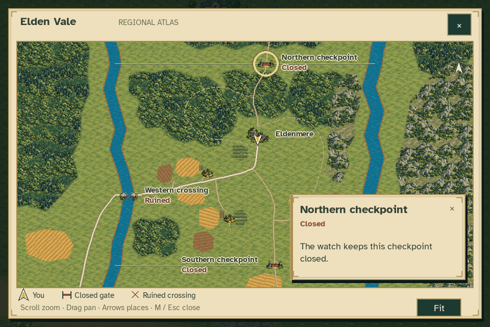 | 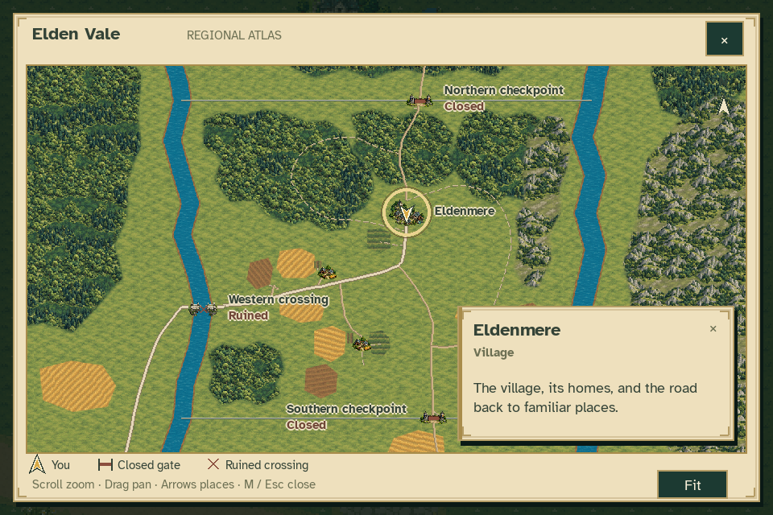 |

| Larger text | Letterboxed display |
| --- | --- |
| 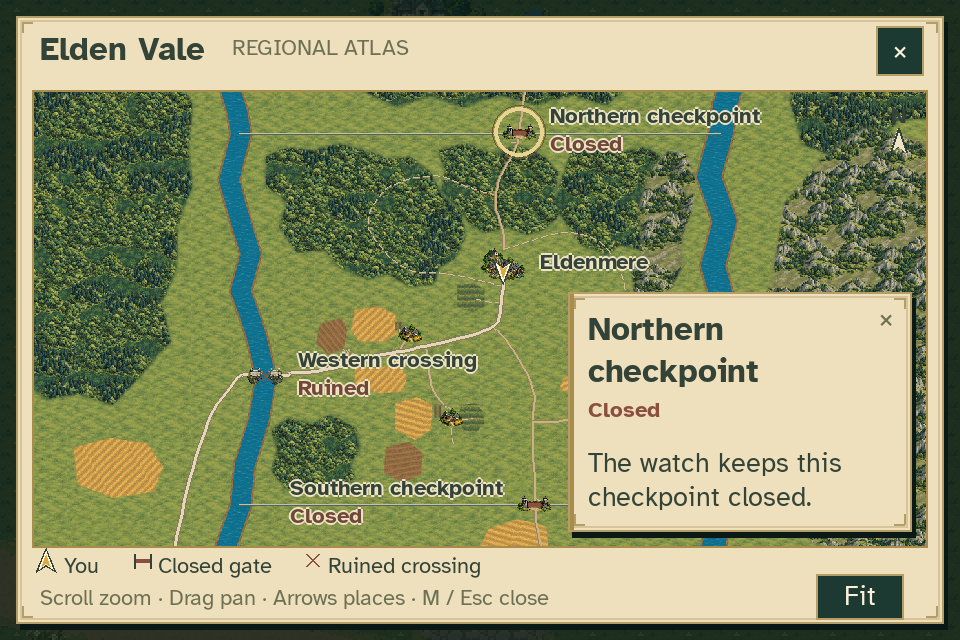 | 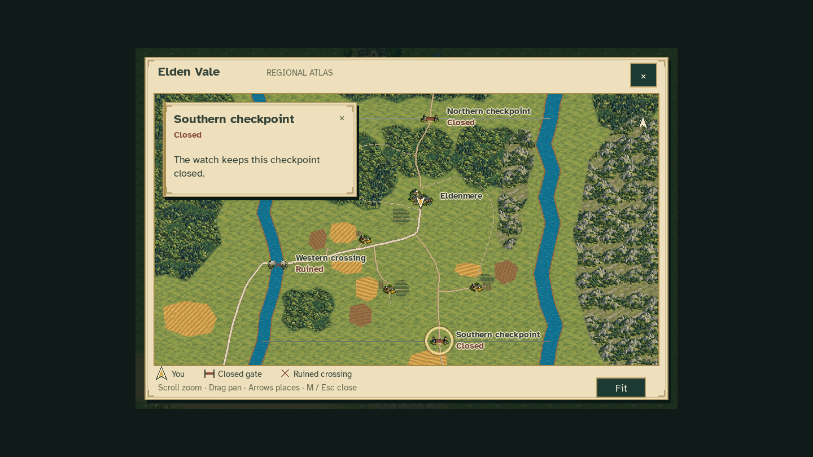 |

Additional accessibility views: [native small window](atlas_small_large_text.png),
[scrolled description](atlas_small_large_text_scrolled.png),
[panned native bridge card](atlas_small_edge_bridge.png), and
[larger-text minimap with interaction prompt](minimap_large_text.png).

[Before/after UI comparison](before_after.png) shows the previous schematic
map and the new default overview. The framing intentionally changes to give
the useful region more screen space.

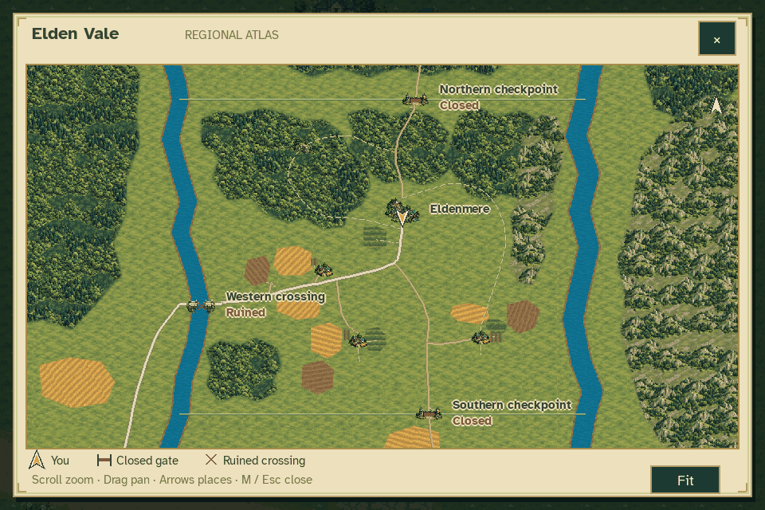

## Minimap and HUD

| Near Eldenmere | Woodland |
| --- | --- |
| 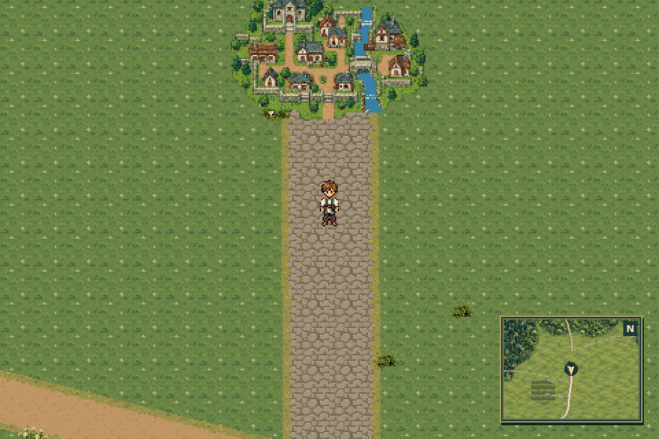 | 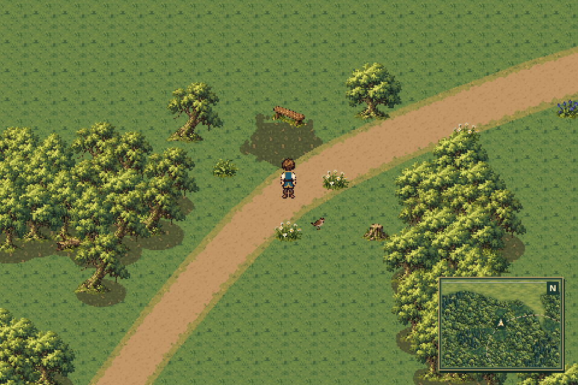 |

| Ruined crossing | Checkpoint |
| --- | --- |
| 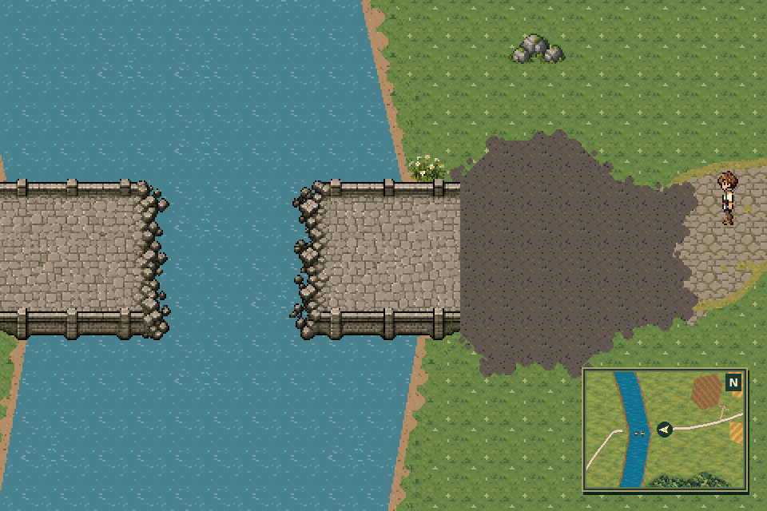 | 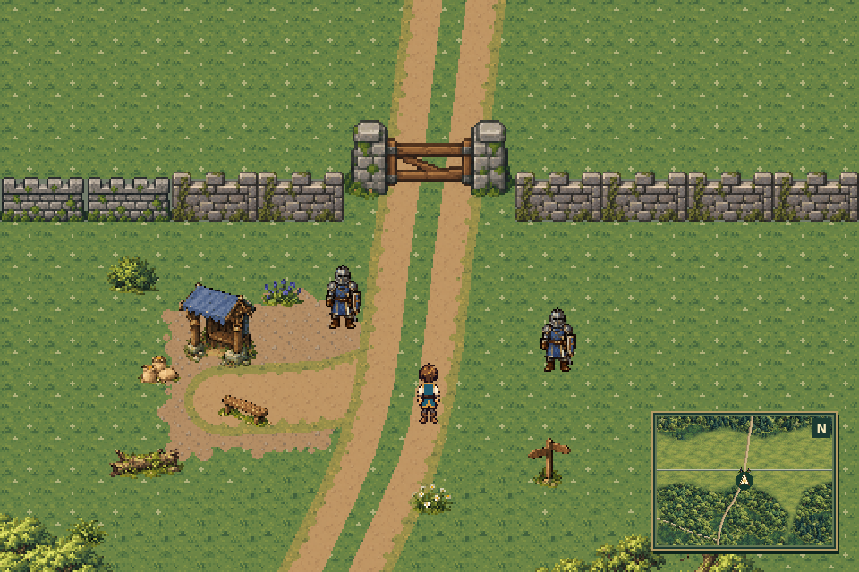 |

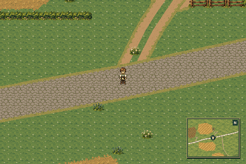

The minimap stays north-up, follows Caelan and uses his facing direction. It
shares chart tiles and cache with the atlas. Clicking it opens the full map.
It yields to dialogue, notices and other interface screens.

The [town HUD](town_no_menu.png) and [interior HUD](interior_no_menu.png) have
no corner Menu button or replacement minimap. Escape remains available.

## Review and validation

- Inspect river, road, wall, settlement and landmark registration.
- Select a place by icon or name; inspect its card and passage status.
- Scroll, drag, navigate places with the keyboard, use Fit and close with M/Esc.
- Compare normal and larger text, including descriptions that need scrolling.
- Move and turn on the overworld; check the minimap and its click target.
- Enter town/interiors and open dialogue or another screen; check HUD visibility.
- Confirm existing pause, quest, travel and Continue behavior.

The chart has fixed-size tiles and levels of detail with bounded shared caches.
Its component draws never request gameplay chunk rendering or a region-sized
runtime surface. Source hashes keep captures registered to their final inputs.

```sh
python tools/build_cartography_art.py --check
python tools/build_elden_vale_cartography.py --check
python -m unittest discover -s tests -p 'test_*cartography*.py' -v
python -m unittest discover -s tests -p 'test_overworld_*map*.py' -v
python tools/capture_elden_vale_atlas.py
```

See [capture measurements](capture_report.json),
[validation results](validation.json), and the [map implementation guide](../../REGIONAL_MAP.md).

Final verification: the full discovery run passed **1,257 tests**. The final map
regression run passed **35 tests**, including the last small-window card and
legacy mouse-wheel fixes. Both artwork exporters passed byte-for-byte checks.
All **81 capture input hashes**, **10,433 original PNGs** and the source region
JSON are unchanged from their verified inputs. Independent review checked 600
layout states and found no unresolved blocker.
