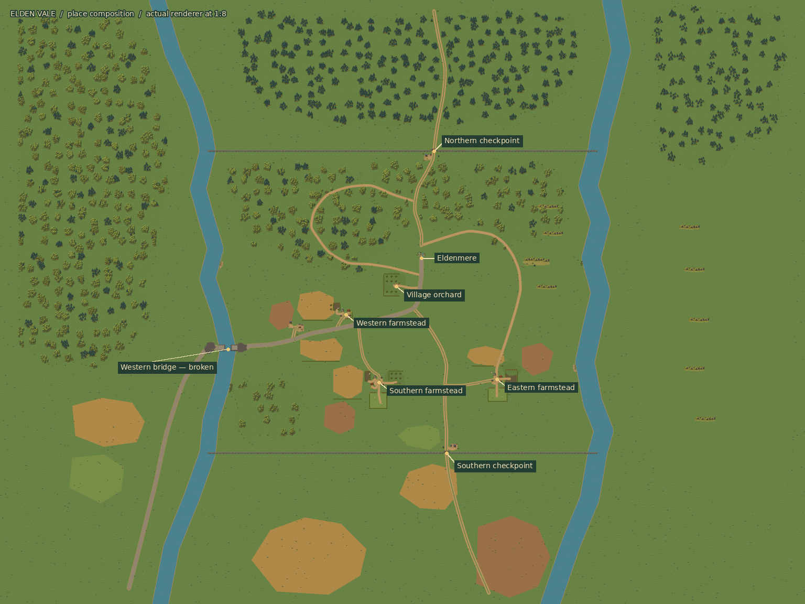
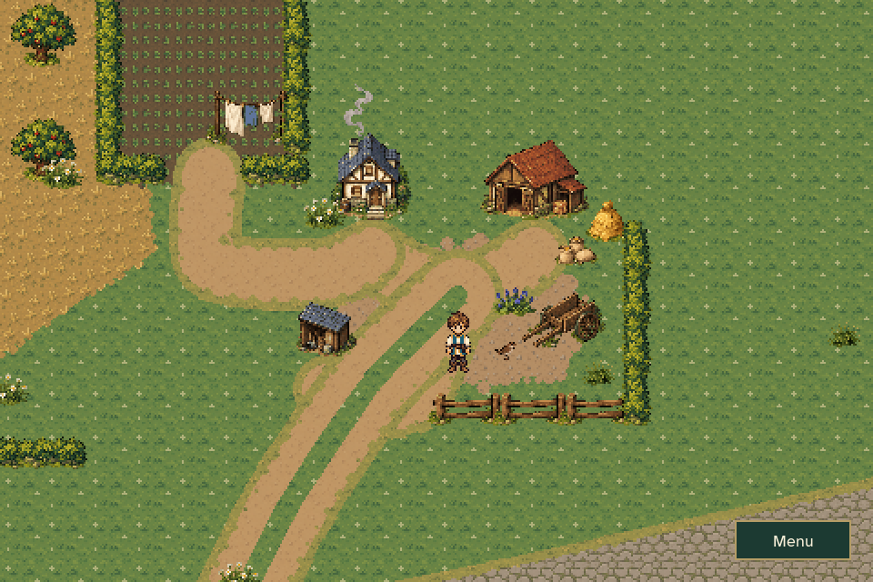
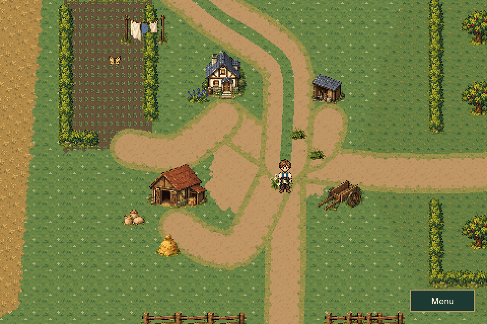
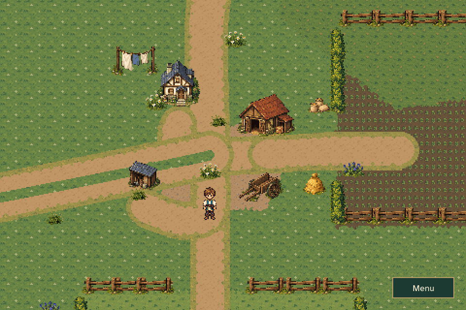
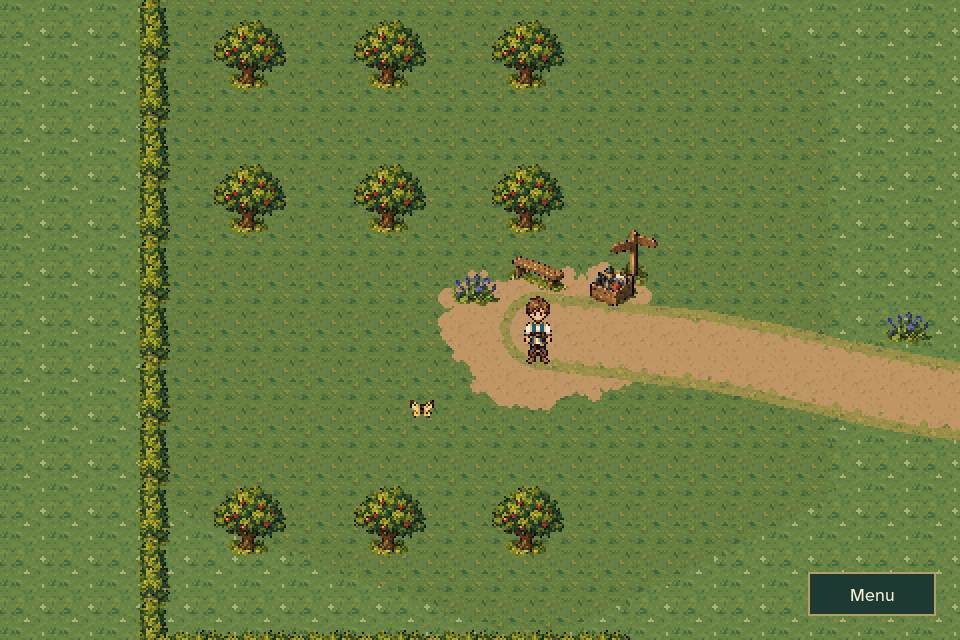
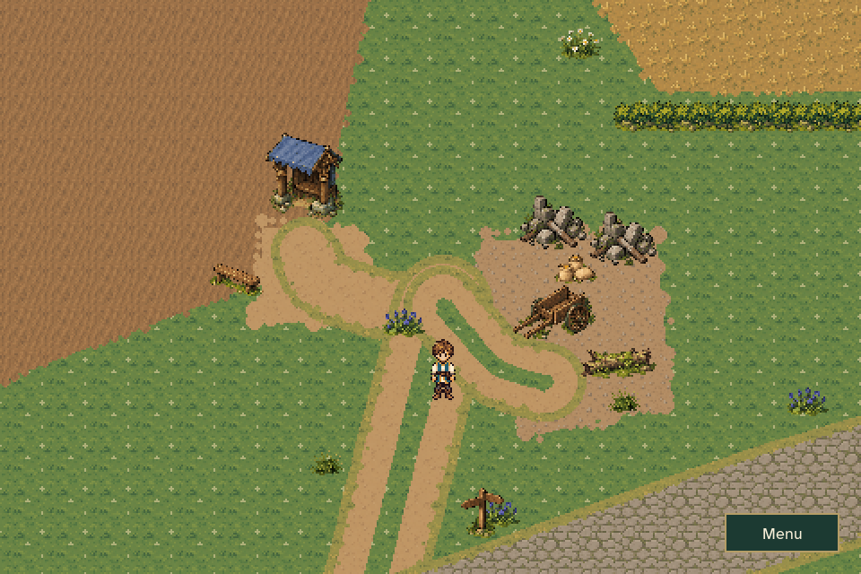
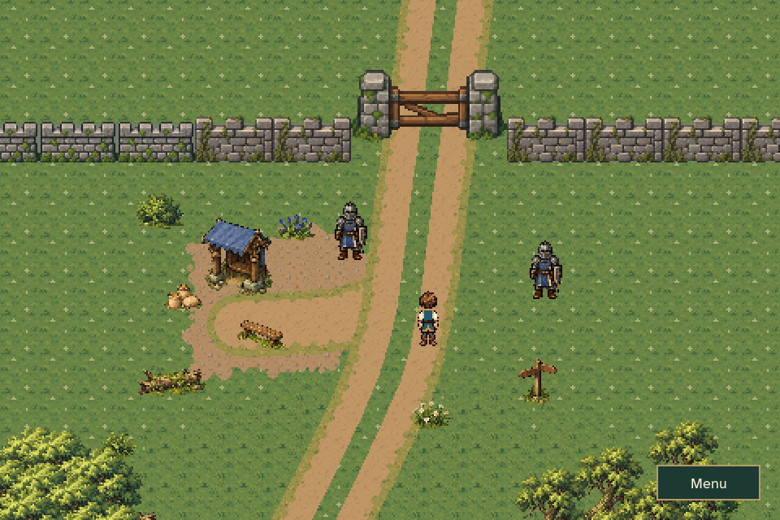
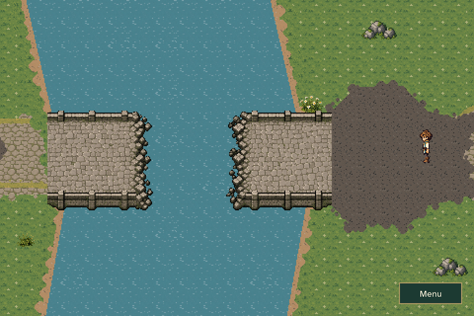
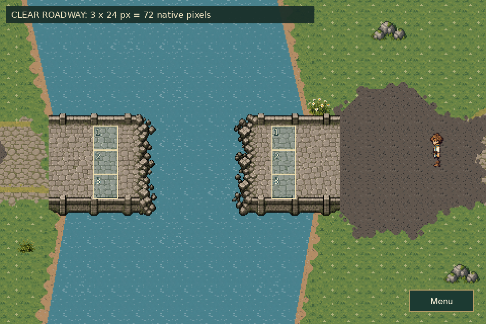
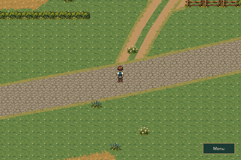

# Elden Vale place composition and wider ruined bridge

This pass concentrates each location around its approach, working space and
surrounding land. It also replaces the narrow ruined bridge with a crossing
whose roadway measures three 24-pixel tiles across, north–south.

The user approved implementation and merge, with review to follow in-game.
All captures below use the production renderer and the final authored layout.

## Region and places

[](region_overview.png)

The overview includes context beyond the opening walls. The two boundary
rivers, guarded checkpoints and independent ruined crossing retain their
existing progression rules.

| Grain loading court | Garden and pasture farm |
| --- | --- |
|  |  |

| Crop-gate farm | Orchard arrival and resting place |
| --- | --- |
|  |  |

| Relief loading bay | Northern duty station |
| --- | --- |
|  |  |

Additional views: [southern checkpoint](southern_checkpoint.png),
[forest interior](forest_interior.png), [woodland approach](northern_woodland.png),
[riverbank](riverbank.png), and [eastern foothills](eastern_foothills.png).

## Three-tile bridge roadway



The width is the north–south roadway between its parapets. Its east–west span
still meets the riverbanks, and the destroyed center remains an open gap.
The separate bridge-repair fact continues to govern whether it can be crossed.

[](bridge_width_audit.png)

The audit overlays three 24-pixel tile intervals on the rendered road surface.
The ordinary gameplay view contains no measurement guides.

## Walkthrough



[Town exit and return](town_transition.gif) exercises the existing automatic
contacts. The walkthrough uses ordinary player movement, collision and camera
tracking, with the existing walking animation and speed.

## In-game checks

1. Follow the stone road from Eldenmere to the bridge. Inspect the wider deck,
   matched approaches and collapsed center; the broken route must remain closed.
2. Visit the farms. Look for connected entrances, door approaches, working
   groups of tools/supplies, clear tracks and purposeful property boundaries.
3. Follow the orchard aisle to its resting and harvest area. The path should
   arrive at a visible destination.
4. Approach the relief station and both checkpoints. The loading track should
   remain visually clear, and the guards should stand near their gates.
5. Walk the woodland, bank and foothill routes. Check canopy groupings, ground
   transitions, connected rock shelves and readable passages.
6. Continue an existing regional journey and verify that quest companions and
   progression resume safely, including when a new prop occupies older feet.

The illustrated regional-map redesign is a separate planned PR.

## Reproduce

```sh
python tools/build_overworld_composition_art.py --check
python tools/build_elden_vale_overworld.py --check
python -m unittest discover -s tests -p 'test_overworld_*.py' -v
python tools/capture_elden_vale_composition.py
```

See [capture measurements](capture_report.json),
[validation results](validation.json), and the [overworld guide](../../OVERWORLD.md).
The [previous environment pass](../elden_vale_polish/README.md) remains available
for historical comparison.

Validation passed: 107 relevant regression cases, including measured bridge
width, three repaired-deck lanes, doorstep/orchard access, relocated guard
dialogue, world seams, progression barriers and saved-journey compatibility.
Both exporters reproduce their outputs byte-for-byte. All 10,405 pre-existing
tracked PNGs remain unchanged; the wider bridge uses new artwork.
