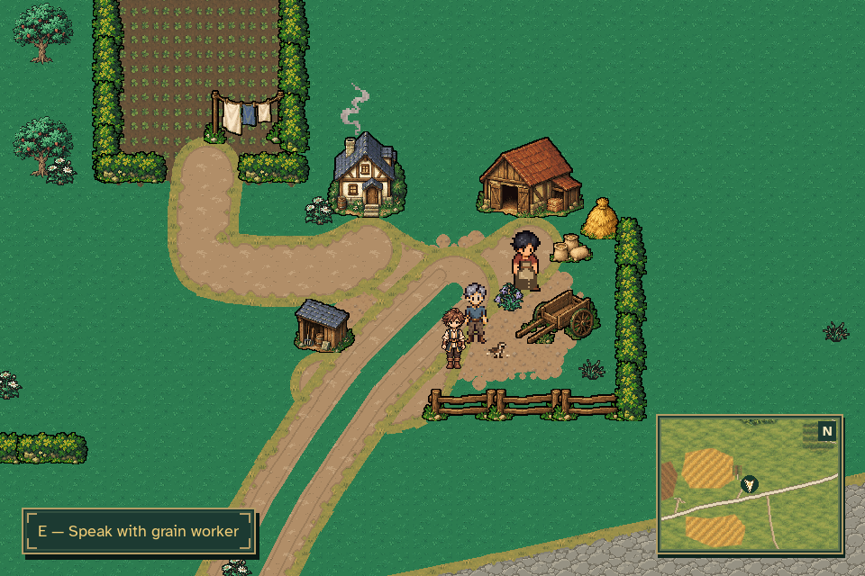

# Elden Vale — live HD foundation integration

This review records the first gameplay integration after the three staged asset
deliveries. The [regional guide](../../world/regions/ELDEN_VALE.md) remains the
creative authority; [OVERWORLD](../../OVERWORLD.md) owns runtime/reproduction facts.

## Delivered scope

The live `hd_art_manifest` binds 21 material records and 48 scenery records at
2× artwork density. Nineteen vegetation aliases share one union crop, scale and
root registration across their animation frames. Regional logical canvases,
anchors, movement speeds and collision remain at their previous scale. The
Sanctuary miniature and separately owned NPC, wildlife and handheld banks retain
their existing art in this step.

Native materials follow existing vector roads, fields and rivers. Paving and
water phases use global coordinates, including negative coordinates and chunk
edges. Natural bank detail stays on the dry fringe. Contact shading and curved
shore joins have explicit seam regressions. Water and plant motion use the
exploration clock; reduced motion selects fixed frames, and pause/focus loss
freeze presentation and exploration.

The source recipe records six area roles and protects the future internal
causeway along the existing road. Antler support candidates reference existing
solid outcrops; overhead reservations add no collision. Geometry hashes retain
the original rivers, roads, walls, gates, landmarks, bridge and authored scenery.
Collision comparisons find no newly solid pixels in ten critical chunks.

Pale Antlers, signature ruins, the rebuilt Sanctuary silhouette, Rising Rain,
new local actions and final atlas regeneration remain subsequent integration.
The atlas/minimap artwork in these captures is the existing map. Original staged
pack manifests keep their delivery metadata; the live overlay registry records
the actual integration. Refreshing the foundation builder updates only its
dynamic layout/provenance JSON for the newly reserved clearances.

## Actual-game review

Captures come from an initialized `Game`, disposable save/settings paths and the
production native renderer at 960×640. Fixed review views place the player on
clear ground; movement and reciprocal scene contacts use `Game.update`. They do
not constitute an uninterrupted quest playthrough. PNGs preserve exact render
pixels; GIFs use one shared review palette.

| Area | Capture |
| --- | --- |
| Eldenmere / meadows | [Town miniature](town_miniature.png), [meadows](eldenmere_meadows.png) |
| Southern farms | [West farm](farmstead_1.png), [middle farm](farmstead_2.png), [east farm](farmstead_3.png), [orchard](southern_orchard.png) |
| Western road | [Broken bridge](western_bridge.png) |
| Internal causeway reservation | [Existing road / protected clearing](central_causeway_reservation.png) |
| Northern woodland | [Woodland](northern_woodland.png), [millrace approach](millrace_approach.png) |
| Sanctuary heights | [Existing Sanctuary approach](sanctuary_approach.png) |
| Boundaries | [East riverbank](eastern_riverbank.png), [north checkpoint](northern_checkpoint.png), [south checkpoint](southern_checkpoint.png) |



[Walking](road_walk.gif), [running](road_run.gif) and
[town departure / return](town_roundtrip.gif) show actual gameplay movement.
The three-second road captures travel 215.676 and 323.325 logical pixels along
the curved path, consistent with the retained 72 / 108 units-per-second speeds.

The review checked readable native contours, fixed vegetation roots, preserved
regional scale, scenery depth and road/shore joins. Existing character-bank
migrations remain separate. The [reduced-motion view](reduced_motion.png) and
three [water stills](water_still_0.png) are time-invariant; normal water samples
change by 310 / 410 native pixels against their initial frame, while reduced
motion changes by 0 / 0 in the same water-only crop.

## Evidence and verification

All **184 tests** passed across the overworld (79), regional controllers/materials
(66), Elden Vale packs/integration (23) and renderer (16) suites. All four
foundation, live-registry, signature-landscape and Rising Rain export checks
passed. An outdated map-freeze test fixture was updated to supply the current
Game controllers; production behavior did not require a workaround.

[observations.json](observations.json) records exact runtime/art hashes, capture
hashes, view fixtures, timings, cache state and gameplay probes. The capture
rejects a run if an input changes during it.

- Visible farmhouse texels match the HD source with **zero RGBA mismatches**.
  Compare [native source detail](farmhouse_native_pixels.png) with the
  [old enlarged source](farmhouse_legacy_upscale.png).
- **150,918 native pixels** in the sampled ground chunk differ from an enlarged
  logical mirror: [native chunk](ground_native_detail.png),
  [mirror enlargement](ground_logical_upscale.png).
- Automatic town departure/return and regional Save/Continue preserve exact
  quests, party, dialogue flags, player and regional state. The sampled town
  actors each retain one owner.
- Pause and focus-loss probes preserve elapsed time, player position, farm /
  garden / bridge controller snapshots and native world-render hashes, then
  verify that exploration time resumes.
- Focused tests cover unchanged protected geometry, no new solid ground,
  chunk/cache eviction, frame registration, still frames, exact material masks,
  seam stitching, repaired-bridge exclusion and transient oversized masks.

Warm draws are measured after lookahead cache keys stabilize, over 12 samples
per view. Land-view means are **3.67–6.43 ms**; riverbank and bridge means are
**14.03 / 15.41 ms**, with maxima **28.53 / 39.63 ms**. These are hardware-specific
SDL-dummy world-render measurements, excluding simulation, display and UI; they
are not a frame-rate guarantee. The render LRU finishes at **64,880,640 bytes**
within its 67,108,864-byte budget and metadata stays within 64 chunks. The new
material and mask LRUs are separately capped at 8 MiB each. The capture-process
peak RSS includes asset banks, retained GIF frames and a second initialized Game
for Continue; it does not measure the regional cache alone.

## Reproduce

```sh
python tools/build_elden_vale_hd_integration.py --check
python tools/build_elden_vale_overworld.py
python tools/build_elden_vale_hd_foundation.py --check
python tools/build_elden_vale_signature_landscape_hd.py --check
python tools/build_elden_vale_rising_rain_hd.py --check
python tools/capture_elden_vale_hd_integration.py
python -m unittest discover -s tests -p 'test_overworld*.py' -v
python -m unittest discover -s tests -p 'test_regional*.py' -v
python -m unittest discover -s tests -p 'test_elden_vale_*.py' -v
python -m unittest discover -s tests -p 'test_rendering.py' -v
```

When changing the active regional recipe, rebuild it before refreshing the
foundation builder's dynamic layout/provenance metadata. Review that refresh as
an intentional source update; it must not silently change historical art.
