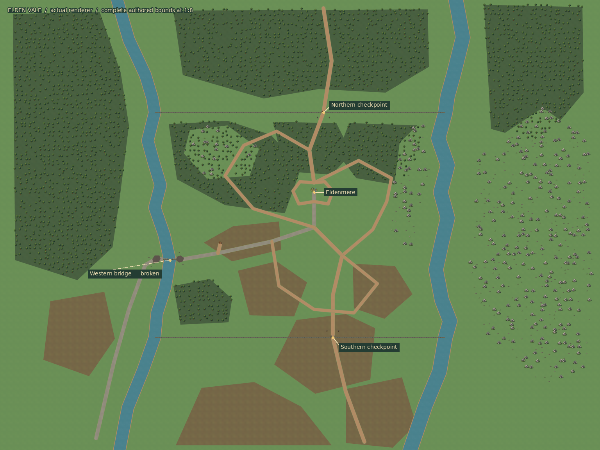
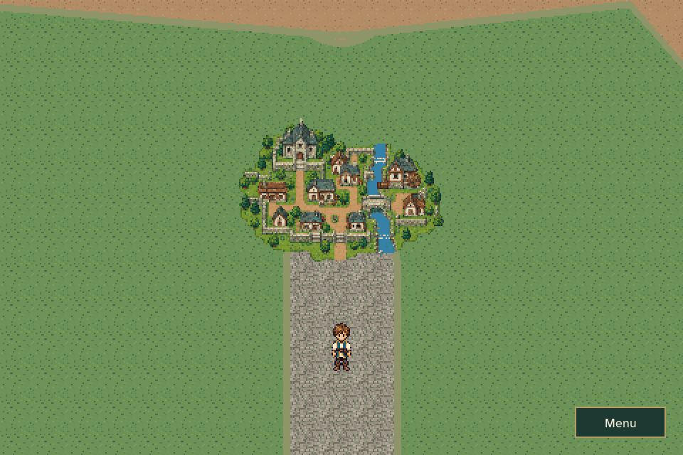
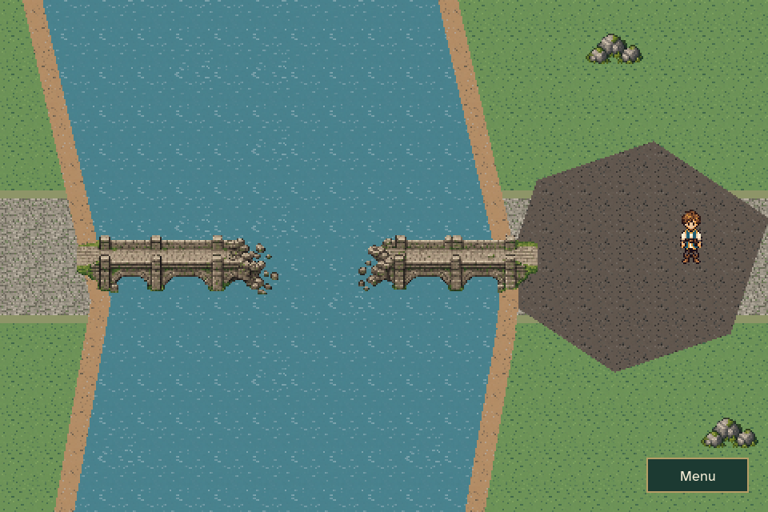
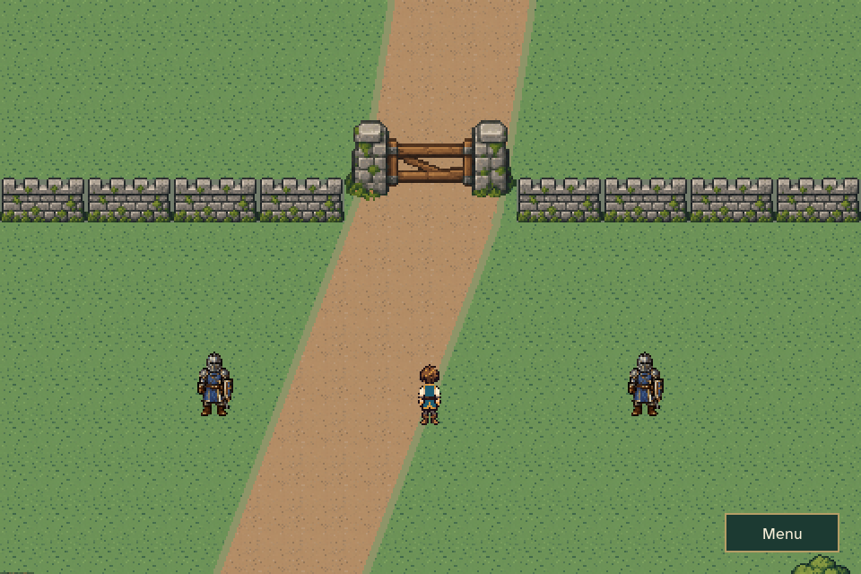
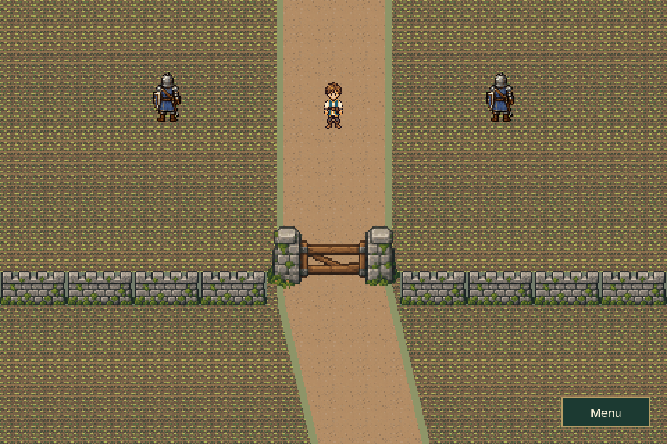
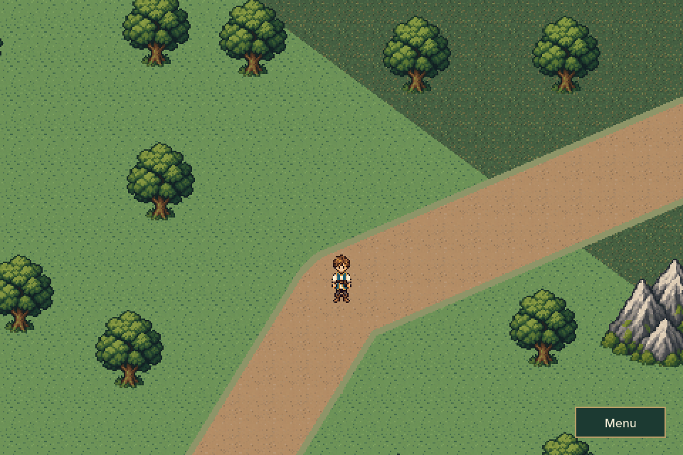
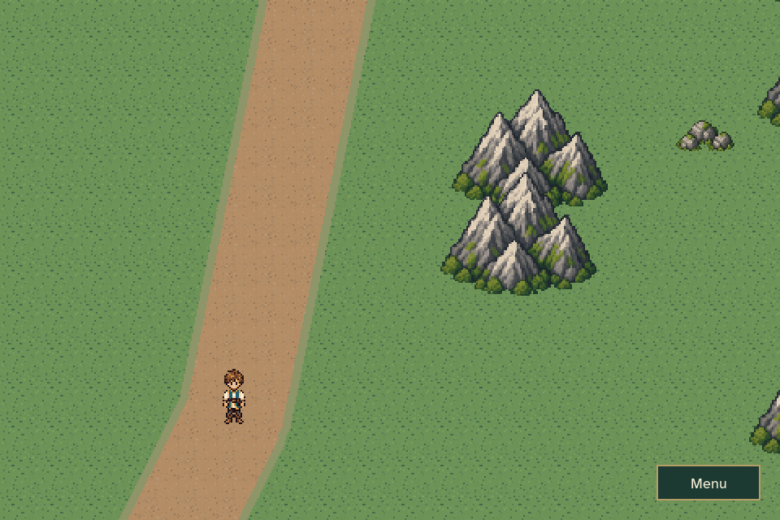
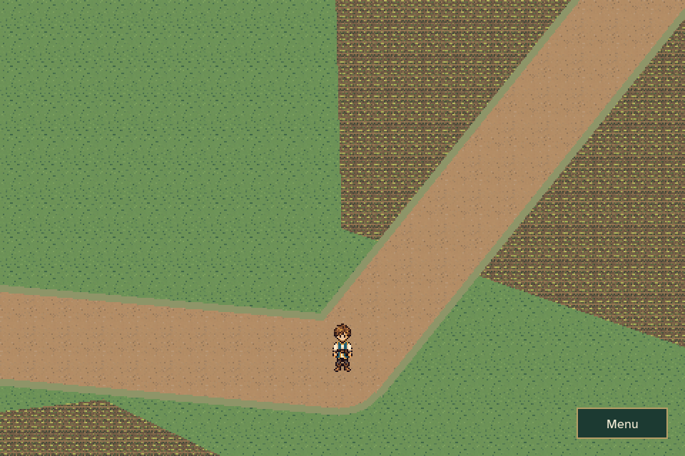
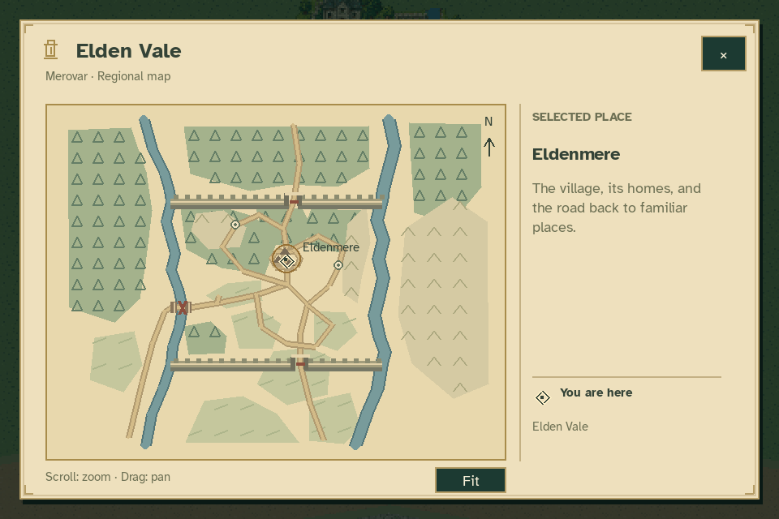
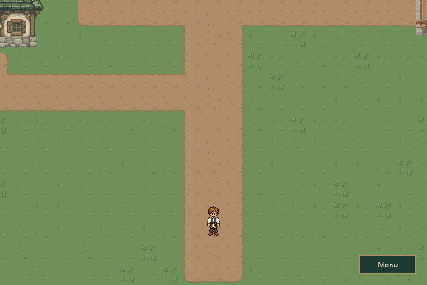

# Elden Vale region review

This feature branch adds the first regional overworld south of Eldenmere.
These captures come from the production `Game` and `OverworldWorld` renderers,
using the new native pixel assets. The PR is prepared for review before merge.

## Layout

[](region_overview.png)

The overview streams all 768 authored chunks, reducing each immediately to
1:8. It includes scenery beyond the opening boundaries for context; the player
is confined between the two rivers and the northern/southern walls. Its labels
are review annotations. The runtime never constructs this overview or a
full-size terrain image.

The [atlas survey](atlas_reference.png) shows the approved map, reference
anchors, winding waterways and enlarged context. The classroom atlas is
unchanged. The boundary rivers and next town south remain unnamed.

## In-game views

| Town miniature and return | Destroyed western crossing |
| --- | --- |
|  |  |

| Northern checkpoint | Southern checkpoint |
| --- | --- |
|  |  |

| Woodland | Eastern foothills | Cultivated south |
| --- | --- | --- |
|  |  |  |

[](regional_map.png)

The regional map uses vector cartography and display-resolution text. It
supports zoom, drag, selection and landmark details without loading chunks.
Optional landmarks appear as Caelan discovers them.

## Movement and scale changes



The transition capture uses ordinary `Game.update` movement across the village
south exit, then approaches the miniature and returns through the southern
entrance. No quest state is seeded. The [woodland movement preview](region_walk.gif)
shows the regional camera following Caelan with the existing walking cycle.

## What to review

1. Follow the village's south road to leave. Eldenmere should read as a small
   town at regional scale, with a continuous road leading away from it.
2. Approach the miniature from any direction to return to the south entrance.
   Step away and re-enter several times; no automatic transfer loop should occur.
3. Follow the stone road southwest to the ruined western bridge. The crossing
   and damaged road on both banks should be readable, and movement should stop
   before the destroyed section. The eastern river has no crossing.
4. Explore the paths, fields, woods and foothill overlook. Both wall checkpoints
   remain blocked. Approach either road guard and press E for a brief exchange.
5. Open M, zoom and drag the regional map, select a landmark and close it. The
   classroom world map and town map should still behave as before.
6. Continue a journey saved in the region, including one with quest companions.
   Return to town and verify that the same companions resume their quest
   positions without replayed dialogue, objectives or rewards.

The guards require a future opening-story release **and** ready destinations;
MQ04 completion alone does not open the walls. Bridge repair is independent.
Aldric's arrival cutscene, revised MQ03 dialogue, future towns, random encounters
and opening-chapter departure are subsequent work.

## Reproduce

```sh
python tools/build_overworld_art.py --check
python tools/build_elden_vale_overworld.py --check
python -m unittest discover -s tests -p 'test_overworld_*.py' -v
python tools/capture_elden_vale_overworld.py
```

The capture tool uses temporary saves and muted audio, renders 960×640 display
views and records both actual contact transfers. Its full overview is assembled
from individual 384×384 render requests; render/metadata cache limits are
asserted during traversal. See [capture measurements](capture_report.json) and
[validation results](validation.json), plus the [implementation guide](../../OVERWORLD.md).

Validation passed: 1,214 full regression cases and 29 final overworld cases.
Both asset exporters reproduce their outputs byte-for-byte. All 10,284 existing
tracked PNGs, including the approved classroom atlas, retain their original hashes.
