# Elden Vale environment quality pass

The region now has a designed agricultural landscape, varied woodland and
rocky foothills, with roads connecting places where people live and work.
These previews use the production game renderer and native pixel assets.
The PR is prepared for visual review before merge.

## Regional composition

[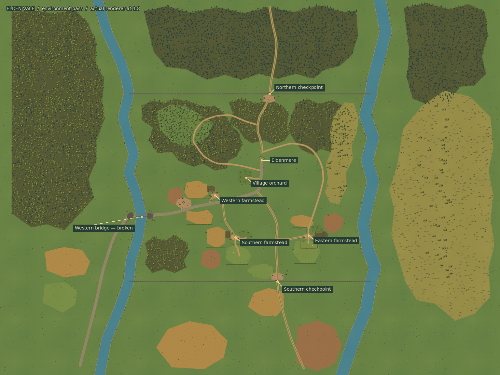](region_overview.png)

The overview includes scenery beyond the walls; the opening enclosure remains
between the rivers and the two guarded checkpoints.

The main stone road leads from Eldenmere to the ruined western crossing.
Smaller cart tracks serve farmyards and field gates; footpaths follow woodland
clearings and the eastern rise. Different crops, pasture and orchard ground
distinguish cultivated parcels. Forest silhouettes and ground transitions
break up the former regular spacing and broad polygon edges.

[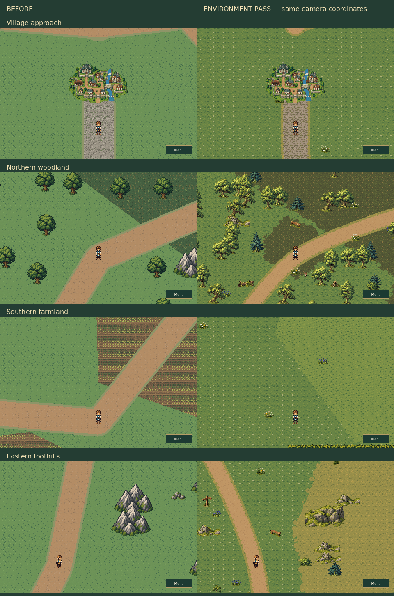](before_after.png)

The comparison holds camera coordinates fixed. The former southern junction
is now meadow; the redesigned farmyards sit along the new cart-track network
and are shown in the close-ups below.

The original regional previews remain available in the
[first implementation review](../elden_vale_overworld/README.md).

## Places to inspect

| Western farmstead | Southern farmstead |
| --- | --- |
| 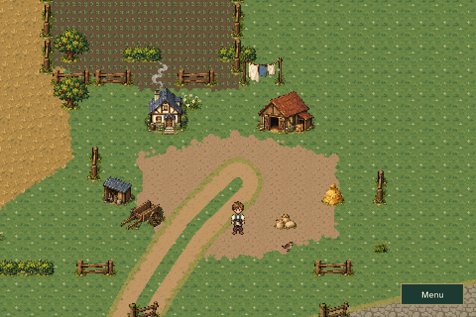 | 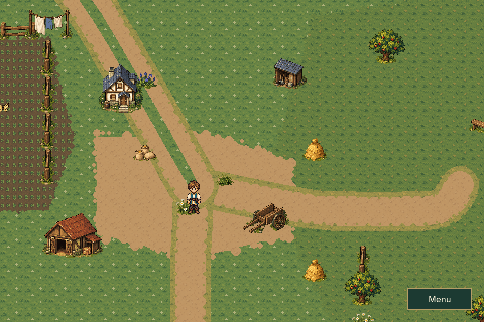 |

| Eastern farmstead | Village orchard |
| --- | --- |
| 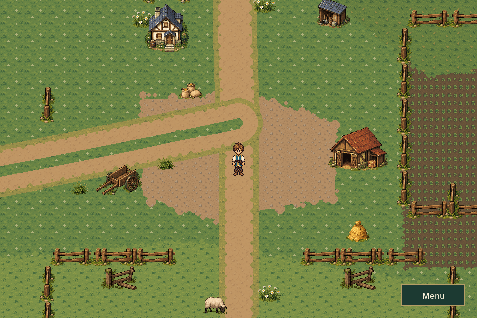 | 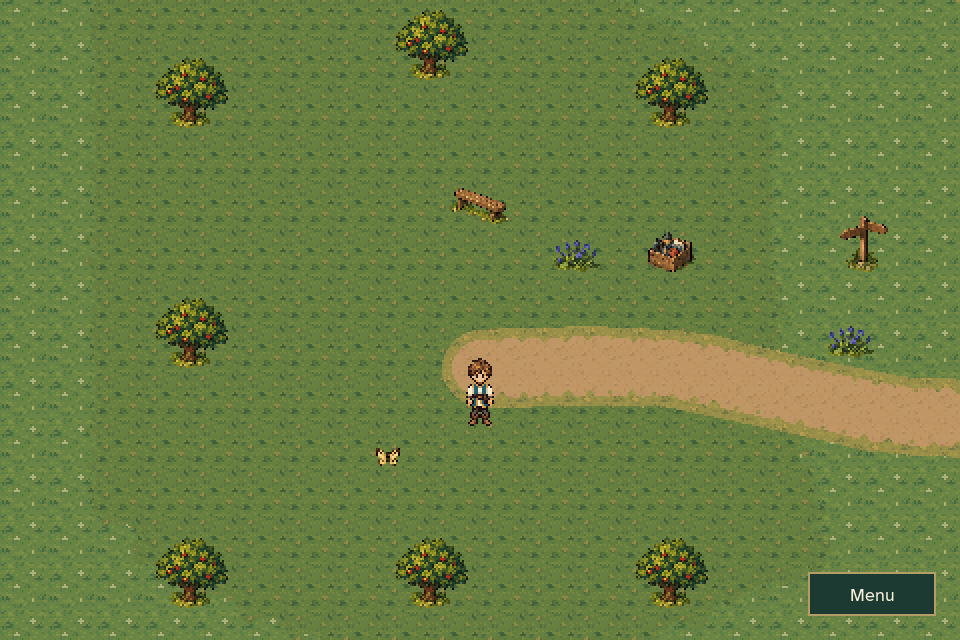 |

| Northern woodland | Eastern foothills |
| --- | --- |
| 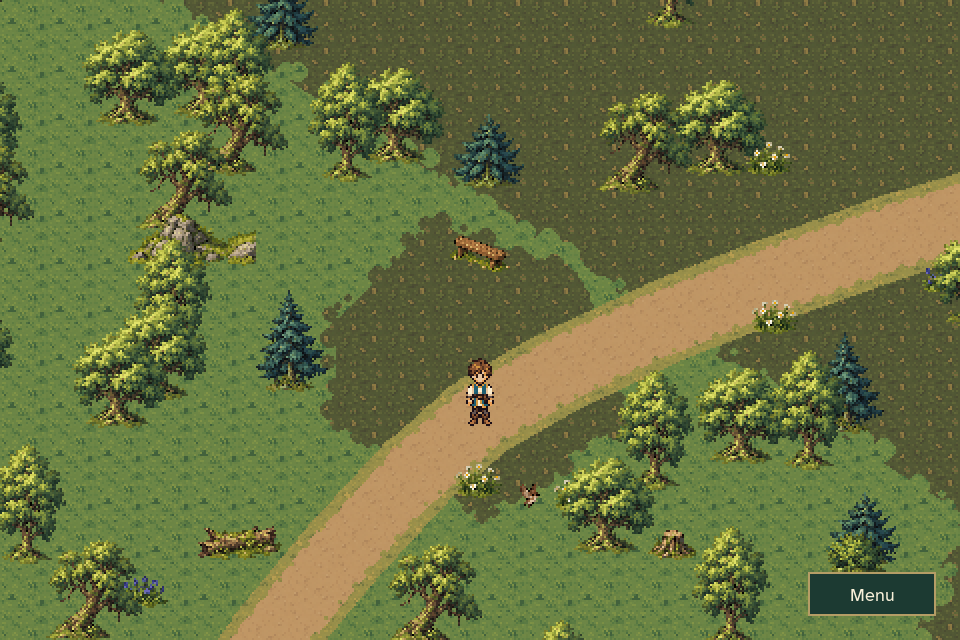 | 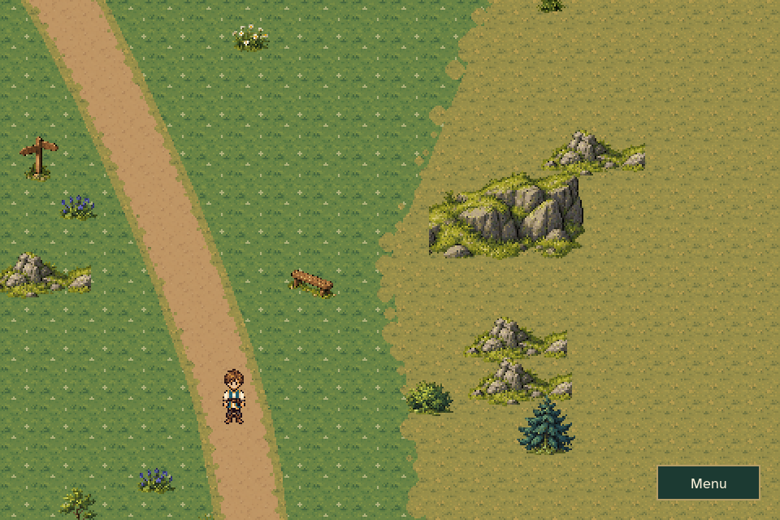 |

| Ruined bridge | Road crew staging |
| --- | --- |
| 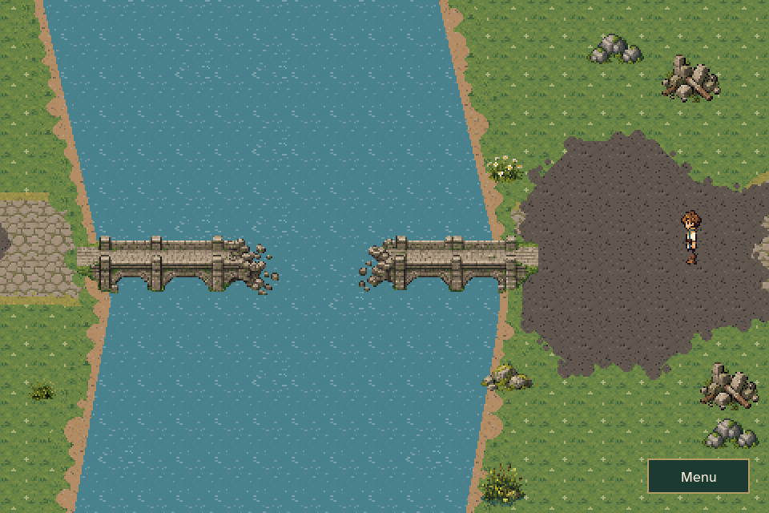 | 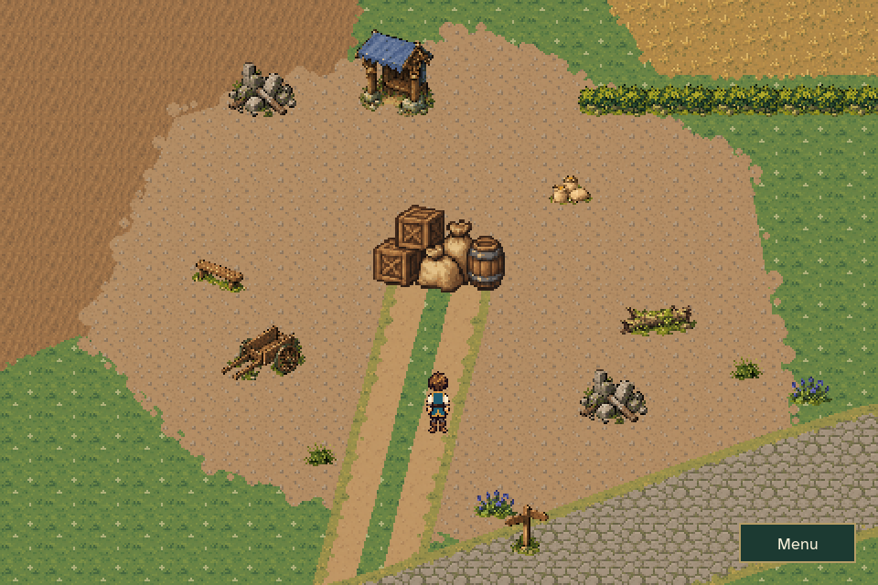 |

| Northern checkpoint | Southern checkpoint |
| --- | --- |
| 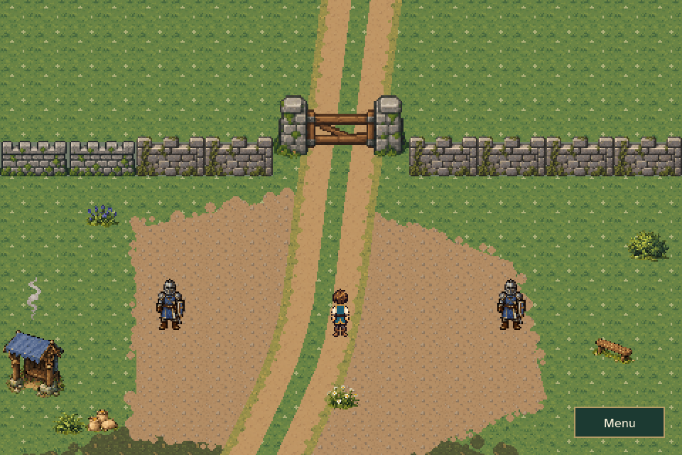 | 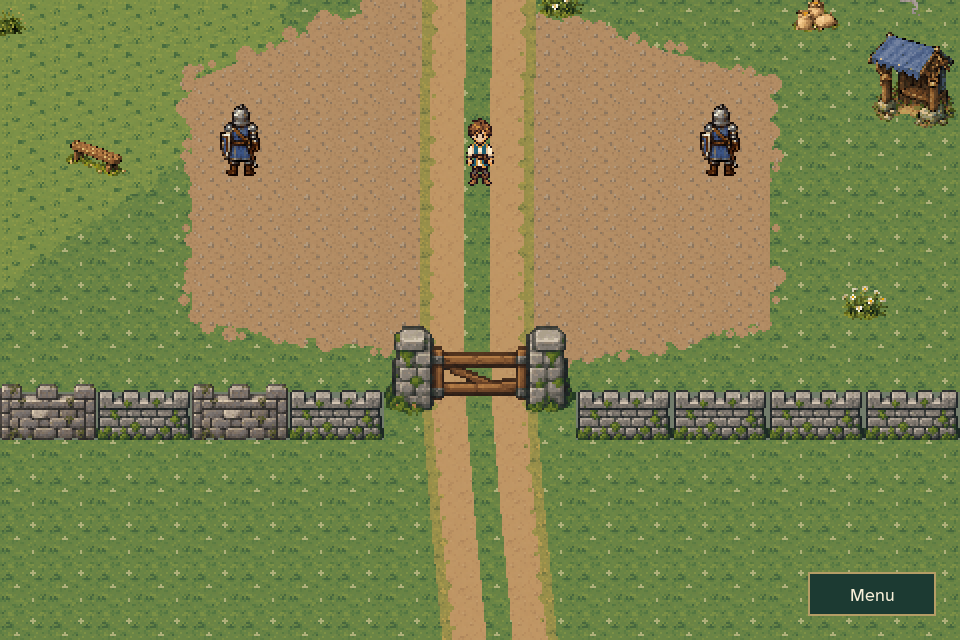 |

Additional views: [village outskirts](village_outskirts.png),
[forest interior](forest_interior.png), [riverbank](riverbank.png), and
[regional map](regional_map.png).

## In motion

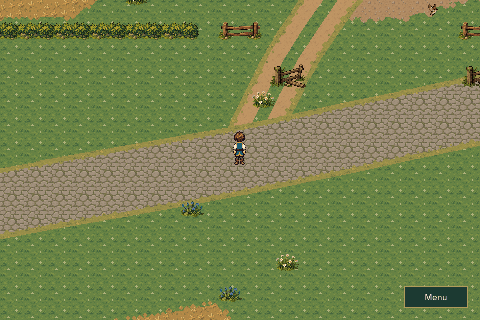

[Town exit and return](town_transition.gif) uses ordinary player movement and
automatic scale-changing contacts. The walkthrough shows actual scenery,
camera tracking and local animation at the existing movement speed.

## Review checklist

- Do the stone road, cart tracks and footpaths have a clear visual hierarchy?
- Do the farmyards read as inhabited, miniature regional places, with distinct
  crop parcels and useful gates?
- Do forests feel clustered and varied, with readable paths and clearings?
- Do the eastern slopes form a coherent rise rather than isolated mountains?
- Are the riverbanks, bridge damage and guarded checkpoints clear in play?
- Do small details and animations add interest while leaving quiet meadow?
- Can Caelan still reach existing landmarks, return through the town miniature,
  and Continue safely from a regional journey?

The same geographic enclosure, town scale, quest progression and durable
checkpoint/bridge facts are retained. Farm buildings are regional scenery.
The art pass adds no new quest, enterable interior or story explanation for
the lightning surge.

## Reproduce and validate

```sh
python tools/build_overworld_polish_art.py --check
python tools/build_elden_vale_overworld.py --check
python -m unittest discover -s tests -p 'test_overworld_*.py' -v
python tools/capture_elden_vale_polish.py
```

The overview is assembled from individual streamed chunk renders and reduced
as each arrives. The runtime does not allocate a region-sized surface.
See [capture measurements](capture_report.json),
[validation results](validation.json), and the [overworld guide](../../OVERWORLD.md).

Validation passed: 99 relevant regression cases, followed by 41 overworld cases
against the final layout. Both exporters reproduce their outputs byte-for-byte.
All 10,321 pre-existing tracked PNGs retain their original hashes. Independent
code and visual reviews found no blocking issues.
