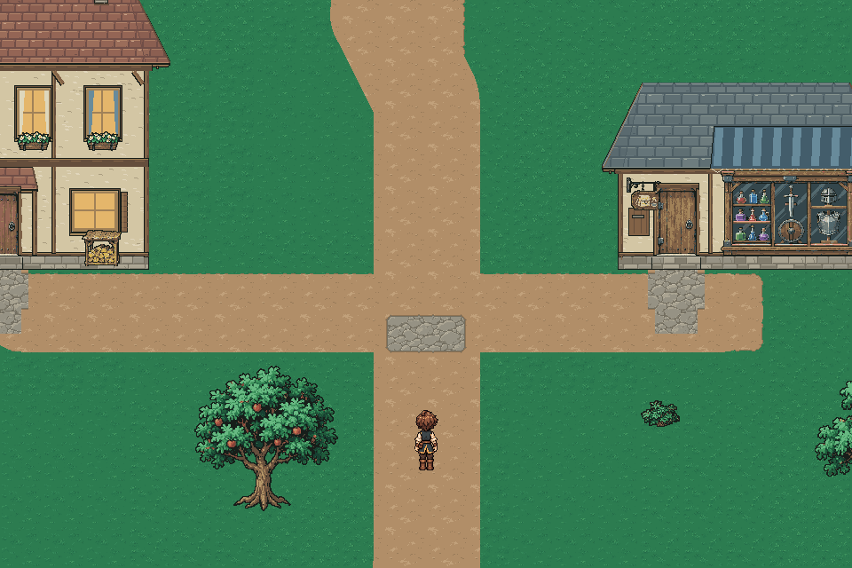
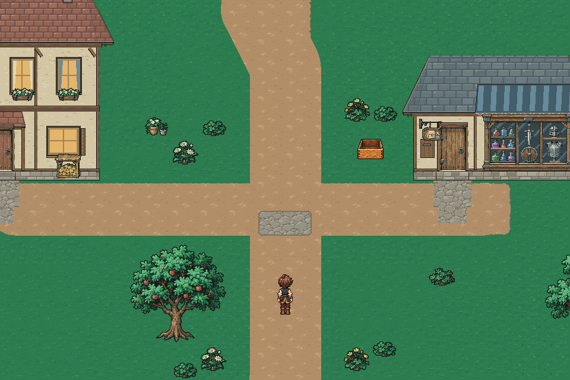
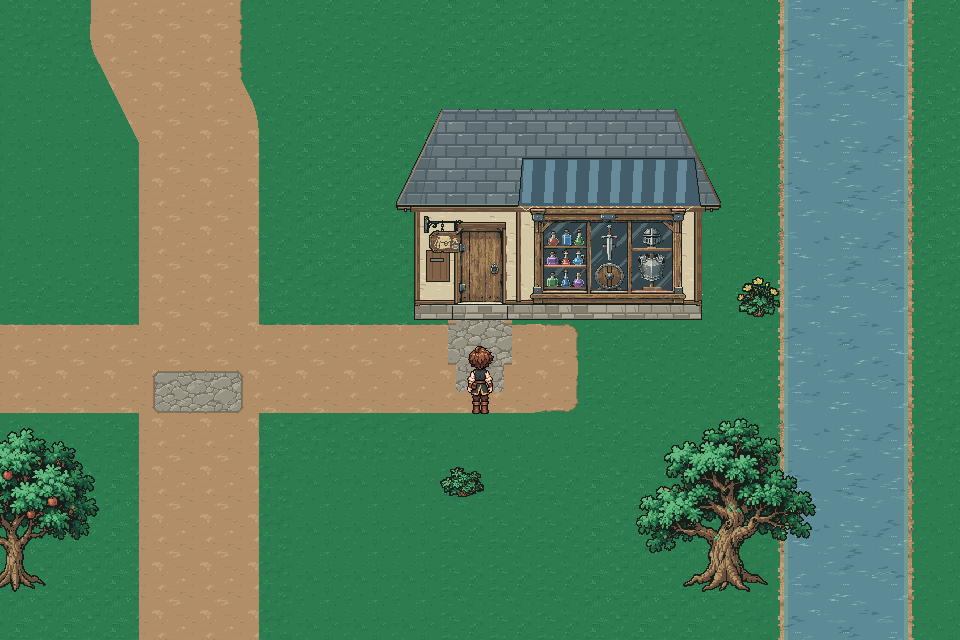
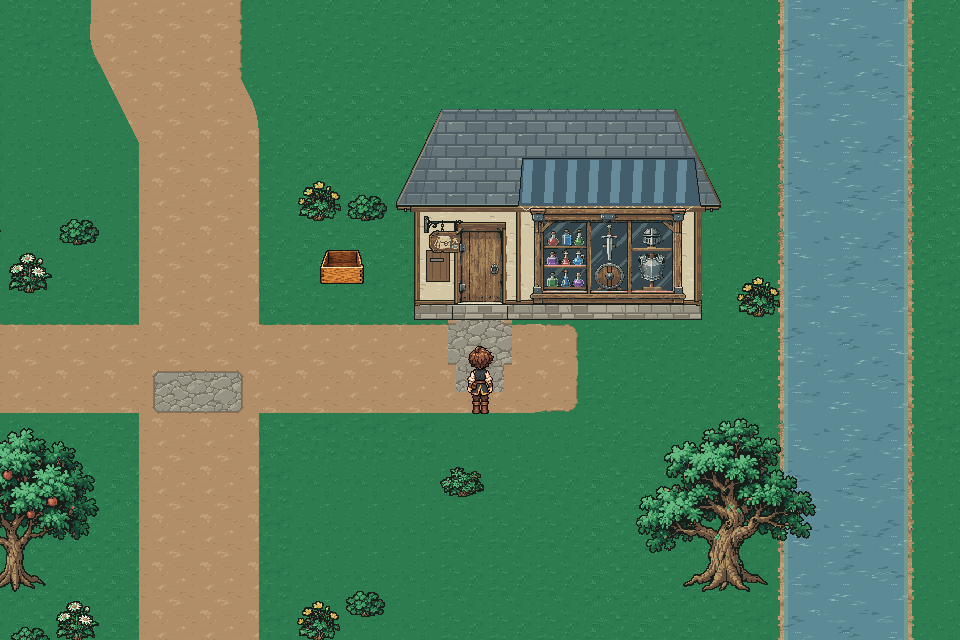

# Eldenmere southern arrival

Sparse planting and two ordinary containers now dress four small margins beside
the inn, item shop and southern approach. The road remains the route out of
town: no new gate, fence, travel condition or interaction is added. Existing
businesses, signs, displays, trees, flowers and shrub retain their owners.

| Clean main before PR 8 | Production rendering |
| --- | --- |
|  |  |
|  |  |

The baseline is clean main
`1e39f7b2ac0f9a8c93bfa3fcb2b27d445cf5bed9`, after settlement PR 7.
[Revision metadata](before_revision.json), [original map](before_town.json),
[original observations](before_observations.json) and exact
[logical collision mask](before_collision.png) are retained for fresh-clone
checks. [The verification record](observations.json) contains native hashes,
source-frame checks, exact player/camera fixtures, movement traces, automatic
travel states, doorway transfers and Continue checks.

These are initialized production Game fixtures with temporary saves/settings
and the opening disabled. Native 960×640 output preserves the ordinary logical
camera coverage. Static fixtures use disclosed clear positions; no quests are
seeded, residents moved, routines disabled or replacement scenery painted.
The collision image is logical data, not a gameplay screenshot. Prop/source
witnesses are unscaled crops of actual native Game frames.

The ten new entities stay within four disjoint logical pockets:

| Pocket | Logical rectangle `[x,y,width,height]` |
| --- | --- |
| Inn frontage | `[384,1392,96,72]` |
| Shop frontage | `[576,1392,48,72]` |
| Western approach | `[432,1600,48,32]` |
| Eastern approach | `[576,1584,48,48]` |

The production checks passed:

- All previous entities and all five earlier dressing ledgers are unchanged.
  Grass, streets, cartography, doors, travel contracts, service and quest
  metadata are unchanged. Existing production artwork is unchanged.
- All **six full native ground phases are pixel-identical** to the baseline.
  There are no soil cells, grass retirements or new flat ground layers.
- Collision is exactly baseline collision union the flowerpots' **20×4** and
  empty crate's **20×6** logical supports: **200 added pixels**. Navigation is
  byte-identical. The retained collision witness covers the full 1536×1632
  logical town, including the southern extension.
- All **13 framework views and nine focused arrival views** have zero changed
  pixels outside the actual four-pocket union, rather than the whole district.
- All **74 authored source frames and ten reduced idles** match their opaque
  native source pixels. Animated sources show visible normal variation; static
  containers remain static. All nine reduced-motion views remain identical at
  0 and 600 ms.
- Caelan's real sprite is checked behind and in front of both solid props.
  The correct prop/actor pixels win at all **257/539** overlapping pixels for
  the flowerpots and **298/749** for the crate. No marker actor or replacement
  scene is used.
- The complete southern road, business lane, door approaches and service-side
  routes pass walking and running in both directions: **24 routes, 3,145 real
  Game.update frames, zero replans**. Both business doors complete walking and
  running roundtrips: **four ordinary entry/return sequences**.
- Automatic regional travel completes **six real roundtrips**: lanes **x=516,
  528 and 540**, walking and running. One initial fixture starts in the older
  town at **[528,1104]**; actual input traverses the southern road before the
  first departure. All later lane alignment, departures, regional walkaways
  and returns use input, with no teleports or convenience transition methods.
- Every automatic departure reaches the same actual regional world singleton,
  normally landing at **[288,-600]**. The player walks away to **[288,-588]**,
  rearms the regional contact and walks north until ordinary automatic return
  to **[528,1572]**. Travel traces retain clear footprints and actual guard,
  modal and cooldown states.
- All three quick-run cases reach the town contact during its positive
  cooldown, with the contact already rearmed. Neutral input then allows the
  normal automatic transfer. First-contact cooldowns are approximately
  **0.035 / 0.061 / 0.035 seconds** for the three lanes. Cooldowns and armed
  flags are never reset during the travel sequence.
- Normal Save/Continue preserves unique arrival entities, all six district
  ledgers, supports and gameplay progress. Two disposable older checkpoints
  at **[420,1424]** and **[600,1443]** are clear with the baseline 24×12 probe
  and blocked by the new supports. Ordinary Continue safely restores both to
  the existing **[384,312]** town entry.
- Quest, party, inventory, flags and production inputs remain unchanged.
  All **159 PNG witnesses**, including the exact collision mask, have verified
  recursive hashes in the capture record.

The authored exit center is **[528,1620]**, but automatic departure occurs
around **y=1603.2** when the player's real footprint first touches the exit
rectangle. The capture exercises that actual behavior rather than forcing the
player onto the exit center or calling a transition method.

The **229 core/arrival checks** and **19 service checks** pass. Separate service
tests cover functionality; this movement review does not claim purchases or
rest-service use. [The baseline comparison](baseline_test_comparison.json)
records the broader regressions and any confirmed existing failures without
changing their original assertions. This is a scoped rendering, movement,
travel and save review, not a full quest playthrough.

Regenerate from a fresh clean-main baseline containing framework/detail views,
exact map/masks and six full native ground phases:

```sh
python tools/capture_eldenmere_arrival.py --baseline-dir /tmp/settlement-pr8-before
```

Large full-town ground witnesses remain in the temporary baseline directory;
the committed review keeps their hashes and useful native scene witnesses.
