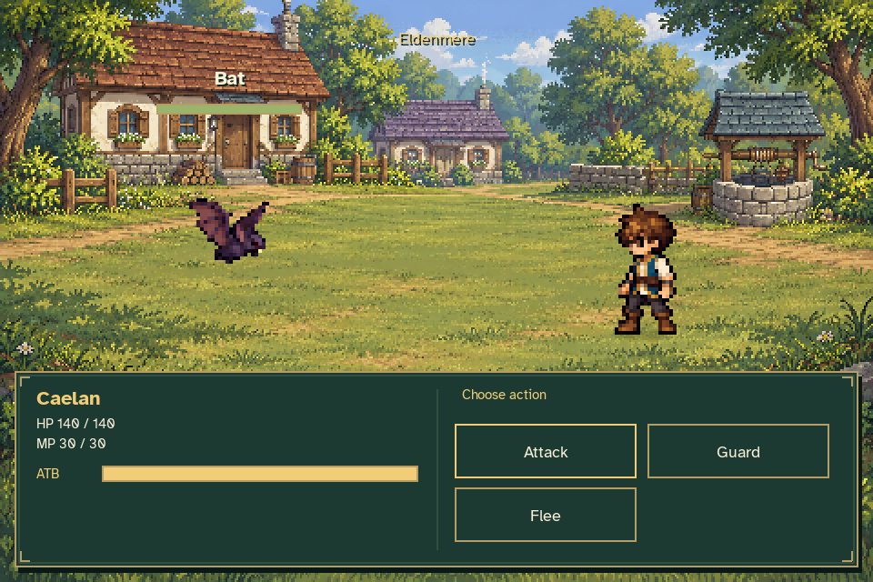
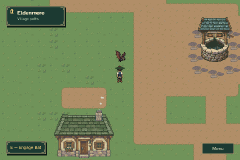
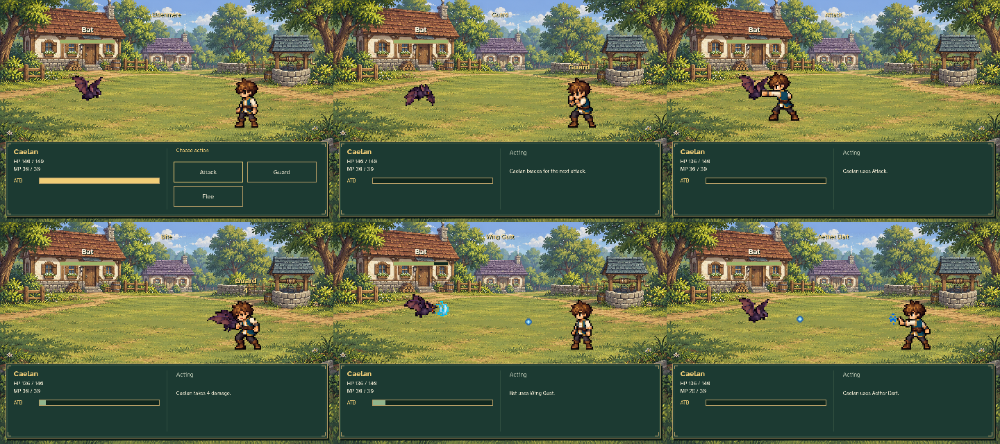
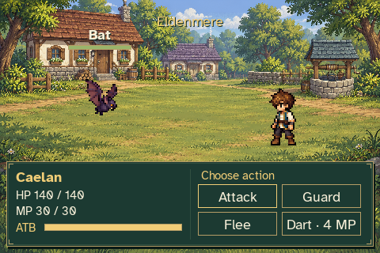
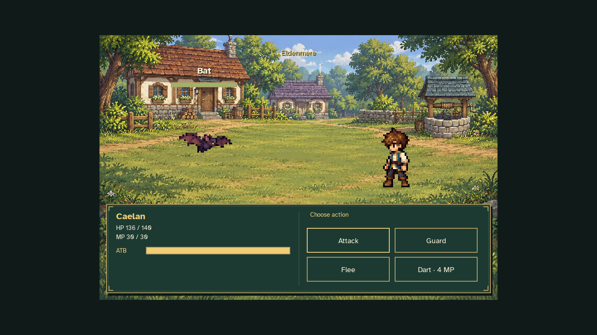

# Eldenmere battlefield detail pass

These are captures of the actual Bat encounter, with the new battlefield
artwork, existing combat sprites and production interface.



The viewpoint is the village green west of the well. The roofed stone well
stays behind the right side of the fighting ground, with cottage fronts,
garden fences, firewood and trees framing the village. Flowers, clover,
stones, exposed soil and dappled shade add depth at the foreground edges.
The brook, mill and festival decorations are outside this local view.

The middle remains clear for attacks. Caelan has a grounded contact shadow;
the Bat has a smaller ground projection beneath its hovering position. Two
small foreground tufts sway gently at the corners, become still with Reduced
Motion, and pause with the battle. Scene assets and grass poses are cached.



The animation samples decision and action stages while omitting long charging
intervals. Its 86 encoded frames use one shared palette to preserve the static
scenery between frames. The PNG screenshots retain the rendered colors.



The first temporary journey uses Caelan's starting attributes. A separate
temporary journey learns Aether Dart through the real lattice to show its
existing casting effect against the new scenery. Neither fixture changes the
player's ordinary journey or settings.





The capture verifies the three-second ready-state ATB pause, frozen exploration
state, normal action costs, victory settlement and Flee return. Guard is clicked
at the minimum 480×320 window with 150% text; Dart is clicked in a 1440×810
letterboxed window. Combat timing, damage, rewards and quest behavior use the
existing implementation.

Validation: 84 focused combat model, damage, scene, gameplay and asset tests
passed. Independent visual review covered the action sheet, minimum window and
letterboxed view. The scenery exporter reproduced the runtime assets exactly.

Reproduce all twelve screenshots, the GIF and
[verification data](verification.json) with:

```sh
python tools/build_eldenmere_battlefield.py
python tools/capture_combat.py --output work/eldenmere-battlefield
```

This review retains selected screenshots from the full capture. Pillow only
exports authored source images or assembles captured game frames; it does not
paint the game scenery. Original generated art and provenance are retained in
[`assets/source/combat`](../../../assets/source/combat/eldenmere_README.md).
