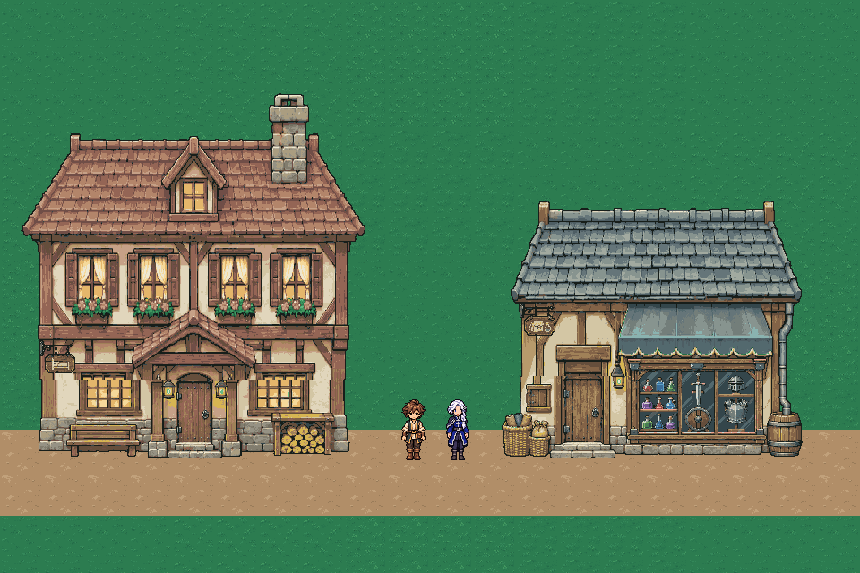
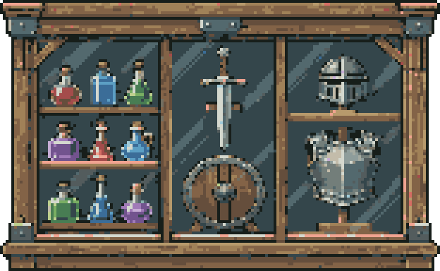

# Inns and item shops: HD exterior assets

Maintained and weathered versions of both buildings, **staged for later gameplay
integration**. Visual approval remains pending independently of merge status.

[Weathered versions at native scale](street_weathered_native.png) ·
[All four buildings](businesses_native.png) · [Signs and props](props.png)

[Weathered display closeup](display_weathered_closeup.png)

Animations:

- [Maintained inn](inn_maintained.gif), [weathered inn](inn_weathered.gif).
- [Maintained shop](item_shop_maintained.gif), [weathered shop](item_shop_weathered.gif).

The inn has a sheltered entrance, four upstairs guest windows with varied curtains,
a dormer, terracotta roof, substantial chimney, flower boxes, bench/firewood and
bed-symbol sign. The shop has a slate roof, blue-green awning, delivery hatch,
stock baskets, rain barrel and satchel/potion-symbol sign. Both variants preserve
shared geometry; wear adds repairs, patches and moss without blocking the entrance.

The dedicated fixed window shows red, blue, green and violet potions in distinct
round/square/conical bottles, a sword and shield, and a helmet and breastplate.
Stationary glass reflections and mullions establish that these goods sit behind
glass. Potion colors and steel shading survive native export. Merchandise stays
pixel-identical through every ambient frame and receives no pickup/discovery cues.
These pictures do not bind to inventory or grant/sell equipment.

Signs sway with fixed hardware; the shop awning rustles without moving its mounting
or display. Inn smoke and optional pane light share the existing 3.6-second clock.
Five drawn door states retain 100 ms timing; closed/open stills provide reduced
motion. Six reusable props add signs, bench, sheltered firewood, boots and a pack.
The native fixtures retain unchanged approved Caelan and Iselin for scale.

[Candidate placement overview](placement_overview.png) ·
[Placement data and baseline checks](placement_plan.json) ·
[Future interior/service integration specification](integration_spec.json)

The planning diagram uses a retained legacy town reference at logical resolution,
with cyan candidate footprints and orange future access routes. It is not an
actual gameplay capture, native-art acceptance image or applied town layout.
Seven collision snapshots show clear footprints/corridors in the recorded baseline;
future integration must revalidate the current map and add terrain/navigation.
The service specification covers inn rest choices, merchant transactions, initial
consumable references, ordinary-gear catalog prerequisites, currency, cancellation,
insufficient funds and save behavior. Interiors and functional services are not
implemented by this asset pack.

Validation: 13 focused tests cover variants/units/status, entrance and portal
registration, five-state doors, exact closed/open layering, four potion colors and
weapon/armor sections, fixed glass stock excluded from flicker, ambient layer
reconstruction, sign supports, prop scale, hard alpha/palette/native detail,
candidate geometry and collision snapshots, explicit service/non-registration
status, native scene reconstruction, lossless GIF/PNG timing, hashes and deterministic
scoped outputs. Individual/enlarged/native reviews covered material contrast,
merchandise readability, scale, glass reflections, entrances and restrained motion.

`layout.json` records fixtures. Native PNG frames retain the exact review pixels;
shared-palette GIFs may coalesce identical frames only with exact preserved timing.
`exports.json` records sources/dependencies and output hashes. `preservation.json`
records a one-time comparison of eight existing banks/maps/catalog/character
references, not a permanent freeze on future development. Existing maps, inventory,
equipment, door controllers, services and saves remain unchanged.

All authoring and maintenance guidance remains in the
[visual art standard](../../VISUAL_ART_STANDARD.md#staged-eldenmere-inns-and-item-shops).
