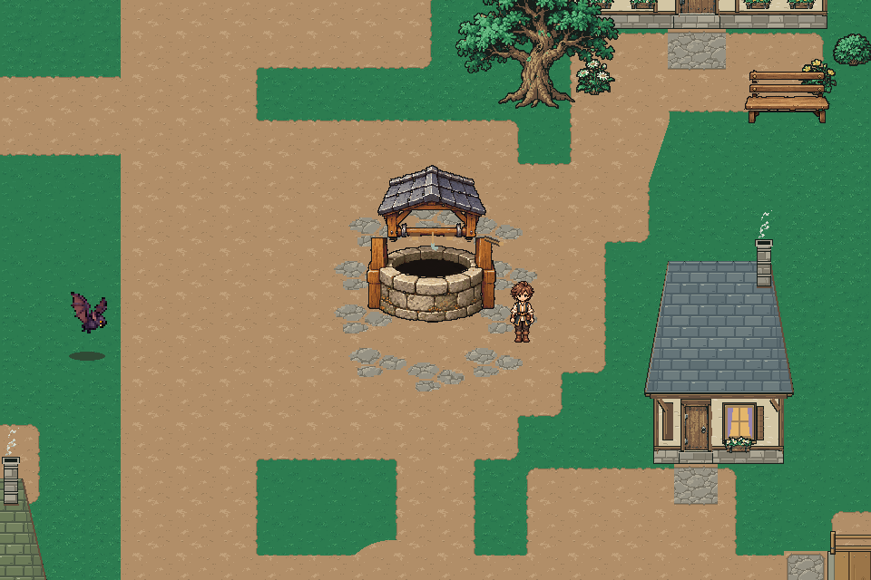
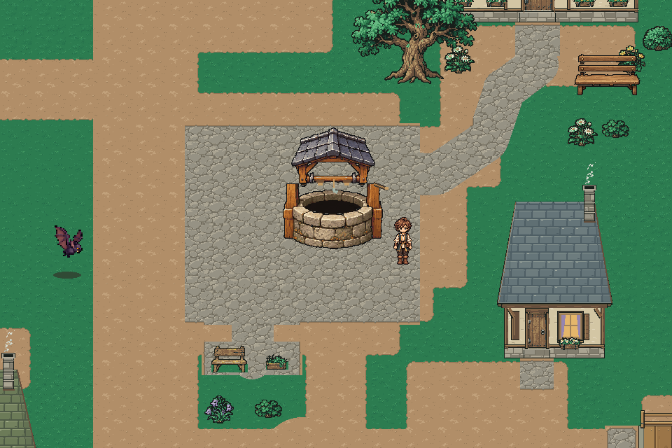
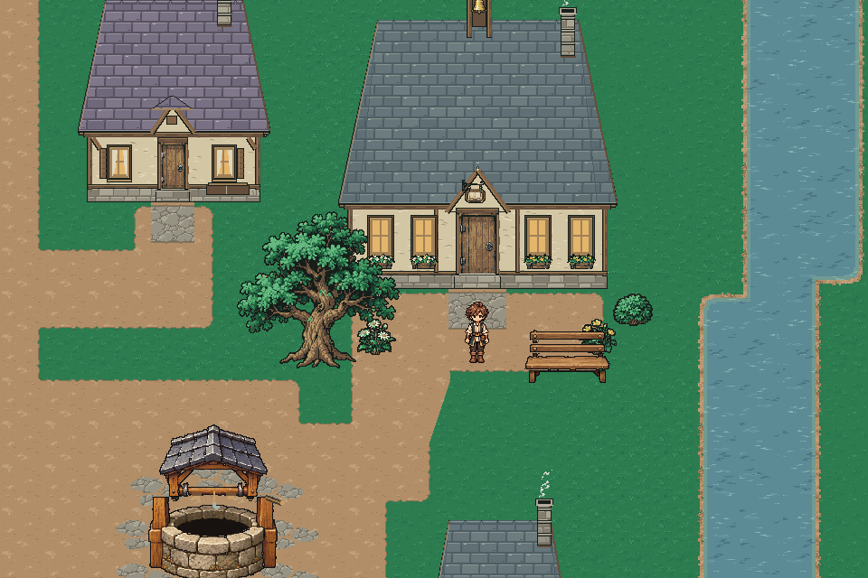
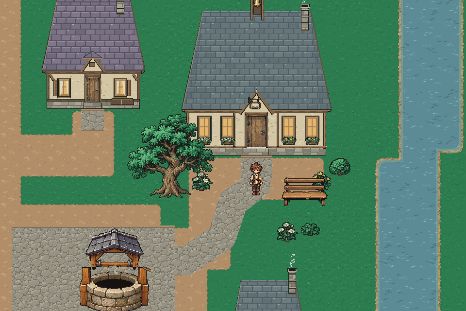

# Eldenmere civic commons

The well square now has a connected stone civic surface, a school approach and
a small southern resting edge. The existing well, pail ownership, school,
buildings, residents, scripts, entrances and navigation retain their owners.

| Clean main before PR 5 | Current production rendering |
| --- | --- |
|  |  |
|  |  |

These are native 960×640 initialized-Game views, with disclosed player/camera
fixtures and disposable saves/settings. The opening is disabled; no quests are
seeded, residents moved, routines disabled or replacement scenery painted.
The four civic views also have `_reduced.png` witnesses. The separate coverage
image is a cropped diagnostic mask, not a gameplay screenshot.

[The verification record](observations.json) contains the exact baseline revision,
source hashes, camera/player fixtures, all 13 framework views and pixel counts,
native ground phase hashes, movement traces, doorway checks and Continue results.
[The baseline revision](before_revision.json) identifies clean main
`2e98894c5820ccfe3810a9e8ff0a63c86d815216`, after settlement PR 4 and the
independent roof-style revision. The final capture uses the merged production
build at `9b96225391bff80798d556c54604969caad3e174`.

The production checks passed:

- Every prior entity, courtyard/workyard ledger, street treatment and cartography
  record is retained. Existing non-ground artwork and grass are unchanged.
- Collision is exactly the baseline union the two declared supports:
  **252 added logical pixels**. Navigation is byte-identical.
- Each of six full native ground phases changes **107,362 pixels**; zero changed
  pixels leave source civic treatment cells plus their one-tile material fringe,
  intersected with the declared **[384, 720, 384, 288]** logical scope.
- Five source-owned civic treatments include the existing well's canonical
  48×48 ground support as a visual stone underlay. This removes the former dirt
  rectangle at its base while preserving every well collision pixel and layer.
- All 13 framework views have zero changed pixels outside the scope. Only the
  commons and school views differ; the other 11 views are pixel-identical.
- Four independent well approaches, the south pail/service lane, the school
  link and neighboring household approaches pass walking and running in both
  directions: **24 routes, 2,202 actual Game.update frames, zero replans**.
- The existing school door enters and returns during both walking and running.
  Arrival guards rearm through real movement away from the contact.
- Save/Continue preserves unique civic entities, all three district ledgers,
  solid supports and progress. Two disposable older-checkpoint fixtures put
  only the saved player coordinate inside each new support; ordinary Continue
  recovers safely to the existing town entry **[384, 312]**.
- All four reduced-motion civic views remain pixel-identical at 0 and 600 ms.
  Quest, party, inventory, flags and production source inputs are unchanged.

The well route uses **[526, 900]**, the established south service waypoint.
The gardener's smaller probe can reach her authored **[526, 892]** source contact;
that point already lies too close to the well for the player's 24×12 probe.
The home-to-commons route follows the clear **[552, 714] → [552, 780]** lane;
the pre-existing school/garden collision covers **[576, 756]**.
These fixture choices preserve the production collision and author anchors.

This is a scoped production rendering, movement, doorway and save smoke review,
not a complete quest playthrough or a full gardener-cycle review.

The broader focused suite has **79 passing checks and two confirmed baseline
failures among 81 checks**. Final core/commons checks pass (184), story checks
pass (79), and architecture checks pass (14). The two original well-rendering
tests are retained.
[Their clean-main comparison](well_baseline_comparison.json) records the stale
single-entity frame expectation and logical marker/depth test, plus native
evidence that the existing well's opaque front rim covers its idle water glints.
That pre-existing runtime limitation is outside this civic layout change.
The framework water-animation check samples the brook; animated pixels elsewhere
in a normal civic view do not demonstrate moving well water.

Business checks have **12 passes and one confirmed upstream failure among 13**.
[The clean-main comparison](business_baseline_comparison.json) proves the same
palette assertion fails on `2e98894c`: the restored roofs use blended shades while
the old test permits only literal ramp colors. All four business building PNGs
are byte-identical to upstream. This PR preserves those roofs and adds only the
bench's source-owned depth metadata to that pack.

Regenerate after creating a fresh, clean-main baseline with the framework tool,
exact map/mask copies and six native ground phase witnesses:

```sh
python tools/capture_eldenmere_commons.py --baseline-dir /tmp/settlement-pr5-before
```

Large full-town ground/mask witnesses stay in the temporary baseline directory;
the committed review retains their hashes and useful native scene witnesses.
