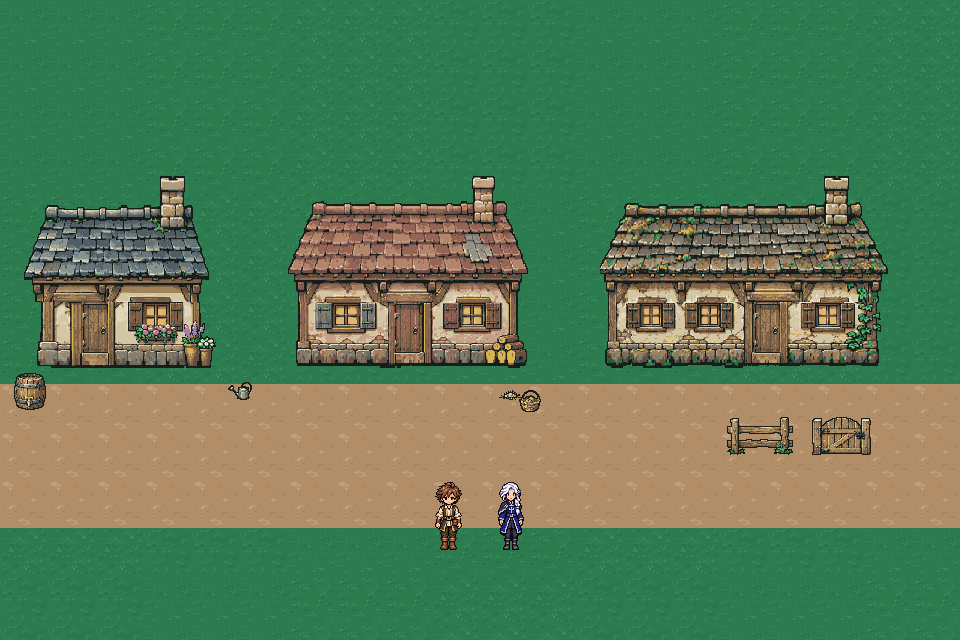
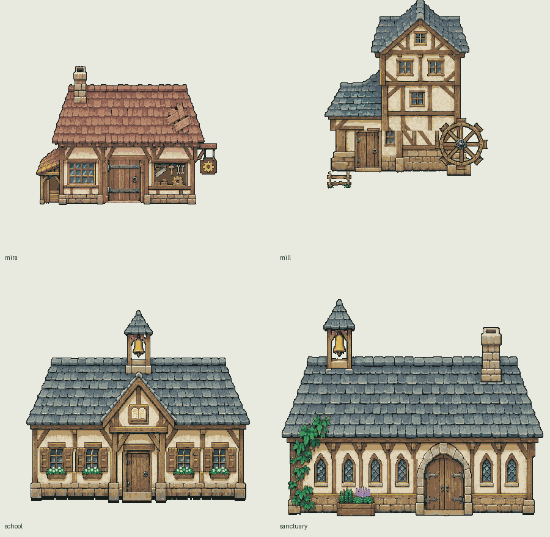

# Eldenmere HD building exteriors and charm

Staged 2× artwork, **not integrated into gameplay**. Visual approval remains
pending user review independently of merge status.

[All cottage options](cottages_native.png) · [Workshop yard](workshop_yard_native.png) ·
[School and Sanctuary](school_and_sanctuary_native.png) · [Charm props](props_review.png)

Animated reviews:

- [Door opening and closing](doors.gif).
- [Gardener home](standard_gardener_ambience.gif),
  [craft household](standard_craft_ambience.gif),
  [weathered home](standard_weathered_ambience.gif).
- [Workshop ambience](mira_ambience.gif), [Sanctuary ambience](sanctuary_ambience.gif).
- [Waterwheel full turn](mill_wheel.gif).
- [Signs, herbs, awnings and laundry, enlarged 2×](props_motion.gif).

Ten cottage options cover compact/standard/wide shapes, three distinct charm
profiles and the existing heather roof identity. Four landmarks rebuild the
workshop, mill, school and Sanctuary. Twenty-four separate props supply window
boxes, practical household belongings, trade symbols, fences/gate, ivy and fabric
accents. No new canonical business or destination is introduced.

Six retained new drawings supply the source artwork, including fixed mill
architecture, an isolated wheel and drawn door-opening states. Existing stone,
wood, plaster, iron, glass and roof ramps retain regional identity; foliage uses
the shared emerald palette. Charm comes from deliberate roof repairs, weathered
plaster, worn thresholds, mismatched shutters, window boxes, tidy firewood and
side clutter. Fine source clusters retain the 2× fidelity alongside approved
character pixels. Small props are individually sized rather than enlarged to
match a generic tile canvas.

`audit.json` snapshots eleven existing consumers and their entrances. All logical
canvases, door rectangles, entry anchors/widths, sort baselines, destinations and
arrival contracts remain recorded independently of the new artwork. Fixed shells
have clear portals; the separately drawn five-state doors keep 100 ms timing.
Ambient layers use a 3.6-second clock; smoke and optional pane light move while
architecture stays fixed. The wheel keeps a fixed hub and the existing 9.6-second
full-turn speed. Mounted props retain their supports. Explicit stills provide
reduced-motion alternatives. Ordinary decoration has no discovery cues.

The native compositions are illustrative asset fixtures, not new canonical maps
or gameplay captures. Placement metadata keeps door approaches clear. Existing
maps, interiors, collision, navigation, renderers, door transitions and saves are
unchanged; live integration and actual movement/occlusion acceptance remain later
work. Closed gate artwork does not register new passability or interactions.

Validation: 16 focused tests cover inventory/units/status, binding snapshots,
entrance and canvas geometry, clear shell portals, authored opening progression,
closed/open/sheet reconstruction, glass-only light masks, fixed ambient structures,
chimney registration, wheel position/hub/direction/full-turn speed, prop scale and
fixed mounts, named palettes/hard alpha/native detail, clear approaches, exact scene
reconstruction, lossless GIF/PNG timelines, non-registration, source/output hashes,
complete output inventory and reproducible scoped exports. Individual, enlarged
and native scene reviews covered proportions, outlines, roof and facade materials,
window/door clarity, prop sizing and restrained motion.

`layout.json` records compositions and the door review schedule. Native PNG frames
retain the review pixels; GIFs use one exact common palette per sequence and may
coalesce held frames only while preserving their timing. `exports.json` records
sources, recipe and export hashes. `preservation.json` records a one-time comparison
of sixteen existing banks/maps/character references, not a permanent freeze on their
future development.

All creation and maintenance guidance remains in the
[global visual art standard](../../VISUAL_ART_STANDARD.md#staged-eldenmere-hd-building-exteriors).
