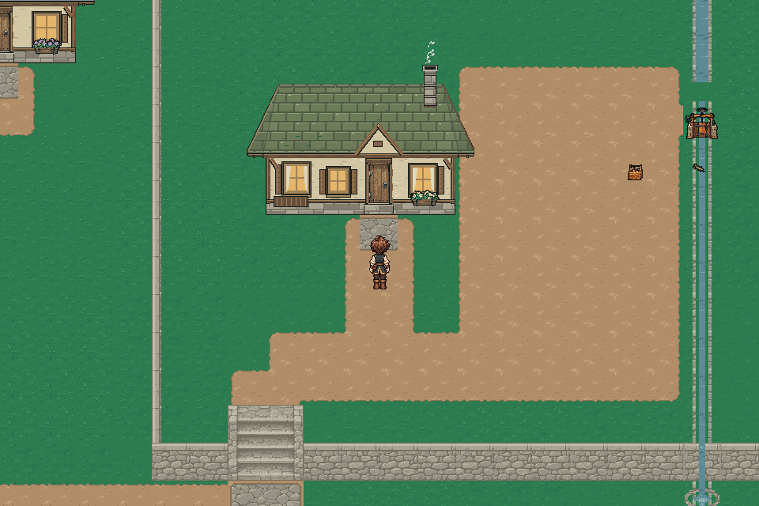
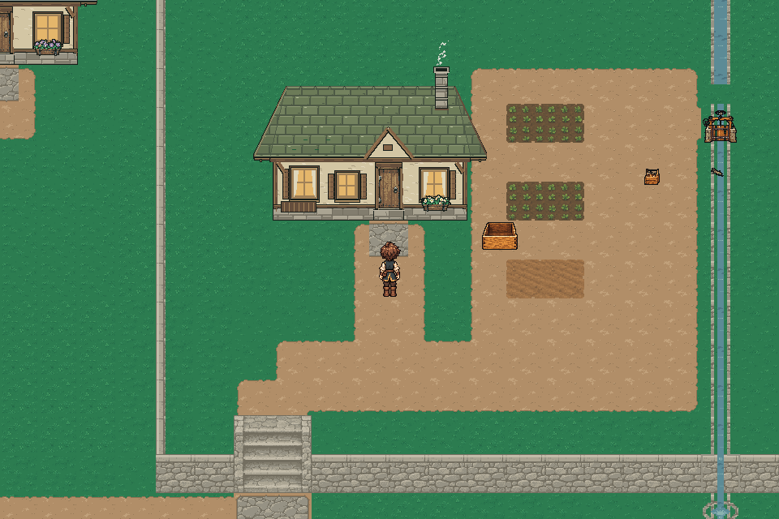
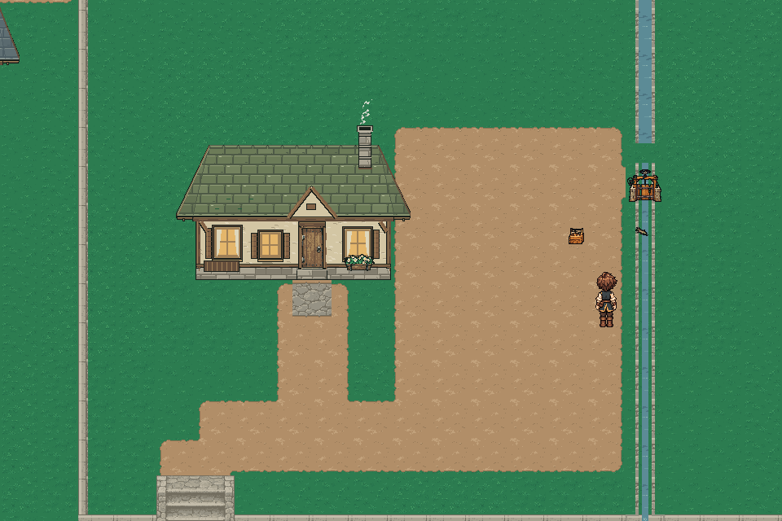
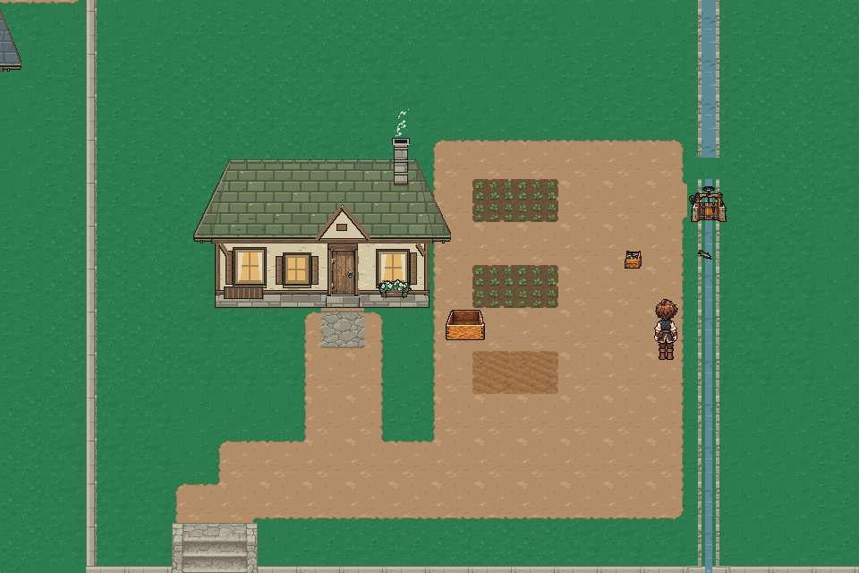
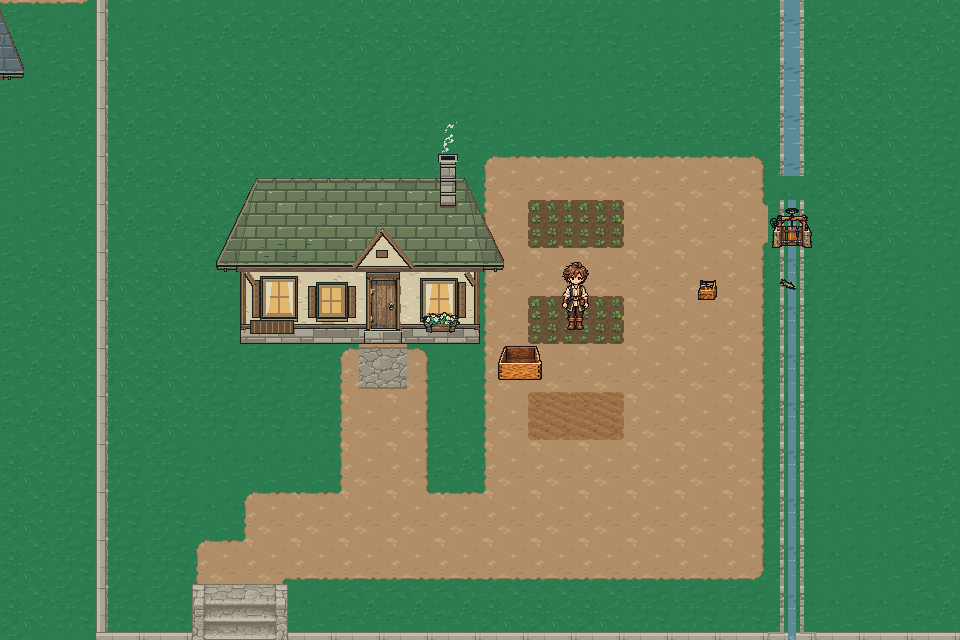

# Venn's eastern growing plot

Two vegetable rows and one empty furrow row now occupy the original upper
growing plot. Six static native field tiles bake into the ground; one empty
service crate remains a separately sorted solid object. The cottage, irrigation
mechanism, tools, channel, terrace steps and lower growing area retain their
existing owners and behavior.

| Clean main before PR 7 | Current production rendering |
| --- | --- |
|  |  |
|  |  |



These are initialized production Game fixtures with temporary saves/settings
and the opening disabled. Native 960×640 views preserve the normal logical
camera coverage. Player starts and camera positions are disclosed; no quests
are seeded, residents moved, routines disabled or replacement scenery painted.
The player-depth witness uses Caelan's actual registered sprite, with no marker
or substitute actor. The small coverage mask is a diagnostic, not scene art.

The baseline is clean main
`5630648b4fe9cb79ae7b1ad867b4aa5b6e0cc836`, after settlement PR 6.
[Revision metadata](before_revision.json), [original map](before_town.json)
and [original observations](before_observations.json) are retained for
fresh-clone checks. [The verification record](observations.json) contains native
hashes, source-pixel checks, exact fixtures, movement traces, door transfers and
Continue results.

The scope is exactly the original source `venn_plots` rectangle,
**[1296,624,96,168]** in logical units. It does not expand to the surrounding
eastern district. The rows are inset from the cottage's existing overhang:

| Row | Logical rectangle `[x,y,width,height]` |
| --- | --- |
| Upper vegetable row | `[1320,648,48,24]` |
| Middle vegetable row | `[1320,696,48,24]` |
| Empty furrows | `[1320,744,48,24]` |

Each row comprises two **24×24 logical / 48×48 native** tiles. One authored
**96×48 native binary contact mask** applies across the complete row, retaining
the internal seam and adding small perimeter notches. Its entire two-art-pixel
inset interior stays opaque. The donor PNGs are unchanged, with no resizing or
tinting. There are no added soil cells, retired grass
instances, crop actors, harvesting interactions or growth simulation.

The production checks passed:

- Every pre-existing entity and all four earlier dressing ledgers are unchanged.
  Grass, street treatments, cartography, doors, travel links and quest metadata
  are unchanged. Existing non-ground artwork is unchanged.
- Collision is exactly baseline collision union the crate's **20×6** logical
  support: **120 added pixels**. Navigation is byte-identical.
- Each of six native ground phases changes exactly **13,596 pixels**, entirely
  within source alpha multiplied by the explicit whole-bed contact masks.
  No broader plot rectangle or transition fringe excuses extra ground changes.
  All **36 source-image checks** find zero opaque native texel mismatches where
  contact is 255. All **18 whole-bed comparisons** match the original baseline
  plus the masked donor tiles at every pixel. Each mask's **76 zero-contact
  pixels** retain their exact original ground; no perimeter pixels are ignored.
- All **13 framework views and seven focused growing-area views** have zero
  changes outside the original plot. Twelve framework views and the entire
  lower-area detail frame are pixel-identical to the baseline. Channel, water,
  existing paving, lower terrain and surrounding vegetation are preserved.
- Caelan retains all **1,301 opaque sprite pixels** while standing on the
  middle row. **635** of those pixels overlap effective field-contact alpha; every pixel matches
  the actual native source sprite, demonstrating that the field stays below him.
- Field aisles, plot approaches, the Venn frontage and the exact existing pin
  **[1428,670]** and channel **[1428,694]** approaches pass walking and running
  in both directions: **32 routes, 1,302 real Game.update frames, zero replans**.
- The **single** eastern stair flight is tested ascending and descending at
  clear lane centers **x=1172** and **x=1180**, during walking and running.
  No second staircase or standalone gate-preview geometry is assumed.
- Venn's door completes both ordinary walking and running roundtrips. Return
  guards rearm through actual movement away from the interior arrival contact.
- Save/Continue retains the crate, all six flat owners, all five district
  ledgers, collision and gameplay progress. A disposable older checkpoint at
  **[1316,735]** is clear with the baseline 24×12 probe and blocked by the new
  crate. Ordinary Continue safely restores to the existing **[384,312]** entry.
- All seven reduced-motion detail views remain identical at 0 and 600 ms.
  The fields are static. Production inputs, donor PNGs, contact masks, quest, party,
  inventory and flags remain unchanged throughout capture.

This ordinary exploration review does not execute the family repair quest.
The tools and magicks repair branches are verified separately; the screenshots
and movement checks do not claim a full quest playthrough.

The 18 growing checks, 28 Venn checks, 79 story checks and 15 architecture checks
pass. Existing core coverage contains 196 checks. Civic checks pass 79 of 81,
and business checks pass 12 of 13. The three failures reproduce on clean main:
two original well-rendering expectations and one business roof-palette
expectation. Exact runner outputs and unchanged relevant source/art hashes are
retained in [the baseline comparison](baseline_test_comparison.json). Original
assertions remain unchanged; brook animation is not proof that the existing
well's idle water moves.

[The original bed-ground index](before_bed_ground.json) records 18 small,
unscaled native baseline crops under `before_beds/`, one for each bed and phase.
They allow fresh-clone tests to reconstruct the complete expected contact
composition. All **71 PNGs**, including those nested crops, have verified hashes
in the capture record.

Regenerate from a fresh clean-main baseline containing framework/detail views,
exact map/masks and six full native ground phases:

```sh
python tools/capture_eldenmere_growing.py --baseline-dir /tmp/settlement-pr7-before
```

Large full-town ground/mask witnesses remain in the temporary baseline directory;
the committed review keeps their hashes and useful native scene witnesses.
