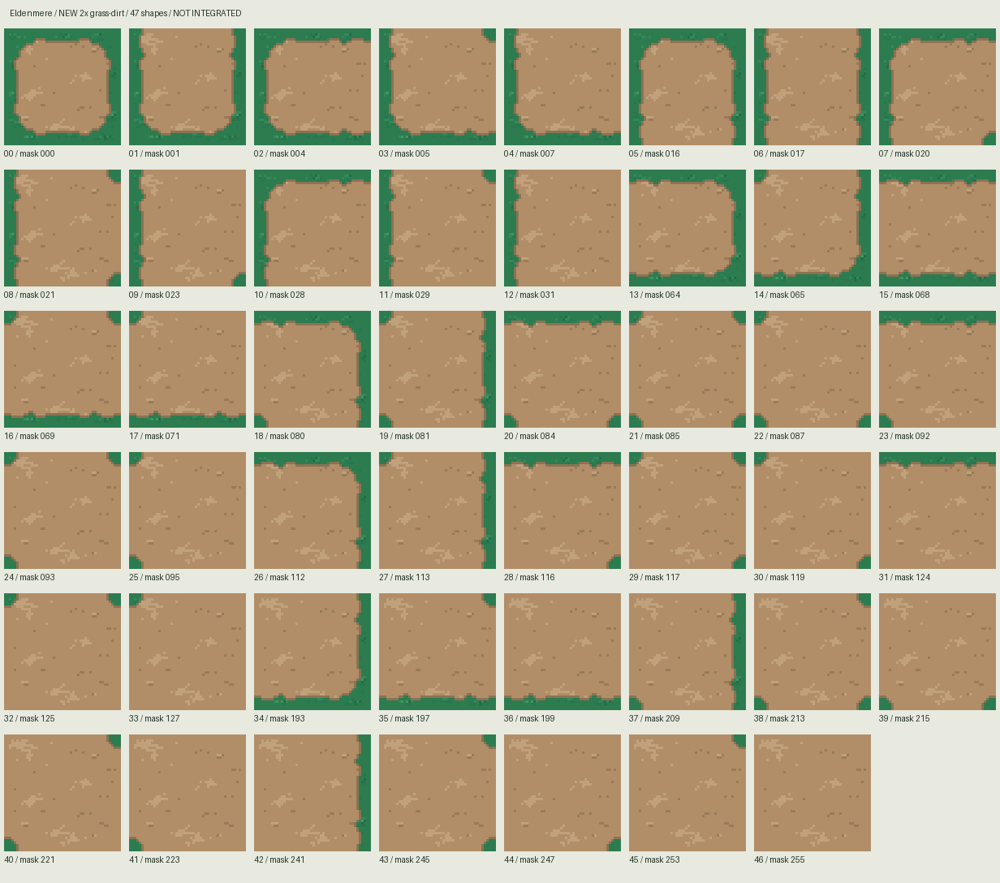
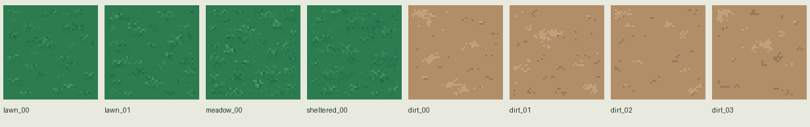
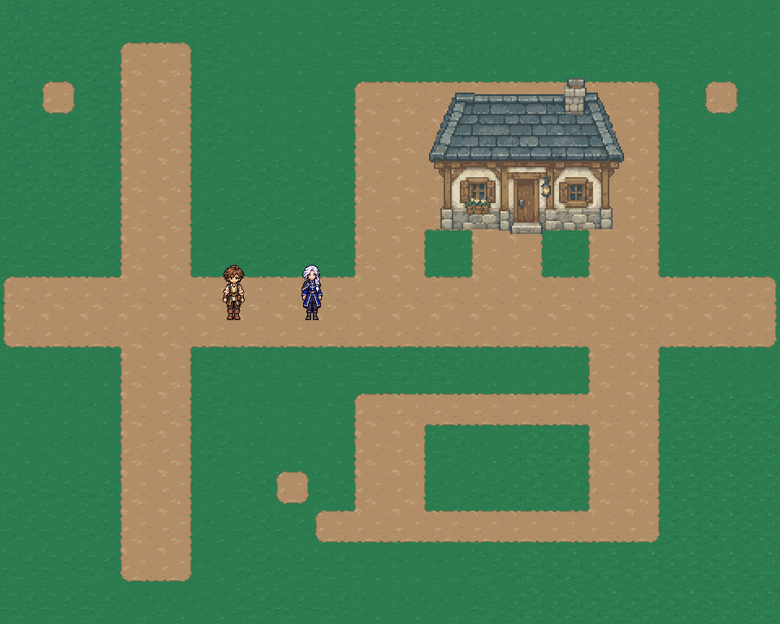

# Eldenmere HD grass/dirt blob review

This is a newly authored **asset-only** bank: 47 dirt-overlay shapes at 48×48
artwork pixels per 24×24 logical tile. It is committed separately from the shipped
terrain and is **not integrated**. Merge status is separate from user visual
approval, recorded as not yet reviewed in the recipe/manifest.

The 384×288 transparent atlas contains 47 canonical neighborhoods and an empty
last slot. There are 20 oriented quarters, a matching coverage atlas, four grass
materials and four dirt fills. Grass retains the current emerald ramp; dirt
retains the existing earth/stone colors. The retained new material/edge drawings
supply the pixels and contour study. Median-based source color registration and
exact-ramp quantization keep broad ground quiet and preserve the regional palette.
The narrow earth lip uses an existing brown rather than black tile boxes.

`layout_native.png` and `repeated_grass_native.png` stress repetition, narrow/wide
paths, bends, junctions, isolated patches, touching diagonals and an enclosed grass
island. `layout.json` records every material, mask and fill choice. The scale scene
is an offline illustrative composition using the retained cottage and unchanged
approved Caelan/Iselin HD idles. The cottage is legacy art sampled at 2× to retain
its existing physical size; it is not a new building asset. No screenshot here
claims runtime terrain integration or a playable map alteration.

Review corrected excessive initial dirt mottling and visible material borders
through technical palette registration. Exhaustive compatible-neighbor checks
also caught an inner-corner port mismatch; the corner radius now agrees with the
straight edge's five-artwork-pixel connection margin. Final native and enlarged
reviews check material quietness, boundaries, corners, repeated fields and
character readability. Further vegetation, water and buildings are separate work.

Validation: 11 focused tests cover all 256 neighborhood lookups, exactly 47 distinct
connected hard-alpha surfaces, atlas/coverage/quarter reconstruction, 2,048
compatible horizontal/vertical alpha-and-color joins, palette/seam-compatible fill
variants, actual fine-resolution detail, source/output hashes, offline scene
reconstruction and deterministic exports. The exporter can write only into the
new pack and its review folder. A one-time bank fingerprint comparison confirms
870 existing terrain/map/character files are unchanged; this historical evidence
is not a permanent freeze on future unrelated map or character development.

`exports.json` retains source/recipe/output hashes. `preservation.json` records the
one-time baseline check. All authoring and maintenance commands are kept in the
[consolidated terrain standard](../../TERRAIN_ART_STANDARD.md#staged-eldenmere-hd-grassdirt-blob).
