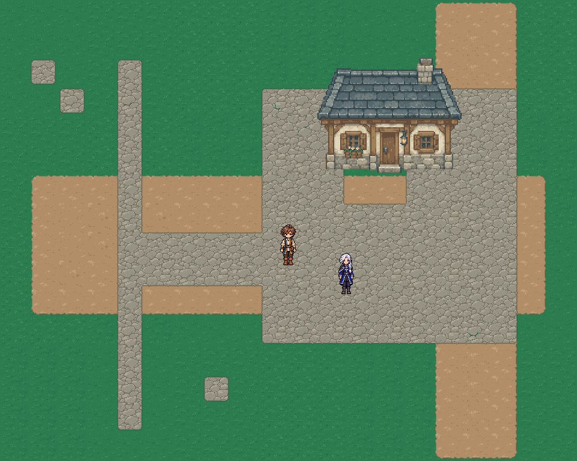
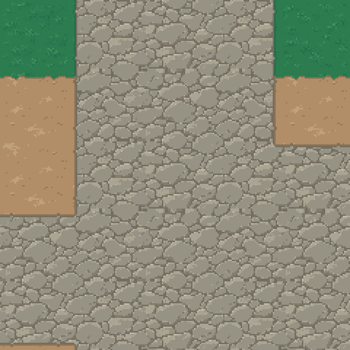
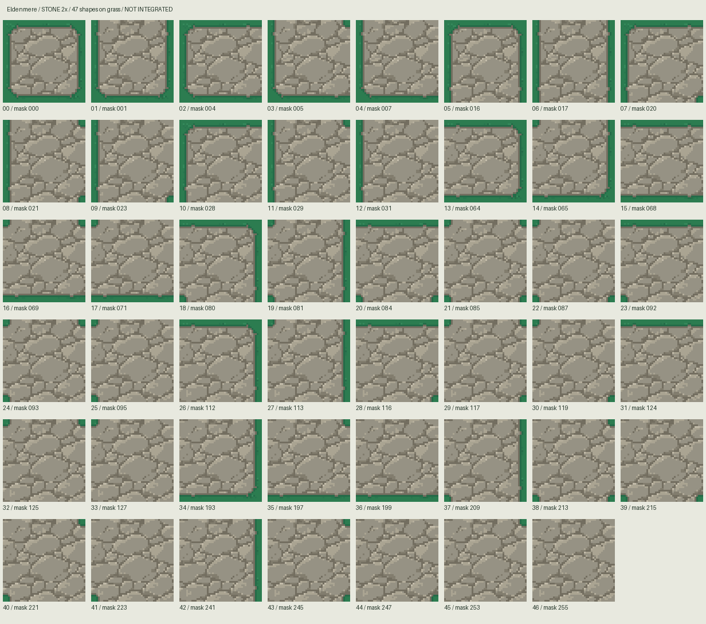

# Eldenmere HD stone paving review

New 2× fieldstone paving at 48×48 artwork pixels per 24×24 logical footprint.
This is an **asset-only, not-integrated** bank. Merge status is separate from user
visual approval, recorded as not yet reviewed in the recipe/manifest.

[All 47 shapes on dirt](blob_on_dirt.png) ·
[Repeated stone field](repeated_surface_native.png) ·
[Character closeup](walkway_scale_closeup.png)

There are 47 canonical boundary shapes, four spatial texture phases and separate
grass/dirt contact-trim banks. The retained new stone drawing supplies irregular
fitted flagstones, quiet worn faces, small cracks and restrained highlights using
the existing terrace stone palette. Separate new moss accents retain existing
greens and are sparse, stationary and clipped to stone mortar/shadow pixels.
The paving boundary finishes in a narrow stone-colored joint rather than black
terrain outlines. The surrounding lawn and earth are the earlier staged HD bank.

The 96×96 surface pattern spans 2×2 tiles. All connected paving uses one world
phase origin; these four different interior arrangements are not randomly
interchangeable or animation frames. A drawn seam repair follows a toroidal source
offset; the exporter restores its original reference perimeter and pairs one-pixel
connection ports. Quarter coverage masks supply connected outer/inner shapes.
The phase-correct body is common to both surrounds. Grass/dirt contact trims are
selected from the underlying material mask per pixel, permitting a single paving
tile to meet both surfaces at three-material corners.

The offline layout contains a paved square, one-tile-wide walkway, intersections,
isolated/diagonal patches and an enclosed opening. Native scale composition uses
an unchanged legacy cottage sampled at 2× to retain physical size, plus approved
native HD Caelan and Iselin idles. These are illustrative asset compositions,
not production gameplay captures. No active map, terrain selection, renderer or
collision is changed. Existing asset banks remain available and unchanged.

`layout.json` records every substrate choice, paving mask, texture phase, moss
placement and reference. Separate underlay, contact, body and moss PNGs expose
layer ownership. `exports.json` records retained source/recipe/output hashes.
`preservation.json` records a one-time comparison of existing banks, not a future
immutable contract on unrelated gameplay or artwork changes.

Validation: 22 focused tests pass across this bank and the staged grass/dirt pack.
Paving checks cover all 256 lookups, 47 distinct connected hard-alpha shapes,
quarter/atlas reconstruction, 8,192 phase-correct stone joins, 4,096 compatible
contact joins, native detail, palette conformance, per-pixel trim ownership on
mixed substrates, exact scene reconstruction, sparse mortar-clipped moss,
source/output hashes and deterministic exports. The exporter writes only to the
new pack and its review folder. Both pack exporters pass their non-writing checks.
Native and enlarged visual reviews covered stone scale, quiet faces, joint
continuity, finished boundaries, repeated fields and character readability.

All authoring and maintenance instructions remain in the
[consolidated terrain standard](../../TERRAIN_ART_STANDARD.md#staged-eldenmere-hd-stone-paving).
