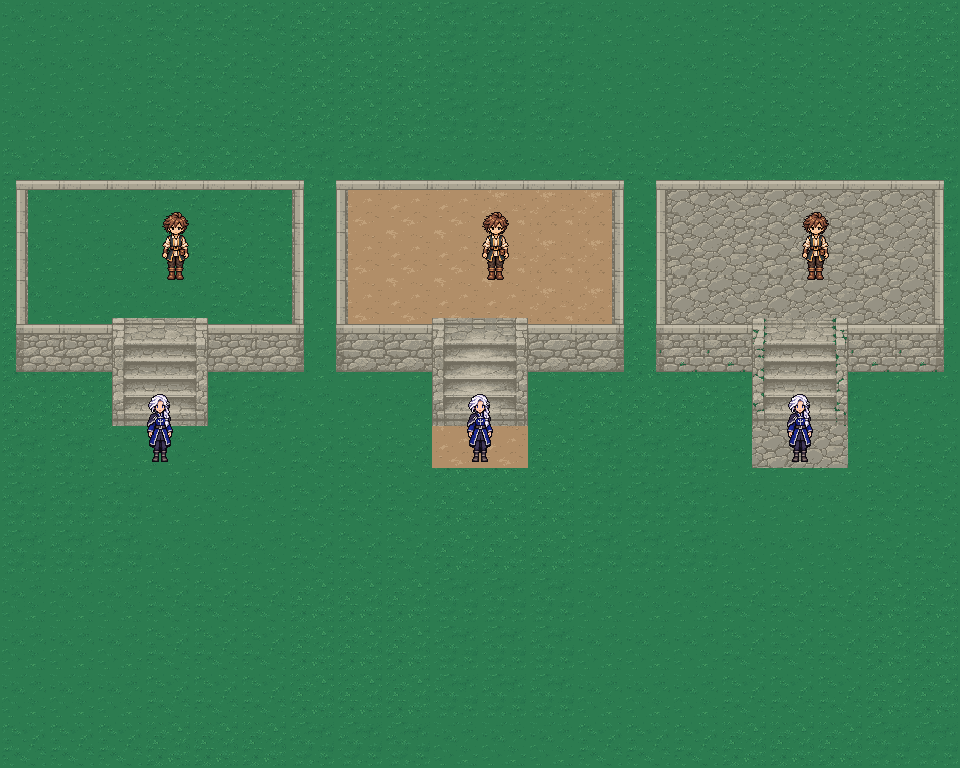
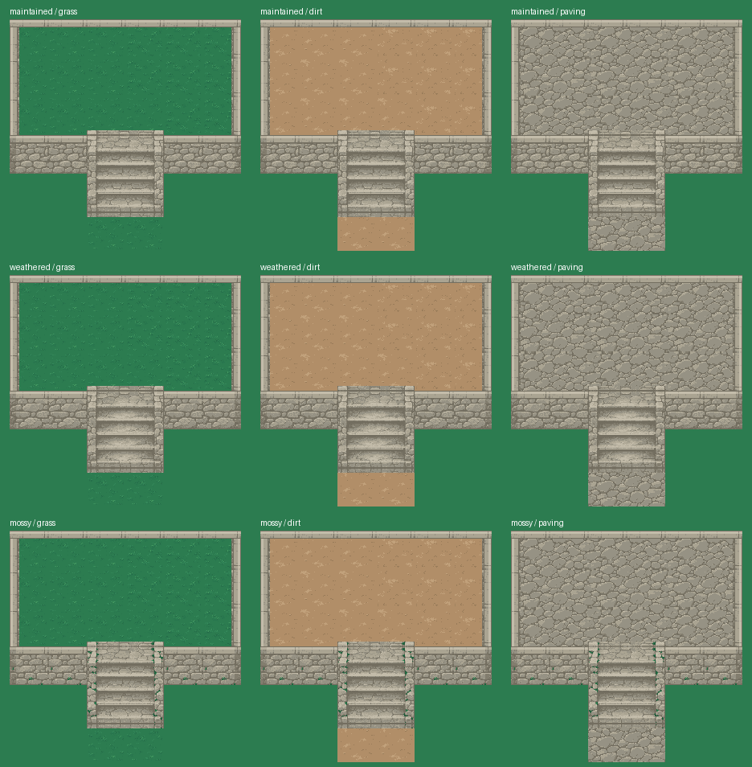
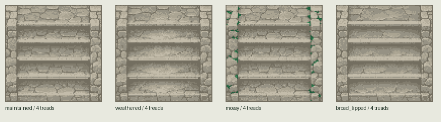

# Eldenmere HD terraces, retaining walls and stairs

New 2× asset bank, **not integrated into gameplay**. Merge and user visual approval
are tracked separately; the latter remains not yet reviewed.

[Wall module board](wall_variants.png) · [Character closeup](scale_closeup.png)

Three masonry families—maintained, weathered and mossy—each provide 14 modules:
three front faces, outer/inner corners, ends, side returns, back coping and back
corners. Four south-descending stair designs include broad-lipped stone. Nine
terrace prefabs combine each masonry family with grass, dirt and paving; 48
upper/lower landing images cover the four stairs and appropriate floor phases.

New retained wall/stair drawings supply visible pixels in the existing warm stone
ramp and emerald greens. Legacy logical alpha envelopes preserve coverage only.
Wall ports share registered coping and connection pixels across all treatments.
The stair footprint remains 48×48 logical units, with four treads, a 24-unit rise
and a 34-unit clear walking interval. Native fine detail uses 2× artwork density.

These are offline illustrative compositions, not actual gameplay captures.
Caelan and Iselin are unchanged approved assets shown at native density for scale;
the repeated figures are independent examples. Existing maps, collision, navigation,
renderers, selectors and asset banks remain unchanged. Spillway/water work is
outside this pack. Integration and actual-game traversal review are still pending.

Validation: 31 focused tests pass across this bank and the two preceding HD packs.
The nine new tests cover explicit units and status, inventory, original logical
coverage, atlas reconstruction, every declared compatible wall port across styles,
palette/hard alpha, native detail and variation, stair quarter reconstruction,
elevation and clearance metadata, landing contacts, paving world phases, prefab
placements, hashes and deterministic scoped exports. All three exporters pass
non-writing checks. Visual review covered native character proportions, enlarged
wall modules, moss restraint, tread readability and the nine terrace compositions.

`exports.json` records source/recipe/output hashes. `layout.json` records the scale
composition. `preservation.json` records a one-time comparison of the existing
banks; it does not freeze unrelated future changes.

All creation and maintenance instructions remain in the
[terrain standard](../../TERRAIN_ART_STANDARD.md#staged-eldenmere-hd-terraces-walls-and-stairs).
