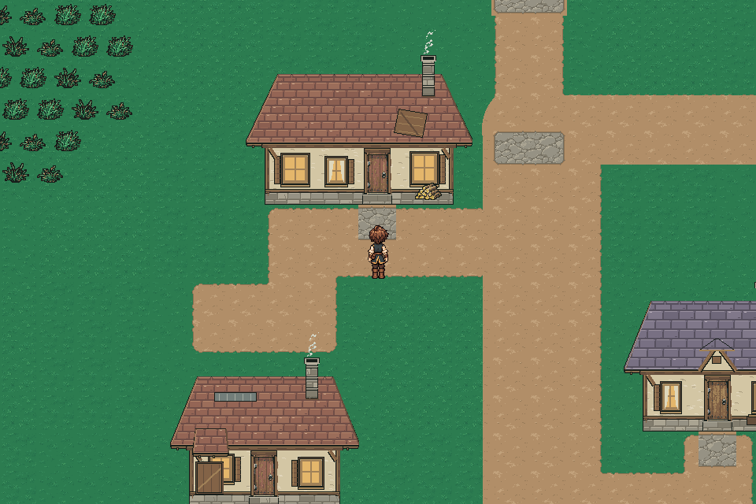
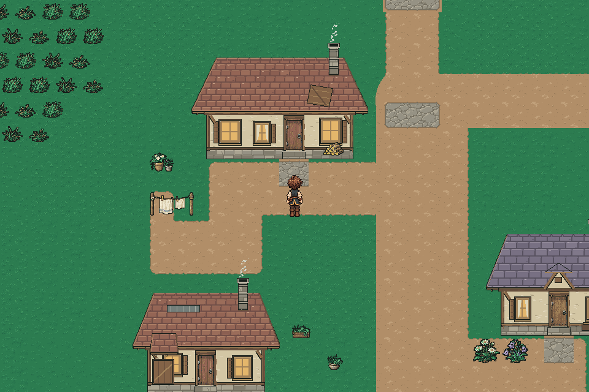
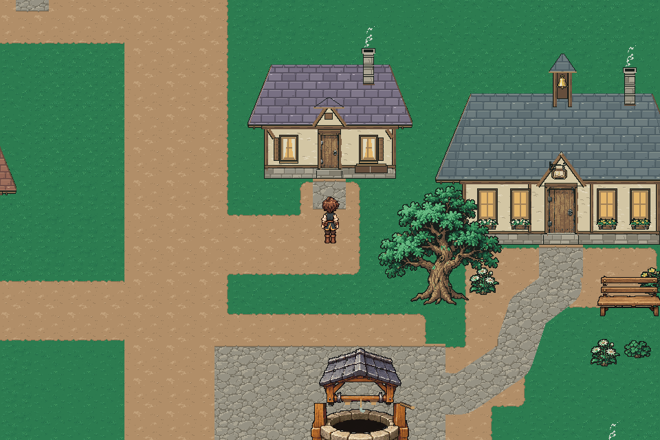
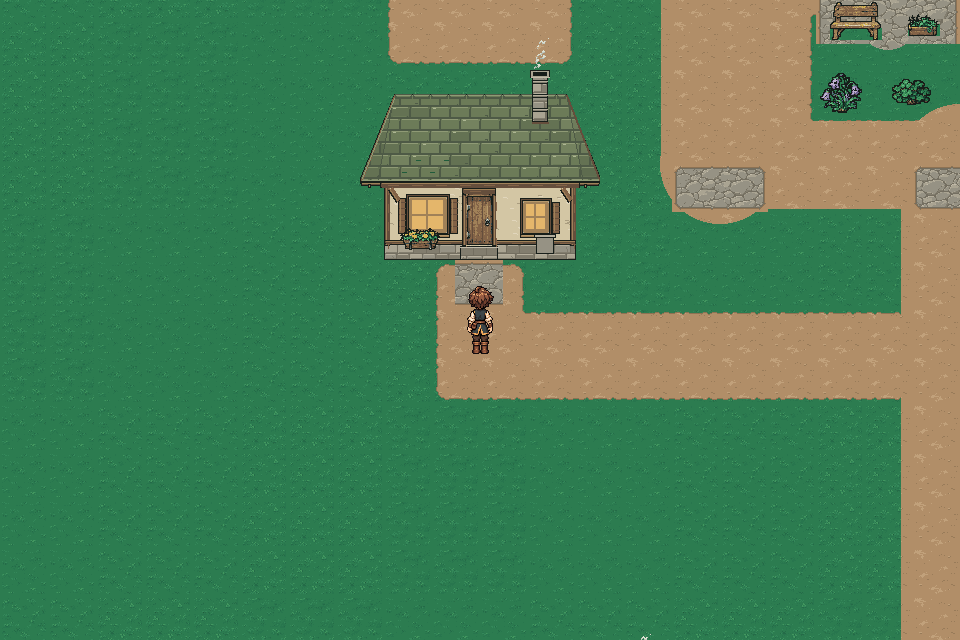
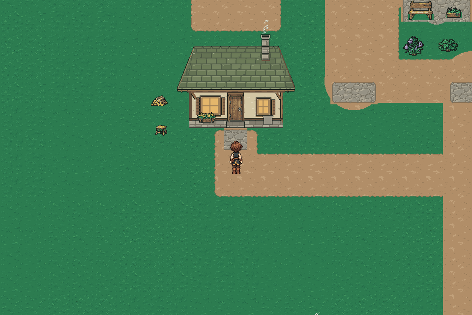

# Eldenmere household plots

Five small household margins now have distinct uses: laundry and flowerpots at
Liam's home, herb containers beside home A, a low flowerbed at home B, fuel and
a stool beside home C, and herbs beside Elira's home. They reuse the native
asset banks. Existing homes, door anchors, actors, routines, workstations,
quests and interaction owners remain in place.

| Clean main before PR 6 | Current production rendering |
| --- | --- |
|  |  |
|  |  |
|  |  |

The remaining native frontage witnesses are [home A](home_a_frontage.png),
[Elira](elira_frontage.png), [Mira](mira_frontage.png) and
[Halden](halden_frontage.png). Mira and Halden are boundary witnesses; their
entire normal frontage frames remain pixel-identical to the baseline. All
seven views also have `_reduced.png` witnesses.

The baseline is clean main
`1b2362ebbe47cfd3542acb8ba3ccaf7608ffe85f`, after settlement PR 5 and the
independent low-roof revision. [Revision metadata](before_revision.json),
[original map data](before_town.json) and
[original observations](before_observations.json) are retained for fresh-clone
checks. [The verification record](observations.json) contains production file
hashes, actual camera/player fixtures, native ground phase hashes, pixel
comparisons, movement traces, door transfers and Continue checks.

These are initialized production Game fixtures with disposable saves/settings
and the opening disabled. The player starts on disclosed clear ground; the
camera preserves the normal 480×320 logical coverage at native 960×640 output.
No quests are seeded, residents moved, routines disabled or replacement scenery
painted. Animated-prop witnesses are unscaled crops of actual native Game frames.
The five small ground-coverage images are diagnostic masks, not scene artwork.

The change is bounded by five disjoint logical parcel rectangles, rather than
the entire commons/household district:

| Parcel | Logical scope `[x, y, width, height]` |
| --- | --- |
| Liam | `[144, 504, 72, 96]` |
| Home A | `[264, 624, 96, 120]` |
| Home B | `[408, 648, 96, 72]` |
| Home C | `[144, 984, 72, 120]` |
| Elira | `[720, 840, 72, 120]` |

The production checks passed:

- All previous entities and all three earlier dressing ledgers are unchanged.
  Grass, the complete street ledger, cartography, doors, scene links, NPC and
  quest metadata are unchanged. Existing non-ground artwork is unchanged.
- Collision is exactly baseline collision union the eight declared supports:
  **556 added logical pixels**. Navigation is byte-identical.
- Each of six full native ground phases changes **7,148 pixels**, with zero
  changes outside the declared garden cells and their complete one-tile
  material fringe. Each fringe fits its owning parcel. The final cells are
  Liam's `[7,23]` wear patch and home B's `[18,28]`, `[19,28]` flowerbed;
  home A, home C and Elira retain their original ground.
- All **13 framework views and seven frontage views** have zero changed pixels
  outside the actual parcel union. The original workyards, civic composition,
  bridge surroundings and business frontage remain intact.
- Five household-access routes, the Liam/Daisy play perimeter and the commons
  connection pass walking and running in both directions: **28 routes,
  2,611 real Game.update frames**. Three bounded replans accommodate live
  residents on the play-perimeter return routes.
- All five house doors complete walking and running roundtrips: **10 ordinary
  entry/return sequences**. The return guards rearm through real movement away
  from the arrival contact.
- Normal Save/Continue preserves unique household entities, all four district
  ledgers, supports and gameplay progress. Eight disposable older-checkpoint
  fixtures place only the saved player coordinate inside each new support.
  Every point was clear with the baseline **24×12** probe; ordinary Continue
  recovers safely to the existing town entry **[384,312]**.
- All seven reduced-motion frontage views remain pixel-identical at 0 and
  600 ms. Quest, party, inventory, flags and production inputs are unchanged.

The laundry is sampled through all **18 authored frames at 200 ms each**, using
its production phase offset of **5**. The source timeline contains three
distinct images, and all three are visible in actual Game crops. Every opaque
source pixel matches its corresponding native rendered phase. Reduced motion
holds the explicit source `idle.png`, whose opaque pixels also match. The two
new animated flower patches receive the same source-phase and reduced-idle
checks. Source paths, phase indices, cadence, hashes and native crop locations
are recorded under `gameplay.animated_prop_frames` in the verification record.

One interior fixture was corrected: Liam's existing furniture blocks the
generic rearm point **[252,258]**. Both doorway checks walk to the disclosed
clear **[252,270]** point instead. The runtime collision and original door
anchor are unchanged. No authored small-NPC contact is treated as a valid
24×12 player target.

Regression validation passes **184 existing core checks**, **12 household
checks**, **79 story checks** and **15 architecture checks**. The civic suite
passes 79 of 81 checks, and business checks pass 12 of 13. The three failures
reproduce on clean main: two original well-rendering expectations and one
business roof-palette expectation. The exact commands, failure traces and
unchanged relevant source/art hashes are in
[the baseline comparison](baseline_test_comparison.json). Original assertions
and rendering remain unchanged. Brook animation and whole-view pixel changes
are not evidence that the existing well's idle water moves.

This is a scoped rendering, movement, doorway and save review, not a full quest
playthrough or complete household/gardener routine-cycle review.

Regenerate from a fresh clean-main baseline containing the framework views,
exact map/masks, six native ground phases and disclosed household fixtures:

```sh
python tools/capture_eldenmere_households.py --baseline-dir /tmp/settlement-pr6-before
```

Large full-town ground/mask witnesses stay in the temporary baseline directory;
the committed review retains their hashes and useful native scene witnesses.
