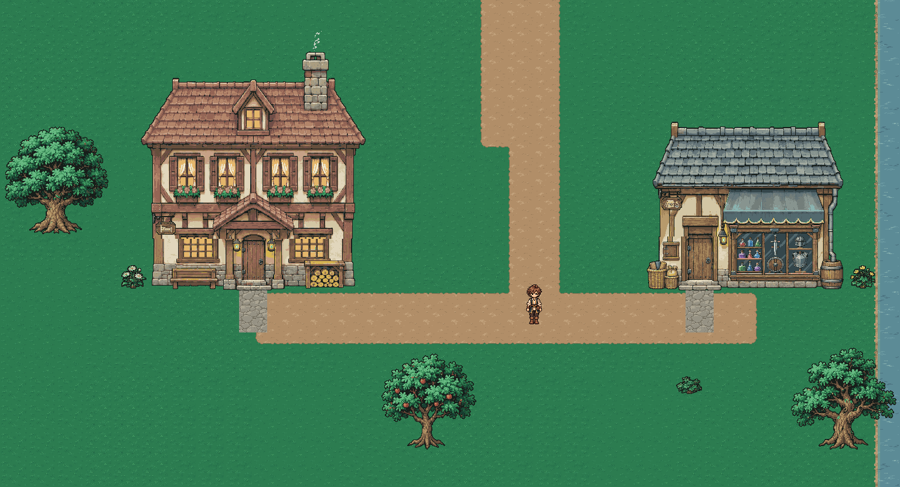

# Eldenmere HD environment and southern expansion

The live town, upstream and ten remaining town interiors use native 2× artwork.
The three Sanctuary interiors and the earlier courtyard's approved facade/props
retain their established banks. Existing character body/travel artwork is preserved.



The town adds twelve tile rows to the south: 1536×1344 becomes 1536×1632 logical
units. Both businesses have furnished, enterable interiors and safe return
landings. The inn guest bed uses the existing confirmed party recovery/save flow.
Shop stock is visual presentation; currency and trading are separate gameplay work.
Every collision/navigation pixel in the original rectangle remains unchanged.
Original entrances, spawns, quest stations and NPC routes keep their coordinates.

These PNGs are actual Pygame renderer captures, not asset-sheet mockups. Ordinary
views are native 960×640; the wide lane is a larger native world-renderer crop.
GIFs use a fixed camera and shared indexed palette to show actual bridge movement;
PNGs retain authoritative native color/detail. All captures use temporary saves
and settings.

- Outdoors: [courtyard](courtyard.png), [workshop](workshop.png),
  [school](school_exterior.png), [well square](well_square.png), [mill](mill.png),
  [residential lane](residential.png), [Elira](elira_exterior.png),
  [Venn](venn_exterior.png), [upstream](upstream.png).
- Movement: [bridge walk](bridge_walk.gif), [bridge run](bridge_run.gif).
- Businesses: [inn](interior_inn.png), [item shop](interior_item_shop.png),
  [inn doorway](inn_door_open.png), [shop doorway](item_shop_door_open.png),
  [available rest cue](inn_rest_available.png), [rest confirmation](inn_rest_prompt.png).
- Interiors: [Halden](interior_halden.png), [Elira](interior_elira.png),
  [Venn](interior_venn.png), [home A](interior_home_a.png),
  [home B](interior_home_b.png), [home C](interior_home_c.png),
  [Mira](interior_mira.png), [mill](interior_mill.png),
  [Liam's family](interior_liam_house.png), [school](interior_school.png).
- Presentation: [town map](town_map.png), [well work](well_work_1.png),
  [reduced motion](reduced_motion.png).

Visual review checked roof/stone/wood detail, physical prop scale, doorway
registration, foreground rails, canopy depth and character readability. The new
street trees were moved south of the route/display. School geography is sampled
from the retained approved Auratia wall-map drawing; its full-size viewer image
is untouched. Elira's shelf and first take pose share one canonical unlit lantern
at the original transfer pixels. It retains its metal/glass oil-lantern identity;
festival paper lanterns use their separate artwork. Well pails keep their occupied bounds, handle
rotation, water levels and ownership; the rope clips behind the near rim.

Ground chunks load on demand through a 48 MiB per-scene LRU rather than allocating
six whole-map native frames. Quest flow uses the same native ground sampling pass.
The renderer profile records environment-specific 30-frame warm draws, excluding
simulation. Full exploration/Gallery peak memory dropped from about 2708 MiB to
1950 MiB after lazy ground loading; these measurements are not a hardware guarantee.

**372 regression checks passed.** `validation.json` records that maintained run; `post_review_validation.json`
records the final layout/map/scene checks. `observations.json` records actual bridge
travel, well routine state and rest dialogue. Two older damaged-checkpoint tests
were reproduced failing on pre-migration main (`4605ad95`): their fixtures assumed
that one corrupt checkpoint invalidated every save slot. Those and the equivalent
household assertions now verify invalid-payload rejection, file preservation and
recovery of a separate valid slot. Production save validation was not weakened.

Reproduce with:

```sh
python tools/build_eldenmere_hd.py --check
python tools/check_eldenmere_hd.py --report /tmp/eldenmere-validation.json
python tools/capture_eldenmere_hd.py /tmp/eldenmere-review
python tools/profile_renderer.py --frames 30
```

The central [terrain standard](../../TERRAIN_ART_STANDARD.md#integrated-eldenmere-town-and-upstream)
and [visual standard](../../VISUAL_ART_STANDARD.md#integrated-eldenmere-town-and-businesses)
own construction guidance. The live manifest records native exports and source
hashes. Legacy compiled ground/prop files remain registration/history inputs or
shared consumers in other regions; active town bindings use the new bank. The
old full-map compiler is guarded, its terrain-only/courtyard commands forward to
the maintained composer, and an unused legacy workshop-crop load was removed.
