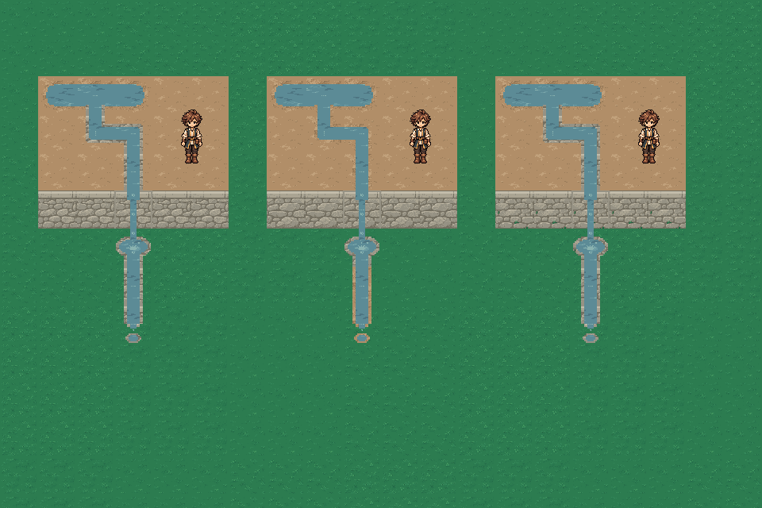

# Eldenmere HD channels and spillways

Staged 2× assets, **not integrated into gameplay**. User visual approval remains
pending independently of merge status.

[Animated terrace connections](terrace_waterworks.gif) ·
[All 120 directed channel modules](routes.gif) ·
[Enlarged spillways](spillways_closeup.png)

Earth-cut, maintained-stone and weathered/lightly-mossy channel treatments each
have 40 directed modules: 32 routes, four stream intakes and four receiver outlets.
Separate banks, masks and current layers accompany six-frame composed exports,
static alternatives and phase atlases. New water source drawings and the preceding
HD masonry bank supply visible pixels; legacy source envelopes preserve coverage
only. Temperate water is baked into the previews; other regional water uses the
same structure/mask layers with its surface and recolored flow/effect glyphs.

Maintained, weathered and mossy south spillways preserve the 24×48 logical size,
24-unit drop and eight-unit upper/lower water ports. Structures stay fixed while
falling streaks and basin effects move. Outlet droplets travel through the air gap
inside declared effect bounds, then enter the receiving pool. Both systems share
the natural-water six-phase, 1.2-second clock.

The native scene shows a natural stream under each intake, two directed bends,
a fall through a matching retaining wall, downstream channel and final outlet.
The three independently repeated Caelan references retain approved native pixels.
The fixture is illustrative, not a new canonical map or gameplay capture.

Validation: 14 focused waterworks tests cover units/status/inventory, complete route inputs
and outputs, exact coverage, compatible ports through every phase, fixed-bank
ownership, bounded airborne droplets moving in four directions, current direction,
static alternatives, spillway rise/ports/fixed structures, downward fall streaks,
atlas reconstruction, source-to-receiver route reachability, exact native-scene
reconstruction, lossless GIF pixels/timing, hashes and scoped deterministic exports.

`layout.json` records every connection and placement; native PNG frames and shared-
palette GIFs retain the review. `exports.json` records dependencies and hashes.
`preservation.json` records a one-time comparison of existing banks and maps,
not a permanent freeze on their future development. No maps, renderer, collision,
navigation, simulation or save state is changed by this pack.

All authoring and maintenance instructions remain in the
[terrain standard](../../TERRAIN_ART_STANDARD.md#staged-eldenmere-hd-channels-and-spillways).
