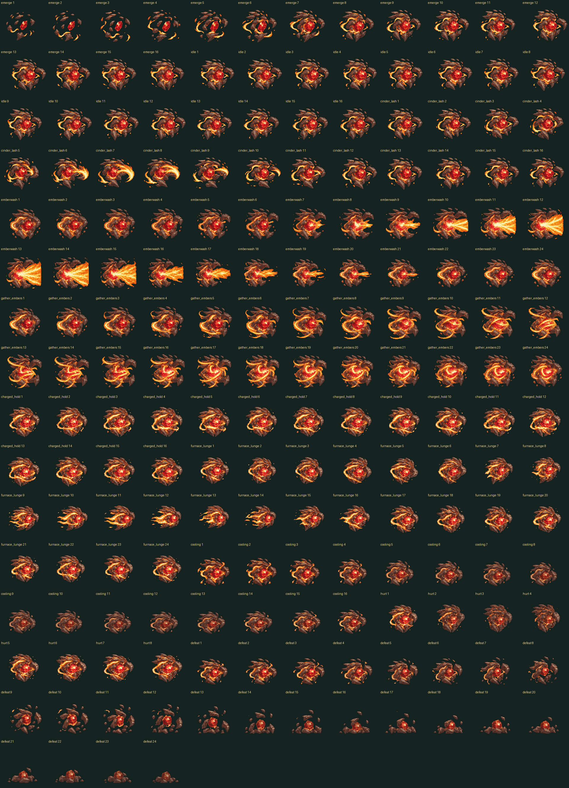

# Embravyr combat-art review

The contact sheet and animation preview show all **184 distinct authored
drawings** of the red-core Fire-Aether elemental. The final native sprites use
a shared 64-color palette, binary transparency and a 160×144 canvas with floor
anchor `(80, 128)`.



[Animation preview](animation.gif)

| State | Drawings | Source duration |
| --- | ---: | ---: |
| Emerge | 16 | 1,600 ms |
| Idle | 16 | 1,600 ms, loop |
| Cinder Lash | 16 | 1,200 ms; contact 600 ms |
| Emberwash | 24 | 1,600 ms; contact 800 ms |
| Gather Embers | 24 | 1,600 ms; casting boundary 800 ms |
| Charged Hold | 16 | 1,600 ms, loop |
| Furnace Lunge | 24 | 1,400 ms; contact 700 ms |
| Cooling | 16 | 1,600 ms, loop |
| Hurt | 8 | 480 ms |
| Defeat | 24 | 2,400 ms |

The GIF is an art review assembled from the actual exported frames; it is not a
recording of live gameplay. Its timing is subject to GIF’s 10 ms granularity.
Combat may use different action durations; runtime maps each action’s impact
to the recorded source contact boundary so anticipation and follow-through
retain every drawing. Per-frame metadata supplies the actual exposed red core,
casting origin, contact and floor anchors.

The four original source atlases and complete registration are retained in
`assets/source/combat/embravyr/`. Full runtime provenance is exported alongside
the animation manifest. There are no transformed duplicates added to inflate
the drawing count; disconnected mineral fragments and ribbons are preserved.

Regenerate and verify the 189 exports with:

```sh
python tools/build_embravyr_combat.py
python tools/build_embravyr_combat.py --check
```
