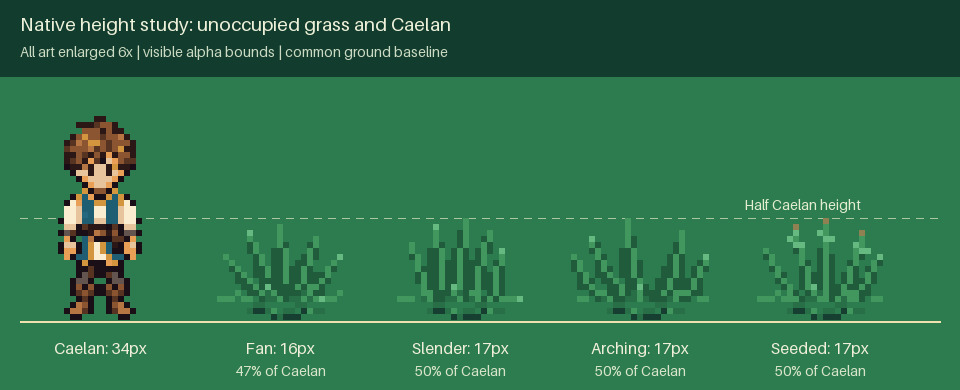

# Playable grass demonstration

[Full field](overview.png) · [Walking, running and standing](grass_walk.mp4)

The height study places unoccupied grass and Caelan on one visible ground
baseline at the same enlargement. It measures the opaque pixels, not the
transparent sprite canvases. The gameplay photographs separately show the
short foreground blades covering legs while the torso stays readable. Every
occupied movie frame is also compared with grass drawing disabled: opaque
head and torso pixels must remain identical, while leg overlap is observed.

This isolated prototype uses the actual game Player, camera and World rendering.
The review walks and runs through authored grass patches, holds still while the
grass remains displaced, then leaves it to recover. Every review position is
reached through ordinary movement; no character poses or bend states are staged.

The approved emerald palette and lawn, meadow and woodland materials also ship
in the shared production terrain pack. This separate demonstration remains
available for direct material and animation comparison. The launcher never
opens game journeys or settings files.

Run `python tools/preview_grass.py` to explore. Use WASD or arrows to move,
Shift to run, R to reset, M for reduced motion and Escape to exit.

Regenerate with `python tools/capture_grass_demo.py`; verify retained source,
artifact and live-world snapshot hashes with `python tools/capture_grass_demo.py --check`.
The [verification record](verification.json) contains actual positions, occupied
grass states, recovery, timings and the immutable source fingerprints.

Grass measures 16–17 opaque pixels beside Caelan's 34-pixel visible sprite.
Every idle and parting pose stays within that half-height limit. Foreground
blades reach at most five pixels above the roots, preserving the upper body.
The walkthrough checks **64,632 opaque upper-body
pixels**, with **0 occluded**; leg overlap
appears in **186 frames**.

The silent walkthrough contains **899 frames** over
**44.95 seconds**, at **960 × 640 / 20 fps**.
Movement, standing occupancy, recovery and live-world isolation checks pass.
