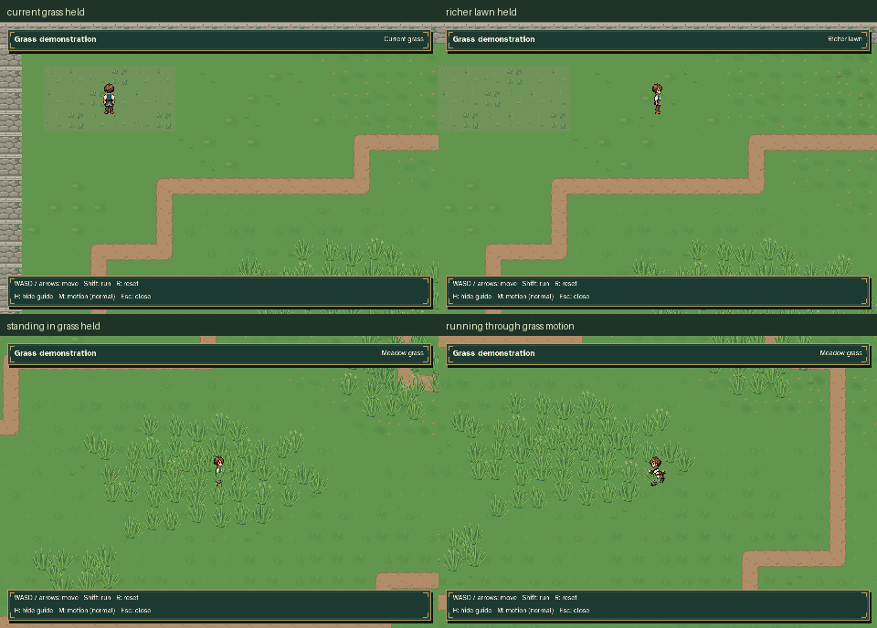

# Playable grass demonstration

[Full field](overview.png) · [Walking, running and standing](grass_walk.mp4)

This isolated prototype uses the actual game Player, camera and World rendering.
The review walks and runs through authored grass patches, holds still while the
grass remains displaced, then leaves it to recover. Every review position is
reached through ordinary movement; no character poses or bend states are staged.

The richer ground palette and lawn, meadow and woodland materials remain in
the demonstration. Eldenmere and the Sanctuary have not received the new pack.
The launcher never opens game journeys or settings files.

Run `python tools/preview_grass.py` to explore. Use WASD or arrows to move,
Shift to run, R to reset, M for reduced motion and Escape to exit.

Regenerate with `python tools/capture_grass_demo.py`; verify retained source,
artifact and original-world hashes with `python tools/capture_grass_demo.py --check`.
The [verification record](verification.json) contains actual positions, occupied
grass states, recovery, timings and the immutable source fingerprints.

The final silent video is **44.95 seconds**, **899 frames**, at **960 × 640 / 20 fps**.
It records 19 real movement/standing views; up to four clumps are occupied at
once, running reaches strength 2 while standing holds strength 1, and all grass
recovers after exit. The current and proposed ground palette can also be
compared on the [material board](../../../assets/terrain/grass_demo/materials_review.png).

Integration validation passed **6 tests and 32 subtests**, including real input,
native walk/run sprites, standing without repeated activation, recovery, and
head visibility in all four grass variants and facing directions for both gaits.
Grass overlaps lower-body pixels while leaving the head readable. The isolated
preview opens neither a journey store nor settings and launches successfully
from another working directory, writing only an explicitly requested screenshot.
Original world/grass reference hashes and capture checks pass; a deliberately
stale source fingerprint was rejected. The final contact sheet and native views
were visually inspected after the ground's dense repeated motifs were reduced.

Final regression validation passed **68 tests and 101 subtests**, covering the
grass lifecycle, playable preview, normal world rendering, party travel and
existing gallery isolation. Both asset and scene builders pass `--check`.
All **9,145** clear full-foot samples in the demonstration are connected, and
all 13 route goals were reached with production player movement. Independent
review also checked 1,224 actual idle/walk/run poses with no head-pixel loss.
The prototype adds its own assets and scene; original terrain and playable
maps remain byte-for-byte unchanged.
