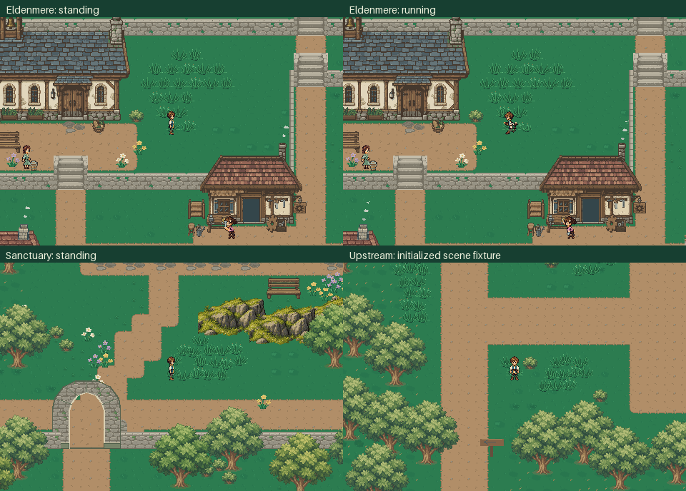
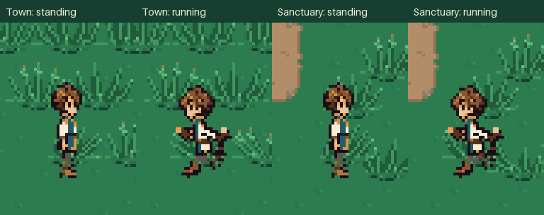

# Emerald grass in the game

[Walking, running, standing and recovery](emerald_grass.mp4)

The town and Sanctuary views use an ordinary disposable new exploration journey,
production Game movement and the normal town/overworld/Sanctuary contacts. Long
travel segments are omitted from the silent video. No quests, equipment or
character poses are seeded. Detail views are integer-enlarged crops of those
actual screenshots. The upstream still is explicitly an initialized production
World/Player fixture; it does not demonstrate the quest-gated transfer.

Grass parts during walking and running, remains parted while standing and
recovers after leaving. Every occupied review frame compares grass enabled and
disabled at the same real pose: opaque sprite pixels above row 25 remain identical,
while lower-body overlap is observed. The [verification record](verification.json)
retains counts, actual coordinates and final source/artifact fingerprints.

Regenerate with `python tools/capture_grass_rollout.py`; verify with
`python tools/capture_grass_rollout.py --check`. Captures use temporary save and
settings paths and do not modify journey files or map assets.

Final validation passes **189 tests and 3,126 subtests**, covering grass assets,
contact and visibility, journey resets, map geometry, party travel, Sanctuary
and mill travel, quest interactions, saves and Gallery sessions. Asset and map
build checks pass. Collision masks for all three detailed outdoor maps remain
byte-for-byte identical to the pre-rollout versions.

The final 17.8-second movie contains 356 frames at 960 × 640 / 20 fps.
Across the town and Sanctuary, 40,756 opaque upper-body pixel comparisons show
zero occlusion; leg overlap appears in 180 checked frames. Source/artifact
fingerprints and video metadata were verified after the journey-reset fix.
