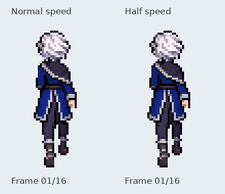

# Iselin rear walk — approved

Authoring rules live in the [global sprite and animation standard](../../SPRITE_ANIMATION_STANDARD.md).
This file retains asset-specific implementation details and review history;
older construction methods and review-stage wording are historical, not current
general instructions.

Sixteen whole-character drawings exported at42×72, using the established35ms
frame time and560ms two-step cycle. The user approved revision 3 for merge into main. These assets follow the
existing front/side animation format; runtime character replacement is separate.

[Numbered native drawings enlarged4×](frames_stable_body_v3.png).

The canonical reference is `assets/source/characters/iselin/idle_back_master.png`.
The mantle stays on anatomical right (viewer right); the braid turns forward
over anatomical left, so only its root/bend is visible from behind. No long
central rear ponytail is invented. The head, hair root, mantle and coat retain
the rear idle design while following the gait with small drawn variations.

Contact and passing keys were generated first. Short whole-frame transition
strips followed. The first strips exchanged legs too early in some candidates,
so a reference showing only the right-arm-trailing contact was used to redraw
the opening/closing transition. Complete poses were selected and ordered around
the left/right exchange. Unused candidate columns remain in the source artwork.

Arms and legs move in depth, with foreshortening and natural occlusion rather
than sideways kicks. A forward-reaching hand may be hidden; it is not drawn
through the coat. Boot soles are visible in trailing/lifted poses. The opposite
contact exchanges the visible trailing hand and lower boot. The complete
drawings include all overlaps; no limb rig, body-part assembly, spatial mirroring
or procedural posing is used.

Sources, selected columns, bounding rectangles, uniform scales, origins and
hashes are retained in `assets/source/characters/iselin/walk_back/redrawn/`.
The initial export used hard-alpha extraction, strip scales and ground-based
registration. Revision 3 below supersedes that body registration with audited
crown/belt landmarks. Rebuild: `python tools/export_iselin_back_walk.py`.

Checks cover16 distinct RGBA frames, hard alpha, bounds, timing, successful
Pygame loading, and the hand/boot exchange at opposing contacts. The native
sheet was visually inspected for complete silhouettes, costume sides, hand
count, left/right identities and transitions across strip joins. Such checks
support motion review; they do not certify precise joint angles or world-space
foot locking. The final in-place preview is approved and merged; runtime walking integration
remains separate.

## Right foot correction, revision 2

Audit found the right boot held high through frame 4, then dropping about nine
native pixels into frame 5. Frames 11–12 also had an abrupt height change.
Imagegen redrew complete four-pose strips with smaller right-foot lift and a
more gradual return to contact. Export protects every original pixel outside
x22–31, y48–71, retaining the arms, upper body, and left leg exactly.
No procedural limb translation, rotation, or stretching is used.

The revised right-boot bottom positions are
63, 62, 63, 65, 66, 69, 69, 69, 69, 68, 66, 63, 64, 64, 64, 65.
The largest adjacent change is three native pixels, including the loop seam;
the earlier nine-pixel drop is removed. This measures visible vertical motion,
not physical world-space foot locking. Frame timing remains 35ms.

[Initial preview](initial_preview.gif) and [initial frame sheet](initial_frames.png)
remain available for comparison. Frozen original frames and complete generated
correction drawings are in `redrawn/right_foot_revision/`; source hashes and
registration are recorded alongside the original generation records.

## Body stability correction, revision 3 (current)

The previous export used full drawing height and the lowest visible pixel to
scale and register poses from separate strips. Crown height jumped four native
pixels in frames 5 and 10, with inconsistent head and torso proportions.
Those frames are retained in `body_stability_v3/before_*.png` and the
[revision 2 preview](preview_right_foot_v2.gif).

New complete rear drawings use the first frame as a shared proportion reference.
The current upper-body export uniformly scales each complete source drawing
using its audited crown-to-belt distance, then aligns the crown horizontally
at x21. Foot position does not determine this registration. No independent
horizontal/vertical stretching is used. The crown follows y positions
3,3,2,2,3,4,4,3 twice per cycle: two pixels total excursion, with at most one
pixel of movement between adjacent frames, including the loop seam.

Measured exported crown-to-belt distance stays within one pixel of 27. Hair
silhouettes retain minor drawn variation (16–18 pixels wide, adjacent changes
at most one pixel). The corrected boots and lower shins, rows 54–71, remain
pixel-identical to revision 2. Regional coat/knee cleanup was generated as
complete drawings to remove stray old hem fragments at the revision boundary;
head, torso and boot pixels are protected during that cleanup. All review
outputs remain flattened complete RGBA sprites; no runtime limb rig is used.

`tools/iselin_back_walk_stability.py` and the two audited landmark manifests
record source crops, complete-drawing scales, origins, cleanup windows, bob
positions and source hashes. Original drawings and intermediate review strips
are retained. Focused checks cover actual exported crown/belt landmarks, loop
continuity, historical foot revision preservation, current boot preservation,
alpha, bounds, distinct poses, opposing contacts and timing. The numbered
sheet was inspected for coat continuity, body proportions and complete limbs.
The user approved this revision for merge into main.
