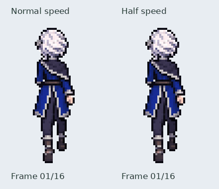

# Iselin rear walk — review pending

Sixteen whole-character drawings exported at42×72, using the established35ms
frame time and560ms two-step cycle. The review branch does not activate or merge
this cycle; approved front and side artwork remains unchanged.

[Numbered native drawings enlarged4×](frames.png).

The canonical reference is `assets/source/characters/iselin/idle_back_master.png`.
The mantle stays on anatomical right (viewer right); the braid turns forward
over anatomical left, so only its root/bend is visible from behind. No long
central rear ponytail is invented. The head, hair root, mantle and coat retain
the rear idle design while following the gait with small drawn variations.

Contact and passing keys were generated first. Short whole-frame transition
strips followed. The first strips exchanged legs too early in some candidates,
so a reference showing only the right-arm-trailing contact was used to redraw
the opening/closing transition. Complete poses were selected and ordered around
the left/right exchange. Unused candidate columns remain in the source artwork.

Arms and legs move in depth, with foreshortening and natural occlusion rather
than sideways kicks. A forward-reaching hand may be hidden; it is not drawn
through the coat. Boot soles are visible in trailing/lifted poses. The opposite
contact exchanges the visible trailing hand and lower boot. The complete
drawings include all overlaps; no limb rig, body-part assembly, spatial mirroring
or procedural posing is used.

Sources, selected columns, bounding rectangles, uniform scales, origins and
hashes are retained in `assets/source/characters/iselin/walk_back/redrawn/`.
Technical export performs hard-alpha extraction, one scale per source strip and
whole-drawing registration. Rebuild: `python tools/export_iselin_back_walk.py`.

Checks cover16 distinct RGBA frames, hard alpha, bounds, timing, successful
Pygame loading, and the hand/boot exchange at opposing contacts. The native
sheet was visually inspected for complete silhouettes, costume sides, hand
count, left/right identities and transitions across strip joins. Such checks
support motion review; they do not certify precise joint angles or world-space
foot locking. This remains an in-place animation preview for user approval.
