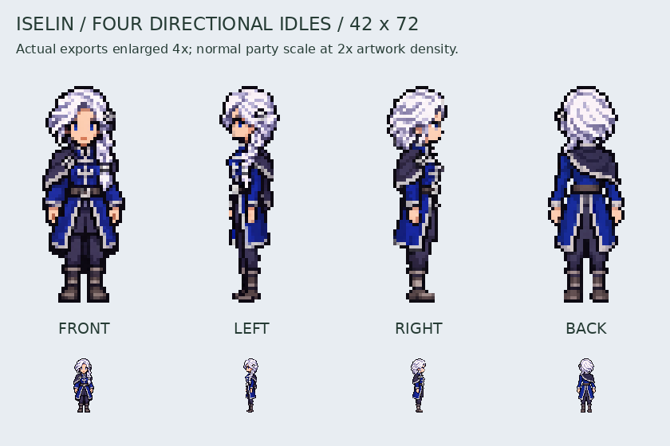
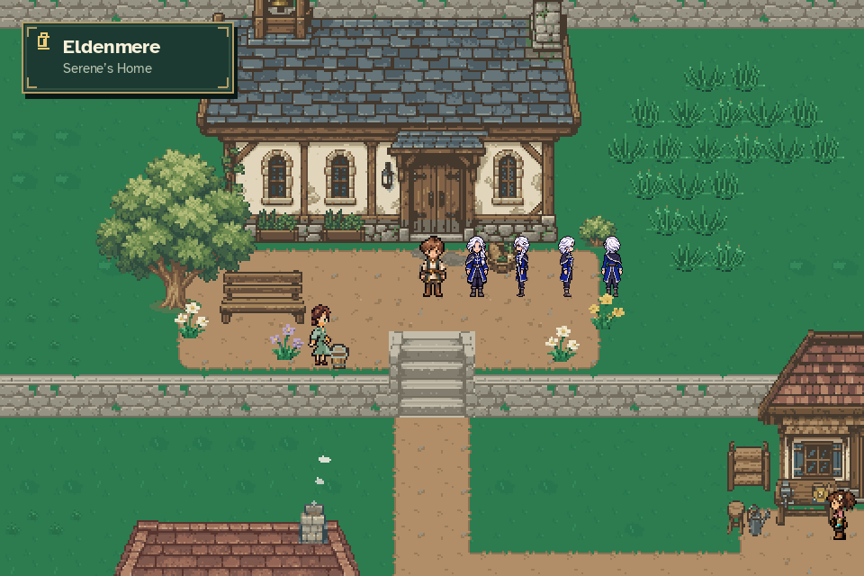

# Iselin directional idles

Authoring rules live in the [global sprite and animation standard](../../SPRITE_ANIMATION_STANDARD.md).
This file retains asset-specific implementation details and review history;
older construction methods and review-stage wording are historical, not current
general instructions.

The left, right and back views extend the approved 42×72 front idle. The front
artwork and portrait are unchanged. All four directions now register in the
existing idle actor and use the display-density renderer at normal party scale.
Walking and cinematic art remain separate work.

The braid remains on anatomical left, falling over the front of the shoulder;
the navy mantle and brooch remain on anatomical right. The left profile shows
the near-side braid, the right profile shows the near-side mantle and brooch,
and the rear shows the braid turning over the left shoulder rather than hanging
down the center of the back. Profiles are independently authored, not mirrored.

Generated sources are retained unchanged under `assets/source/characters/iselin/`
as `idle_left_master.png`, `idle_right_master.png`, and `idle_back_master.png`.
Each was generated with `image_gen.imagegen` using the approved front master
as its reference and explicit anatomical-side instructions. The directional
registration file records source hashes, extraction rectangles and scale.
Export only isolates alpha, scales the whole drawing uniformly with integer
rounding, and places it on the registered canvas. No limbs or faces are painted
procedurally. The canvas is 42×72, with a 68-pixel occupied height and a 21×36
logical fallback. All directions retain the same anchors and collision probe.

Rebuild: `python tools/export_iselin_first_assets.py`; verify with `--check`.
Capture: `python tools/capture_iselin_idles.py` in the game environment.
The capture uses temporary saves and does not place duplicate actors in a journey.
Visual inspection covers native/enlarged faces, braid/mantle sides, coat tails,
natural anatomy, outline, ground registration and the actual world renderer.
Focused tests cover all facings, conversation selection, density rendering,
non-mirrored profiles, collision, registration, depth, and animation ownership.
